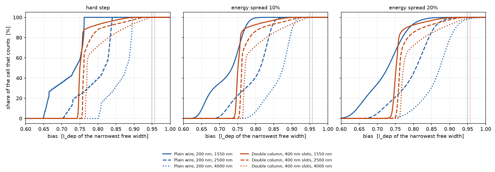
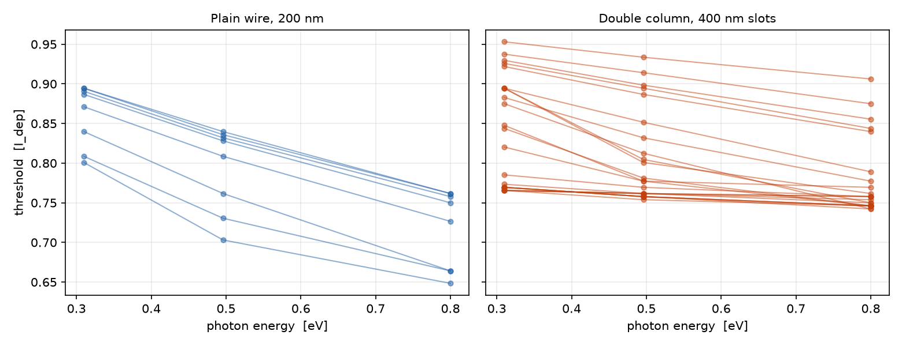
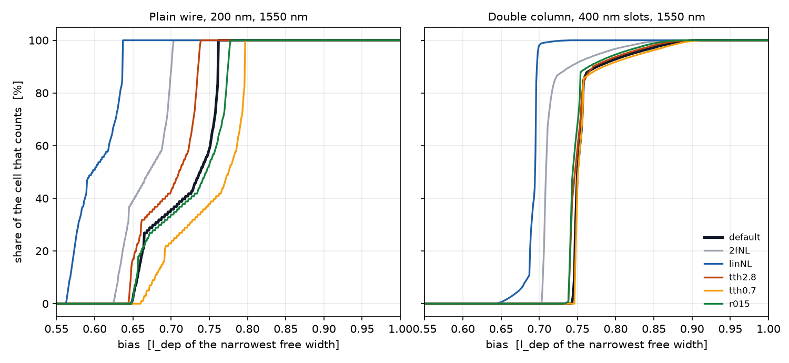
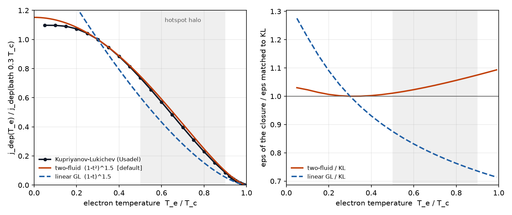

# The device: a double column of 400 nm slots

A 200 nm strip of 9 nm NbTiN with two aligned columns of slots, 40 nm everywhere:

    edge | 40 nm channel | 40 nm slot | 40 nm channel | 40 nm slot | 40 nm channel | edge

- Slots 400 nm long with semicircular ends; 40 nm bridges between consecutive slots (period 440 nm).
- Three 40 nm channels in parallel. The narrowest free cross-section is 120 nm (I_dep = 60.6 µA); at the bridge
  rows the full 200 nm carries the current.
- Simulated device (`geometry.DOUBLE_400`): the central slot pair with one neighbour on each side and 150 nm of plain
  lead to each terminal, 1.58 µm long, 11 squares between the voltage probes.
- References: `Plain_Wire` (200 nm, the same footprint), `Plain_120` (the free width), `Plain_40` (one channel).

The model is in [model.md](model.md), numerics in [methods.md](methods.md). Biases are in I_dep of the narrowest
free cross-section.

## 1 · What the earlier model found (branch `slot-geometries`, 7–9 Nov 2026)

These numbers used the previous photon and heat models (a calibrated ε-hotspot, linearised Joule heat, a current
source). They are kept as the baseline in `results/baseline_kinetic/`; the full record, with the single and
staggered columns, notches and longer slots, is `git show slot-geometries:docs/slots.md`.

| Site | voltage trigger, no heat | sustained, no heat | with heat |
| --- | --- | --- | --- |
| double column, channels | 0.665–0.681 | 0.80–0.83 | 0.78 |
| double column, slot-end zone | | | 0.78–0.83 |
| double column, bridge rows | 0.87–0.93 | 0.92–0.95 | 0.87–0.93 |
| plain 200 nm wire | 0.87–0.90 | 0.87–0.90 | 0.87–0.90 |
| plain 40 nm strip | 0.57 | | |

What that established, and what the new model has to confirm or correct:

1. **The channels work as a cascade**, like parallel nanowires (a SNAP): a photon blocks one 40 nm channel, its
   current moves to the other two, and they switch if they cannot carry it. The voltage trigger sat at the
   three-channel limit 1 − 40/120 = 0.67.
2. **Without heat the cascade healed**, leaving 2–5 flux quanta in the slots. The device stayed resistive only from
   0.80–0.83, so the two criteria were 0.15 apart. With heat the channels detected at 0.78, between the two.
3. **The bridge rows set the plateau.** They are 9 % of the cell length and needed 0.87–0.93, above the plain wire's
   worst site (0.90). With 400 nm slots the plateau test failed (i_95 0.901 against 0.899).
4. **Longer slots were the one lever that helped**: thresholds did not move, the bridge share shrank. Full heated
   maps gave i_95 0.842 (800 nm) and 0.821 (1200 nm). `geometry.double_column(800)` builds them.
5. **Why 400 nm and not 150:** with 150 nm slots the diverted current re-enters the same channel at the next bridge
   and the channels never reach the cascade (0.78–0.82 instead of 0.67).
6. **Method checks that carry over** (methods.md): the short device reproduces a 2 µm strip within 0.011; a 2.0 ξ
   mesh is within 0.019 of 1.4 ξ (channel sites 0.005) and 6–8× faster; dark switching 0.98–1.00.
7. **Limits that carry over:** no thermal noise (the dark switching current is an instability, not a dark-count
   rate; every slot end crowds the current to 1.7× the uniform value); real 9 nm NbTiN strips switch at 0.63 I_dep
   [40]; below threshold the slots keep trapped flux, so the device has memory.

## 2 · With the new model: first look (10 Nov 2026)

Screening runs only: 2.0 ξ mesh, the critical sites, 1550 nm, bath 0.3 T_c, 750 squares in series, a count when
the load carries 20 % of the bias. `results/thresholds/thr_n750_w1550_m2.csv`, `results/events/`,
`results/variants/`. Treat every number as ±0.02 until the 1.4 ξ check and a full map exist.

| Site | new model | previous, with heat | previous, trigger |
| --- | --- | --- | --- |
| plain wire, edge (−96, 0) | **0.664** | 0.866 | 0.872 |
| plain wire, (−58, 0) | **0.727** | 0.877 | 0.877 |
| plain wire, centre (0, 0) | **0.762** | 0.902 | 0.901 |
| double, edge channel (−96 / −80 / −64, 0) | 0.746 / 0.742 / 0.746 | 0.782 | 0.67–0.68 |
| double, centre channel (−16 / 0, 0) | 0.758 / 0.754 | 0.78 | 0.67 |
| double, edge channel beside a bridge row (−80, 220) | 0.750 | 0.870 | 0.869 |
| double, centre channel beside a bridge row (0, 220) | 0.840 | 0.902 | 0.901 |
| double, slot end (−40, 204) | 0.875 | 0.919 | 0.923 |
| double, bridge centre (−40, 220) | 0.906 | 0.933 | 0.933 |
| dark switching: plain wire / double | 0.949 / 0.957 | | 0.997 / 0.981 |

**1. At 1550 nm the slots no longer help.** The energy-calibrated photon is stronger than the old "f = 1": it makes
a normal core about 40 nm across for 20–30 τ0. In the plain 200 nm wire that is enough to start a belt at
0.66–0.76 I_dep, 0.14–0.20 lower than before. The channels of the double column moved by only 0.03 (0.74–0.76),
because they were never limited by the photon: a 40 nm channel is blocked either way, and the threshold is set by
whether the other two channels and the heat carry the cascade through. So the plain wire is now as sensitive as
the channels at its centre and more sensitive towards its edges, and the bridges (0.84–0.91) are an insensitive
tail that the plain wire does not have.

**2. For a lower-energy photon the advantage comes back.** With 4000 nm (0.31 eV) at 0.80 I_dep the double
column's edge channel counts and the plain wire at (−58, 0) does not; both count at 0.90. The channel threshold
barely depends on the photon's energy as long as the photon blocks 40 nm; the plain wire's threshold rises as the
photon weakens. The crossover wavelength is somewhere between 1550 and 4000 nm and has not been located.

**3. What a count looks like** ([event at 0.80](../results/events/Double_400_-80_0_i0.800_n750_w1550_m2.png)).
The hit channel is blocked within 30 τ0 and its current moves to the other two (a small voltage step). About
150 τ0 later the other channels switch, the slotted section between two bridge rows goes normal (3.3 squares,
its geometric resistance), and the circuit takes 65 % of the current out of the detector by 500 τ0. The normal
domain stops at the bridge rows, where the full 200 nm carries the current. At 0.70 the same photon gives 2.5
phase slips and the device heals. A bridge-row photon at 0.90 does nothing visible for 410 τ0 and then starts to
switch.

**4. Area-weighted efficiency is not yet known.** Interpolating nine sites gives i_50 0.78 and i_95 0.87 for the
double column against 0.73 and 0.76 for the plain wire, but the interpolation spreads the bridge-row values along
the whole centre channel (`thr_n750_w1550_m2_map.png`), so the double column's numbers are pessimistic. The sign of
the comparison does not depend on it: every double-column site is at or above the plain wire's centre. A full map
(63 sites) is the run that settles the numbers.

**5. Dark switching in the model is set by the contacts.** With heat, the plain wire's dark switching (0.949) starts
at both normal terminals and runs inward
([event](../results/events/Plain_Wire_dark_i0.955_n750_w1550_m2.png)). The double column is quiet for 800 τ0 at
0.90 and 0.95, because its 200 nm leads carry 0.6 of the plain wire's current density at the same i. Thresholds
above about 0.93 should not be trusted until the contacts are made harmless (wider leads, or a raised T_c next to
them as Zotova & Vodolazov do).

**6. How firm is the comparison?** Events just below and above the thresholds, with one model ingredient changed
at a time ([model.md](model.md) §8), show that the channel threshold is robust to the photon's details (radius,
deposit time) and that the plain wire's is not: with τ_th = 0.6 ps instead of 1.4 ps the plain wire at (−58, 0)
no longer counts at 0.75 while the channel still counts at 0.76. So at 1550 nm the two devices are within the
model's uncertainty of each other in the channels. The bridges are not: they are 0.08–0.15 above the plain wire in
every variant tried.

## 3 · What this means for the design

- The earlier "onset gain of 0.10" came from a photon too weak to open a belt in a 200 nm strip. With hν tied to
  the measured heat capacities, a 1550 nm photon is strong enough, and the gain disappears.
- The slots are a way to make a wide strip respond like a 40 nm wire. That pays when the photon is too weak for
  the wide strip: longer wavelengths, or a film in which the same photon makes a smaller hot spot (larger heat
  capacity, thicker film, higher T_c).
- The lever found earlier still applies: longer slots shrink the bridge share (`Double_800`, `Double_1200`).
- **Before changing the design**, three things decide whether point 1 stands: the 1.4 ξ mesh, the photon's
  thermalisation time for NbTiN, and above all a measured anchor. Real 200 nm NbTiN strips either show a saturated
  1550 nm plateau below their switching current (0.63 I_dep) or they do not; the model says a plain strip needs
  0.66–0.76 I_dep, so it predicts no full plateau at 1550 nm for a strip that switches at 0.63. If your own or
  KTH's data disagree, the absolute photon scale is still off and that is the number to fix first.

## 4 · Photon energy: 1550, 2500 and 4000 nm (night of 11–12 Nov 2026)

`energy_scan.py` → `results/thresholds/thr_n750_w{1550,2500,4000}_m2.csv`; `energy_analysis.py` →
`results/energy/` (summary.txt, efficiency_vs_energy.png, threshold_vs_energy.png).

**Set-up**
- The same model as §2: 2.0 ξ, 750 squares, bath 0.3 T_c, a count at 20 % in the load.
- Plain wire: its full 8-site grid. The strip symmetry makes this exact across the width.
- Double column: a 23-site medium grid at all three energies, plus the full 63-site map at 1550 nm.
- 121 thresholds in 7.5 h on 11 workers; no failures.

**Thresholds against photon energy** (I_dep of the narrowest free width)

| Site | 0.80 eV (1550) | 0.50 eV (2500) | 0.31 eV (4000) | shift 1550 → 4000 |
| --- | --- | --- | --- | --- |
| plain wire, edge (−96 / −88, 0) | 0.664 / 0.648 | 0.731 / 0.703 | 0.809 / 0.801 | +0.15 |
| plain wire, (−58, 0) | 0.727 | 0.809 | 0.871 | +0.14 |
| plain wire, centre (0, 0) | 0.762 | 0.840 | 0.894 | +0.13 |
| double, channels, y = 0–180 (11 sites) | 0.742–0.758 | 0.754–0.762 | 0.766–0.773 | **+0.01 to +0.03** |
| double, channel ends, y = 200–210 | 0.746–0.777 | 0.769–0.832 | 0.785–0.883 | +0.04 to +0.11 |
| double, slot end (−56 / −40 / −24, 204) | 0.742 / 0.875 / 0.789 | 0.812 / 0.914 / 0.852 | 0.875 / 0.938 / 0.894 | +0.06 to +0.13 |
| double, bridge row (y = 220, 6 sites) | 0.750–0.906 | 0.801–0.934 | 0.894–0.953 | +0.05 to +0.14 |
| dark switching: plain / double | 0.949 / 0.957 | | | |

**Efficiency, hard step**

| | i_50 | i_90 (= I_det, 90 % of plateau) | i_99 | η(0.80) | η(0.90) |
| --- | --- | --- | --- | --- | --- |
| plain, 1550 nm | 0.739 | 0.762 | 0.762 | 100 % | 100 % |
| double, 1550 nm (full map) | 0.749 | 0.762 | 0.879 | 93 % | 100 % |
| plain, 2500 nm | 0.819 | 0.838 | 0.840 | 40 % | 100 % |
| double, 2500 nm (medium grid) | 0.762 | 0.815 | 0.913 | 88 % | 98 % |
| plain, 4000 nm | 0.879 | 0.895 | 0.895 | 0 % | 100 % |
| double, 4000 nm (medium grid) | 0.770 | 0.878 | 0.938 | 72 % | 94 % |

**What it shows**

1. **The hypothesis holds.** As the photon gets weaker, the plain wire loses sensitivity much faster than the
   double column's channels:
   - Plain wire, every site: +0.13 to +0.15 from 0.80 to 0.31 eV.
   - Double column, channel sites: +0.01 to +0.03.
   - The double column's onset (i_50) moves 0.750 → 0.770; the plain wire's 0.739 → 0.879.
   - At 0.80 I_dep and 4000 nm, 72 % of the double column's cell counts and none of the plain wire's.
2. **The onset crossover is near 1650 nm (about 0.75 eV)** (linear interpolation of i_50 between 1550 and 2500 nm).
   At 1550 nm the plain wire is still 0.01 ahead at i_50, and the same at i_90 (0.762 against the full map's 0.762).
   From 2500 nm on, the double column is ahead by 0.06 (2500) and 0.11 (4000) at i_50.
3. **Why the channels barely care:** a 40 nm channel is blocked by any of these photons, and the count is decided
   by the cascade and the heat, not by the photon. The plain wire needs the photon to start a belt across 200 nm,
   which costs bias as the hot spot shrinks.
4. **The bridges still set the plateau, and they are energy-sensitive.**
   - The bridge rows and slot ends behave like the plain wire, since the full 200 nm carries the current there.
     They rise by 0.05–0.14.
   - So the double column's advantage shrinks from i_50 to i_90: at 4000 nm it is 0.11 at i_50 but only 0.017 at
     i_90.
   - Its i_99 (0.938) is above the plain wire's (0.895), close to dark switching (0.957).
   - Longer slots (`Double_800`, `Double_1200`) shrink exactly this tail. At low photon energy they are the case
     to run next.
5. **The energy spread changes little.** With a 10–20 % spread of the deposited energy, the plain wire's curves
   broaden, because its threshold depends steeply on energy. The channels' do not. No conclusion changes:
   - 4000 nm, 20 % spread: i_90 is 0.918 (plain) and 0.883 (double).
   - η(0.80) is 10 % (plain) and 72 % (double).

**Caveats**
- At 2500 and 4000 nm the double column is interpolated from the medium grid. At 1550 nm that grid gives the same
  i_50 and i_99 as the full map, but i_90 0.014 too high. So the 2500 / 4000 nm i_90 values are slightly
  pessimistic for the double column.
- 2.0 ξ screening mesh; ±0.02 as in §2.
- Plain-wire thresholds above about 0.93 would be suspect because of the contacts (§2.5); at 4000 nm the plain wire
  tops out at 0.895.
- The photon energy is the only parameter changed. The absorbed fraction, r0 and τ_th are as at 1550 nm. §5 tests
  them: the model sees only the deposited energy, and τ_th and r0 move thresholds by ≤ 0.03.

## 5 · Model uncertainty: deposited fraction, first picosecond, ε closure (12–13 Nov 2026)

Three assumptions of the hotspot model were tested at 1550 nm with the same set-up as §4 (2.0 ξ, 750 squares,
plain wire 8 sites, double column 23-site medium grid).

- `energy_scan.py --photon … --thermal … --label …` writes each variant to its own file,
  `results/thresholds/thr_n750_w1550_m2_<label>.csv`.
- `sensitivity_scan.py run | report` runs the five variants of §5.2 in one pool and writes
  `results/energy/summary_sensitivity.txt` and `sensitivity.png`.
- `closure_kl.py` computes the Kupriyanov–Lukichev depairing current (no TDGL) → `results/closure/`.
- `energy_analysis.py` also writes `results/energy/summary_abs0.5.txt` and `efficiency_abs0.5.png`.

### 5.1 The model sees only the deposited energy

`absorbed = 0.5` at 1550 nm deposits 0.400 eV. Before the run, each site's threshold was predicted by interpolating
the 0.31 / 0.50 / 0.80 eV runs of §4 in ln E (`results/energy/prediction_abs0.5.csv`).

| | measured − predicted, mean | worst site |
| --- | --- | --- |
| plain wire (8 sites) | +0.002 | 0.004 |
| double column (23 sites) | +0.001 | 0.021 (bridge row, y = 220) |

So the thresholds depend on hν × absorbed and on nothing else. Consequences:
- **The energy axis of §4 is the deposited energy** (0.80 / 0.50 / 0.31 eV), not the wavelength. The deposited
  fraction of a real NbTiN film is not measured; Simon et al. lose about 25 % to the substrate, and literature
  values of 0.3–0.6 are quoted from memory, not checked.
- **If half of a 1550 nm photon is deposited**, the slots already win at telecom wavelength:

| 1550 nm | i_50 | i_90 | i_99 | η(0.80) |
| --- | --- | --- | --- | --- |
| plain, absorbed 1.0 | 0.739 | 0.762 | 0.762 | 100 % |
| plain, absorbed 0.5 | 0.848 | 0.865 | 0.867 | 26 % |
| double, absorbed 1.0 | 0.750 | 0.776 | 0.875 | 93 % |
| double, absorbed 0.5 | 0.765 | 0.848 | 0.927 | 78 % |

- The analytic energy spread of §4 is consistent with the dynamics: a photon that deposits E behaves exactly like
  the simulated photon of energy E.
- Simon's 0.75 (0.60 eV at 1550 nm) needs no run: it lies between the 0.50 and 0.80 eV results.

### 5.2 Sensitivity runs

| label | change | question |
| --- | --- | --- |
| `tth0.7`, `tth2.8` | τ_th = 0.7 / 2.8 ps (default 1.4) | first picosecond: how fast the energy arrives |
| `r015` | r0 = 15 nm (default 5) | first picosecond: how wide it arrives |
| `2fNL` | latent heat off | latent heat; reference for `linNL` |
| `linNL` | linear GL ε = (1 − t)/(1 − t0), latent heat off | ε closure (latent heat needs the two-fluid entropy) |

155 thresholds, 9.5 h on 11 workers, no failures.

**Mean threshold shift against the default model** (I_dep)

| variant | plain wire | double: channels (y ≤ 180) | double: bridge rows (y > 180) | largest single site |
| --- | --- | --- | --- | --- |
| τ_th 0.7 ps | +0.033 | +0.002 | +0.009 | 0.047 |
| τ_th 2.8 ps | −0.020 | −0.003 | −0.006 | 0.027 |
| r0 15 nm | +0.007 | −0.004 | −0.013 | 0.024 |
| latent heat off | −0.048 | −0.042 | −0.039 | 0.070 |
| linear ε, latent off | −0.113 | −0.057 | −0.112 | 0.192 |
| *closure alone (`linNL` − `2fNL`)* | *−0.065* | *−0.015* | *−0.073* | |

**Plain wire minus double column** (negative: the plain wire is ahead)

| variant | Δi_50 | Δi_90 | Δi_99 |
| --- | --- | --- | --- |
| default | −0.011 | −0.014 | −0.113 |
| τ_th 0.7 ps | +0.025 | +0.012 | −0.089 |
| τ_th 2.8 ps | −0.036 | −0.035 | −0.126 |
| r0 15 nm | +0.003 | +0.010 | −0.075 |
| latent heat off | −0.037 | −0.040 | −0.133 |
| linear ε, latent off | −0.097 | −0.060 | −0.069 |

### 5.3 The ε closure against the Usadel depairing current

pyTDGL's depairing current scales as ε^{3/2}, so the closure ε(T_e) fixes j_dep(T_e). `closure_kl.py` solves the
Usadel equation of a dirty superconductor with a uniform supercurrent, maximises the current over the pair-breaking
parameter (Kupriyanov & Lukichev 1980) and defines the matched closure ε_KL = (j_KL(t)/j_KL(t0))^{2/3}. Checks:
Δ(0.05 T_c) = 1.764 T_c; Δ(0.99 T_c) = 0.305 against the GL limit 0.306.

| T_e / T_c | two-fluid ε / ε_KL | linear ε / ε_KL |
| --- | --- | --- |
| 0.5 | 1.016 | 0.82 |
| 0.6 | 1.035 | 0.76 |
| 0.7 | 1.059 | 0.71 |
| 0.8 | 1.085 | 0.67 |
| 0.9 | 1.115 | 0.63 |

In the hotspot halo (0.5–0.9 T_c), where the crowded current decides a count, the default two-fluid closure is
2–11 % stronger than KL; linear GL is 18–37 % weaker. The two-fluid − KL gap is 8–22 % of the two-fluid − linear
gap, so a KL closure would move thresholds by roughly −0.005 to −0.015 (plain wire, bridges) and −0.002 (channels).
This is an estimate scaled from `linNL`, not a run.

### 5.4 What it means

1. **The first picosecond is a small effect.** τ_th and r0 move the double column by ≤ 0.013 and the plain wire by
   ≤ 0.033. The plain wire reacts to the timing of the deposit (τ_th), hardly to its width (r0). A 40 nm channel
   is blocked whatever the details. The thermal-electron approximation is adequate for the comparison.
2. **At 1550 nm the two geometries tie within the model uncertainty.** The default i_50 gap (0.011) is smaller than
   the τ_th and r0 shifts, and two variants put the double column ahead. The crossover of §4 (about 1650 nm) is
   uncertain by a few hundred nm. The advantage of the slots at lower deposited energy (+0.13 to +0.15 on the
   plain wire against +0.01 to +0.03 in the channels, §4) is much larger and holds.
3. **The bridges are a robust weakness.** In every variant the plain wire's i_99 beats the double column's by
   0.07–0.13.
4. **Latent heat** shifts both geometries by about −0.04 alike.
5. **The closure is the largest lever, but the default is close to theory.** Wide parts (plain wire, bridges)
   react to the halo's strength; channels do not. Linear GL is far from KL, two-fluid is not, so no rerun.
6. **Remaining model uncertainty at 1550 nm:** about ±0.03 on the plain wire and ±0.01 on the double column,
   comparable to the 2.0 ξ mesh error.

**Calibration gap, still open.** Real 9 nm NbTiN devices switch at I_C/I_dep = 0.63 (Sidorova) and count
1550 nm photons, so their thresholds are below 0.63. The model's lowest 1550 nm threshold is 0.648 (plain-wire
edge). None of the tested assumptions closes the gap in a defensible way:
- lowering the deposited fraction raises the thresholds;
- τ_th and r0 move them by ≤ 0.03;
- the linear closure reaches 0.60, but only because linear GL is wrong in the halo.

The most likely cause is edge defects of the real wire, which lower both I_C and the local thresholds; the ideal
strip has none. Comparisons between geometries are robust; absolute bias values are not calibrated.
