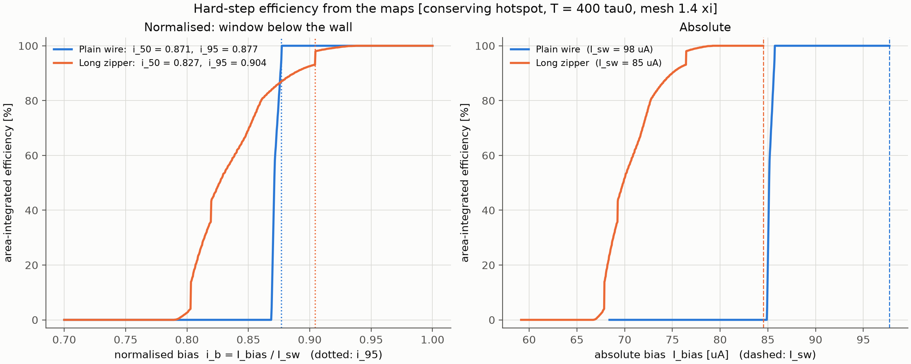
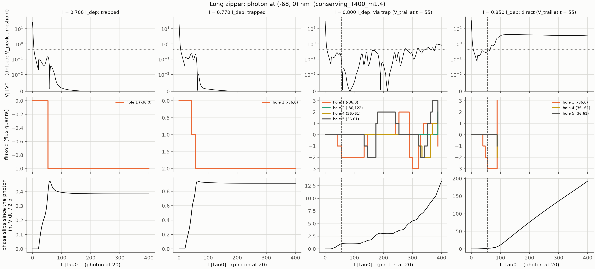

Thesis status report · 30 October 2026
# Perforated SNSPD nanowires: where the TDGL study stands

An update of the 28 October report, covering everything in the repository: the question, the code and how it is organised, the model and its sources, every result that is still current, the checks behind them, the new flux-trapping study, and a critical reading of what the results can and cannot support.

Afonso Dias · pyTDGL 0.9.0 · branch `repo-cleanup` (8 commits ahead of `main`) · replaces the 29 Oct version of this report and the [28 Oct report](https://claude.ai/artifact/LyWWELRdvDbnigHJ4EBX7Y)

> **Status, 30 Oct.** The re-run with the sustained criterion is finished and committed. Its two criteria are read as **bounds** on the detection threshold: the voltage trigger (v2) is a lower bound and sustained switching (v3) an upper bound, because the model has no Joule heating to keep a strip resistive (§4.4). A fabrication-feasible single column of slots in a 2 µm strip has now been run under both bounds and does not lower the plateau either (§9b); those results are not yet committed.

## Summary

1. **Holes still do not widen the detection window.** The long zipper (two staggered columns of 16 × 110 nm holes) saturates no earlier than the plain 200 nm wire under every criterion, window, mesh and hotspot model tried. At 400 τ0 and 1.4 ξ the plateau i_95 is 0.853 vs 0.850 I_dep under both bounds, and i_max is 0.907 vs 0.850. Go / no-go: 0 of 3 criteria (v3).
2. **Much of the zipper's earlier turn-on is flux trapped in the holes.** Below threshold, a photon leaves one or two flux quanta in a hole, with no voltage signal: over 59 % of the unit cell at 0.70 I_dep and 85 % at 0.75. Between 0.78 and 0.81 I_dep the zipper switches only after this trapped flux starts to hop, 80–250 τ0 after the photon. The zipper's i_50 is 0.795–0.805 between the two bounds against 0.845 for the plain wire. Counting only prompt switches it is 0.823 (flux scan), an onset gain of 0.027 instead of 0.05.
3. **The narrow-strip control now depends on the criterion.** With the voltage trigger, a 56 nm strip beats the zipper by about 0.2 I_dep (i_50 0.603, i_95 0.614). With the sustained criterion every strip from 30 to 100 nm switches at 0.82 ± 0.01 I_dep, whatever photon it absorbs. Without heat, a narrow strip that goes resistive heals again: the 30 nm strip at 0.75 I_dep slips 65 phases (about 10 eV) and then recovers. Neither bound is the real device, so this comparison needs a heat model.
4. **Every geometry switches at the depairing current of its narrowest cross-section** (I_sw/I_dep = 0.968–0.971 at 400 τ0). Holes only remove cross-section.
5. **Trapped flux gives the zipper a memory.** A trapped state survives at zero bias. It lowers the device's switching current from 0.968 to 0.79–0.91 I_dep, and it shifts the threshold for the next photon by −0.03 to +0.06 I_dep (v3), depending on where that photon lands. A plain strip has nothing comparable.
6. **The method was tightened three times, each time because a check exposed an artefact.**
   - A channel-collapse branch fired with no voltage.
   - The voltage trigger fired on flux moving from hole to hole.
   - A sustained test applied only inside the window was fooled by late rearrangements.

   The plain wire's thresholds were unaffected each time. The zipper's quantiles moved by about 0.01. The narrow strips' moved by up to 0.49, which is what exposed the missing heat (§4.4).
7. **Fabrication-feasible slots do not lower the plateau either.** The best case, 400 nm slots, has i_95 0.849–0.860 against 0.851 I_dep for the plain 2 µm wire. The slowest sites are in the bridges between slots (§9b).
8. **Position:** the negative result on the plateau is robust. The onset and the narrow-strip comparison sit between two bounds that only a heat model can merge (§12, item 3). The bridges are not mesh-converged for anything that involves trapped flux: the [0 −2] state switches at 0.786 on the 1.4 ξ mesh and 0.845 on the 0.8 ξ mesh.

## 0 · How everything fits together

Start here if you are lost. The project does one thing many times: **for a given device, find the lowest bias at which a photon landing at a given spot gets detected.** Everything else is bookkeeping around that number.

**One threshold, step by step**

| Step | What happens | Where |
| --- | --- | --- |
| 1. Device | Strip size and hole layout, plus the photon sites to test | `snspd/geometry.py` |
| 2. Mesh | The film is cut into triangles, about 4 nm across on the standard "1.4 ξ" mesh | `sim.make_device` |
| 3. Dark switching current | Bisect the bias with no photon to find I_sw, the most the device can carry | `sim.bisect` |
| 4. Photon | A hotspot weakens superconductivity around the site at t = 20 τ0, then spreads and fades | `snspd/hotspot.py` |
| 5. One run | pyTDGL solves the equations at one fixed bias for 400 τ0 | `sim.solved` |
| 6. Was it a detection? | Probe voltage is checked: trigger only, or trigger plus staying resistive | `sim.detect`, `sim.settle` |
| 7. Threshold | Steps 5–6 repeat about 8 times, bisecting the bias, to give i_det at that site | `sim.bisect` |
| 8. Efficiency curve | Thresholds over the unit cell become a map. The area fraction detected at each bias gives i_10, i_50, i_95, i_max | `snspd/analysis.py` |
| 9. Comparison | Devices are compared by those numbers, in units of I_dep | `hitmap.py report` |

**The two numbers that matter most:** i_50 is the turn-on (half the area detects) and i_95 is the plateau (nearly all of it detects). The thesis question is whether holes lower i_95, because a lower plateau means a wider working window below I_sw.

**Which script answers which question**

| Question | Script | Results |
| --- | --- | --- |
| Do holes beat the plain wire? | `hitmap.py` | `results/hitmap/`, `results/slots/` |
| How does a plain strip depend on width? | `narrow_baseline.py` | `results/narrow_baseline/` |
| What does a photon leave behind in the holes? | `fluxtrap.py` | `results/fluxtrap/` |
| Are the map's assumptions valid? | `checks.py` | `results/v1_voltage_or_collapse/checks/` |

**Which document says what**

| File | Purpose | Read it when |
| --- | --- | --- |
| `docs/report.md` (this file) | The full story: why, how, results, critique, references | You want to understand the project |
| `README.md` | Working manual: layout, commands, model settings, current numbers, next steps | You want to run something or look up a number |
| `results/v1_voltage_or_collapse/README.md` | What the first criterion was and why it was dropped | You open that folder |
| `results/v2_voltage_trigger/README.md` | What the voltage-trigger results are; they are now the lower bound | You open that folder |
| `archive/README.md` | What each old script was, and why its numbers should not be quoted | You come across old work |
| `docs/SNSPD geometries beyond hole arrays.md` | Literature review of other geometries | You want design ideas |

**Which numbers are current**

| Folder | Criterion | Status |
| --- | --- | --- |
| `results/hitmap/`, `narrow_baseline/`, `fluxtrap/` | v3, sustained switching | Current upper bound; devices at 0.8 µm |
| `results/slots/` | v3 and voltage trigger | Running; 2 µm strips |
| `results/v2_voltage_trigger/` | voltage trigger | Current lower bound, for the same devices |
| `results/v1_voltage_or_collapse/` | voltage or collapse | History; do not mix with the above |
| `archive/unreliable/` | various | Do not quote |

## 1 · The question and the devices

A superconducting-nanowire single-photon detector (SNSPD) is biased just below its switching current I_sw. An absorbed photon then drives a resistive transition that is read out as a voltage pulse [[6](#r6), [7](#r7)]. Detection becomes efficient only above a threshold bias, the onset of the "plateau". The thesis asks whether perforating the strip with internal holes lowers that threshold relative to the dark switching current, giving a wider detection window 1 − i_95. Edge structures (banks, rails) were tried once and then parked, to keep the study on internal holes.

**Devices (strip along y, current along y; 9 nm thick; 0.8 µm long unless stated)**

| Device | Holes | Narrowest free width | I_dep | Status |
| --- | --- | --- | --- | --- |
| Plain wire | none, 200 nm wide | 200 nm | 100.8 µA | reference |
| Long zipper | 7 ellipses, 16 × 110 nm, in two columns at x = ±36 nm, staggered by half the 122 nm period; 12 nm bridges, three 56 nm channels. Centres: (−36, −122), (−36, 0), (−36, 122), (36, −183), (36, −61), (36, 61), (36, 183) nm | 173 nm | 87.35 µA | current |
| Narrow plain strips | none, 30 / 56 / 100 nm wide | = width | 15.1 / 28.2 / 50.4 µA | control |
| Plain wire, 2 µm | none, 200 nm wide, 2 µm long | 200 nm | 100.8 µA | reference for the slots |
| Slot column (`Slot_110`, `Slot_200`, `Slot_400`) | one centred column of 30 nm wide slots, 110 / 200 / 400 nm long (7 / 5 / 3 slots), 40 nm bridges, two 85 nm channels, 2 µm long | 170 nm | 85.7 µA | done, both bounds (§9b) |
| Edge-bank strip | none; ε = 1 bands of width b around a centre weakened to ε_c | 200 nm | profile-dependent | parked |
| 2×2, staggered 2-1-2, 2- and 3-channel columns, short zipper | see the 28 Oct report §1 | 128–180 nm | — | archived |

## 2 · The repository today

On 28 October the project folder was reorganised. Three scripts with about 90 % shared code (`photon_hitmap_v2.py`, `narrow_baseline.py`, `edge_bank.py`) were rebuilt on a small library, `snspd/`. A regression check confirmed that the new code regenerates every stored summary with identical numbers: narrow-strip and edge-bank quantiles agree within 0.001, and live thresholds within the bisection tolerance. Everything unreliable or superseded moved to `archive/`, which has its own README explaining why. Results are now tagged by hotspot, window and mesh, and grouped by detection criterion so that runs made under different criteria can never be mixed.

**Layout (about 3,200 lines of current Python)**

| Path | What it does |
| --- | --- |
| `snspd/units.py` | Film parameters and unit system: K0, j_dep, τ0, Pearl length; checked against pyTDGL's own `device.K0` |
| `snspd/geometry.py` | Strips and hole layouts, photon-hit grids, unit cells and symmetry rules. New hole layouts go here. |
| `snspd/hotspot.py` | Photon hotspot as ε(r, t): an energy-conserving finite-element diffusion model ("conserving"), and the older free-space Gaussian ("legacy") |
| `snspd/sim.py` | Device and mesh; one TDGL run; the detection criterion; bisection; the current-crowding run; a process-pool runner; seeding a run from a saved state |
| `snspd/fluxoid.py` | Flux quanta held by each hole, from the winding of the order-parameter phase |
| `snspd/analysis.py`, `store.py`, `plotting.py` | Threshold maps, efficiency curves and quantiles; resumable CSV/JSON storage; figure style |
| `hitmap.py` | Photon-threshold maps of any registered devices against a reference; crowding; selectivity; pre-registered go / no-go test. `--criterion trigger` gives the lower bound. |
| `narrow_baseline.py` | Plain strips of any width: narrow-wire control and width scan |
| `checks.py` | Tests of the map assumptions: symmetry images, the unsimulated edge band, trigger delay vs bias |
| `fluxtrap.py` | Flux trapping: an outcome scan over every site and bias; the switching current of the trapped states, and their response to a second photon; single-site traces. |
| `results/` | `hitmap/`, `narrow_baseline/`, `fluxtrap/` hold the current zipper-era results and `slots/` the slot study. `v1_voltage_or_collapse/` and `v2_voltage_trigger/` hold the results of earlier criteria, each with a README. |
| `archive/` | `unreliable/` (do not quote), `superseded/` (valid but coarse), `pre_refactor/`, `exploration/`. 722 MB, mostly solver files ignored by git. |
| `parked/edge_bank/` | The edge-bank study, on hold until the hole study is written up |
| `docs/` | This report and its older figures (`fig/`); literature review "SNSPD geometries beyond hole arrays" |
| `tests/` | Early single- and two-hole tests (not maintained) |

Every run is resumable: finished thresholds are appended to a CSV and skipped next time. A 400 τ0 run at 1.4 ξ takes about 16 s on one core for a 0.8 µm strip, and about a minute for a 2 µm strip when the continuation is included. On the laptop (6 performance and 10 efficiency cores), more than about 9 parallel workers slows every run down sharply.

**Commits on `repo-cleanup`**

| Commit | Content |
| --- | --- |
| 88861fe | Archive unreliable and superseded early work |
| f357ca5 | Add the `snspd` library; rebuild hitmap and narrow baseline on it |
| a7b4df0 | Switch the film to λ = 600 nm |
| afef5e9 | Check the hitmap method: crowding fix, trigger logging, window tests |
| b93cf77 | Detect photons by probe voltage only |
| 1a9e9f1 | Re-run hitmap and narrow strips at 400 τ0; add fluxoid check |
| a778f83 | Add the flux-trapping study |
| 276d559 | Sustained-switching criterion; v2 results archived; full re-run; both criteria reported as bounds |
| *uncommitted* | Slot geometry, `--criterion trigger`, slot results |

## 3 · Model, units and parameters

### 3.1 Equations and solver

The solver is pyTDGL 0.9.0 [[1](#r1)], which implements the generalized time-dependent Ginzburg–Landau (GTDGL) equation of Kramer and Watts-Tobin [[2](#r2), [3](#r3)]. It couples the order parameter ψ to the electric potential μ on a 2D finite-volume mesh:
- Screening is off and no field is applied. This is justified because the strip is far narrower than the Pearl length (w ≪ Λ).
- Current enters through two film-width terminals, where ψ = 0.
- Film edges and hole walls are insulating.
- The photon and any material inhomogeneity enter through the local parameter ε(r, t) ≤ 1.

u/√(1+γ²|ψ|²) (∂ₜ + iμ + γ²/2 ∂ₜ|ψ|²) ψ = (ε(r,t) − |ψ|²) ψ + (∇ − iA)² ψ GTDGL [[1](#r1)] ∇²μ = ∇·Jₛ, Jₛ = Im[ψ*(∇ − iA)ψ] current continuity K₀ = 4ξB_c2/(μ₀Λ), j_dep = K₀/(6√3) GL depairing sheet current [[4](#r4)] V(t) between probes at y = ±L/3; ∫V dt = Φ₀ per 2π phase slip Josephson relation [[4](#r4)]
### 3.2 Parameters

**Film, device and numerical parameters (current values)**

| Quantity | Value | Basis |
| --- | --- | --- |
| Coherence length ξ | 5 nm | Typical of dirty NbN / NbTiN films; sets the mesh and hotspot scale |
| London depth λ | 600 nm (from 28 Oct; 175 nm before) | Fit to 9 nm NbTiN hairpins [[13](#r13)] |
| Thickness d; Pearl length Λ = 2λ²/d | 9 nm; 80 µm | w/Λ ≤ 0.0025, so current is uniform across the strip and screening is negligible [[5](#r5)] |
| γ, u | 1, 5.79 | pyTDGL defaults for the inelastic and relaxation-time parameters [[1](#r1), [3](#r3)] |
| Sheet-current unit K0; j_dep | 5.238 µA/nm; 0.504 µA/nm | Computed from pyTDGL's own definitions |
| I_dep = j_dep × narrowest free width | 100.8 µA (200 nm); 87.35 µA (zipper) | Uniform-film GL value [[4](#r4)]; the bias unit used throughout |
| Strip; terminals | w × 0.8 µm; w × L/100 | Photon sites ≥ 0.27 µm from the terminals |
| Mesh (max edge) | 1.4 ξ = 7 nm; 0.8 ξ = 4 nm | 1.4 ξ for production; 0.8 ξ for convergence checks |
| Window; photon arrival | 400 τ0; t0 = 20 τ0 | Extended from 150 τ0 after the window check (§8) |
| Bisection tolerance | 0.34 % of I_dep(strip width) | A fixed fraction of I_dep, so it stays correct if λ changes |

**λ and ρ_n only relabel the units.** With screening off, λ enters only through K0 and τ0, so every normalised result is independent of it. Absolute currents scale as 1/λ². When λ changed on 28 Oct, stored currents were multiplied once by (175/600)² = 0.0851, and fresh runs reproduced them: plain I_sw 99.50 vs 99.41 µA, 56 nm I_sw 27.92 vs 27.93 µA.

**Time unit.** In a dirty superconductor, λ² ≈ ħρ_n/(πμ0Δ0) [[4](#r4)]. Substituting gives τ0 = μ0λ²/ρ_n ≈ ħ/(πΔ0), which depends only on T_c. For T_c = 8–12 K this is 0.12–0.17 ps, so:

- 400 τ0 ≈ 46–69 ps;
- D = 10 nm²/τ0 ≈ 0.6–0.9 cm²/s;
- t_relax = 35 τ0 ≈ 4–6 ps.

These are close to literature values for NbN-like films (D ≈ 0.5 cm²/s, τ_e-ph ≈ 17 ps [[8](#r8)]). The relation uses zero-temperature BCS quantities in a model derived near T_c, so treat it as an order of magnitude.

### 3.3 Photon hotspot

ε(r,t) = 1 + A f e^{−(t−t₀)/t_relax} n(r, t−t₀), ∂n/∂t = D∇²n, ∂n/∂ν = 0 on edges and hole walls, ∫n dA = π r₀² r₀ = 14 nm (2.8 ξ), A = −2.5, D = 10 nm²/τ₀, t_relax = 35 τ₀, t₀ = 20 τ₀, f ∈ {1, 0.6, 0.35} (photon-energy proxy)
This is the phenomenological hotspot picture [[6](#r6)] in the form used by TDGL studies of photon detection [[8](#r8), [10](#r10)]. The "conserving" version keeps the energy inside the film at edges and hole walls (P1 finite elements, Crank–Nicolson). It replaced a free-space Gaussian that leaked energy out at exactly the sites where geometries differ. One parameter set has been used since 21 Oct. Before that, the geometry ranking flipped with the hotspot parameters (§5).

## 4 · Measuring detection

### 4.1 Thresholds and efficiency

- **Dark switching current.** I_sw is found by bisection without a photon, in [0.70, 1.20] × I_dep.
- **Photon threshold.** I_det(x, y) is found by bisection at each absorption site in [0.30, 1] × I_sw.
- **Sites.** The plain wire has 8 sites across half the width. The zipper has 42 sites over half a unit cell, filled out by its mirror and glide symmetry.
- **Hard-step efficiency.** η(I) is the area fraction of the unit cell with I_det < I, interpolated between sites [[9](#r9)]. i_10, i_50 and i_95 are the biases at which η reaches 10, 50 and 95 %. i_max is the 100 % point.
- **Units.** Results are quoted in I_dep units: I_sw itself drifts with the window, which would mix a window effect into I_det/I_sw.
- **Selectivity.** The median over probe sites of i_det(f) − i_det(1), at f = 0.6 and 0.35. Weak photons need more bias.
- **Current crowding.** K_peak/K_uniform is the steady-state sheet current averaged over discs 1.5 ξ in radius, with centres at least 1.5 ξ from any wall. The single-node maximum used before is dominated by mesh noise (§8).

### 4.2 The detection criterion, three generations

**What counts as a detection**

| Version | A run counts as switched if… | Used | Why it was replaced |
| --- | --- | --- | --- |
| v1 | Any of: peak \|V\| after t0 + 4 τ0 > 0.45 V0; 25 τ0 trailing mean of \|V\| > 0.18 V0; the supercurrent through one monitored cross-section collapses. | 21–28 Oct, `results/v1_voltage_or_collapse/` | A photon inside the zipper's monitored channel, site (68, 61), triggered the collapse branch at 0.724 with no voltage, against 0.801 at its glide image. |
| v2 | Either voltage branch (the "voltage trigger") | 28–29 Oct, `results/v2_voltage_trigger/` | The trailing-mean branch also fires on flux a photon pushes from hole to hole. That costs 1–6 phase slips, then the device is quiet again with new trapped flux (§9). This counted 24 % of the zipper's area as detected at 0.78 I_dep. |
| v3 | All of: the voltage trigger fires; ≥ 1 phase slip between the probes (\|∫V dt\|/2π) in the last 50 τ0 of the window; ≥ 1 slip in the last 50 τ0 of a 150 τ0 continuation from the final state, without the photon. | from 29 Oct, `results/hitmap/` etc. | Current. The continuation was added after a first re-run without it. That re-run found six zipper sites "detecting" at 0.777 I_dep on a rearrangement delayed to 360–386 τ0, inside the window's last 50 τ0. With the continuation, that run has 0.23 slips at the end and is rejected. |

Separating "a vortex crossed" from "a resistive state formed" is an open issue in the TDGL literature on SNSPDs [[10](#r10), [22](#r22)]. One vortex crossing the full width slips the phase by 2π. A vortex that stops in a hole slips only the fraction of the width it crossed, about 0.4 here. The trailing-mean threshold (0.18 V0 over 25 τ0) corresponds to about 0.72 slips, so two vortices entering one hole nearly fire it.

### 4.3 Measuring trapped flux

With A = 0, the fluxoid of a hole is the winding number of arg ψ along a loop around it:
- The loop is pyTDGL's fluxoid polygon, pushed out to the middle of the 12 nm bridge.
- ψ is interpolated linearly from the mesh at 400 points along the loop.
- A frame counts only while min |ψ| on the loop ≥ 0.05, i.e. while no vortex core is crossing it.
- The result agrees with pyTDGL's `hole_fluxoid` and is fast enough to evaluate on every saved frame (at least every 8 τ0).

A trapped state can be used as the initial condition of a new run (`seed_solution`). That is how its own switching current and its response to a second photon were measured.

### 4.4 The two criteria are bounds

> Neither criterion is a real detector.
> - **Voltage trigger (v2): lower bound.** It counts every resistive episode, including flux moving between holes and episodes that heal by themselves.
> - **Sustained switching (v3): upper bound.** It asks the TDGL state to stay resistive with no help. There is no Joule heating in the model, so once the hotspot has relaxed (35 τ0), the strip has to stay resistive on the supercurrent alone. That needs about 0.82 I_dep, whatever the photon was.
>
> In a real film, each phase slip dissipates I·Φ0. That heat keeps the strip normal at lower bias, down to the retrapping current of the electro-thermal model [[8](#r8), [10](#r10)]. The true threshold therefore lies between the bounds, and a heat-balance term would give it directly.
>
> Test case: the 30 nm strip, photon at the centre, 400 τ0.
> - At 0.40 I_dep the trigger fires and the strip slips 2 phases, then heals.
> - At 0.60 it slips 15 phases, at 0.75 it slips 65 (about 10 eV at 11 µA, or 12 photons of 1550 nm). It is resistive until about 200 τ0, then heals.
> - In every case the last 50 τ0 show no slip.
>

## 5 · How the project got here

**Phases, what they showed, and their status**

| Dates | Work | Outcome | Status |
| --- | --- | --- | --- |
| 8–16 Oct | Static I_c sweeps, four-hole tests, crowding landscapes, first photon margins | Several flaws: Bias turn-on transients were read as switching. Some meshes were 100 nm, where the comments said 10 nm. A photon threshold came out above the dark I_sw. | unreliable |
| 18–20 Oct | 2×2, staggered 2-1-2 and the first columns, with a static hotspot fired at the bias step | The plain-vs-holes ranking flips with the hotspot size | unreliable |
| 21–22 Oct | Column cascades (2 and 3 channels, short and long zipper); first 2D hitmap; window check | A cascade happens, but at the plain wire's bias. Valid, but coarse (4 sites). | superseded |
| 23–27 Oct | Conserving hotspot; full-grid hitmap at 0.8 ξ; narrow strips and width scan; edge banks | Negative result for holes; 56 nm strip far better; no gain from banks | v1 |
| 28 Oct | Repository cleanup and library; λ = 600 nm; method checks; voltage-only criterion | Collapse-branch artefact found and removed; zipper thresholds window-dependent | v2 |
| 28–29 Oct | Re-run at 400 τ0 (plain, zipper, 30 / 56 / 100 nm); first fluxoid trace | Zipper onset 0.777 is set by flux trapped in a hole | v2 |
| 29 Oct | Flux-trapping study (1,764 runs + trapped states + second photon) | Detailed in §9 | current |
| 29 Oct | Sustained-switching criterion, full re-run | Plain wire and zipper plateau unchanged. Narrow strips all move to about 0.82: the two criteria are bounds. | current |
| 30 Oct | Fabrication-feasible slot column in 2 µm strips; graded mesh tested | Graded mesh not worth using; no slot length lowers the plateau; the tail sits in the bridges | current |

**18–20 Oct, large static hotspot (r = 18 nm, A = −3):** the plain wire saturates first.

**Same comparison, small hotspot (r = 11 nm, A = −2):** now the holes look better. The ranking was set by the hotspot, not the geometry. That is why one hotspot has been used since 21 Oct.

**Current redistribution in a column device (21 Oct, legacy hotspot).** The hit channel sheds current and its neighbours collapse in turn, 35–55 τ0 later. The cascade works, but only at the plain wire's normalised bias. This is the one result not yet repeated with the current code.

## 6 · Plain wire vs long zipper

**Main comparison across criteria (thresholds in units of I_dep of the narrowest cross-section, f = 1)**

|  | v1 · 0.8 ξ · 150 τ0 (units of I_sw) plain | v1 · 0.8 ξ · 150 τ0 (units of I_sw) zipper | v2 · 1.4 ξ · 400 τ0 (lower bound) plain | v2 · 1.4 ξ · 400 τ0 (lower bound) zipper | v3 · 1.4 ξ · 400 τ0 (upper bound) plain | v3 · 1.4 ξ · 400 τ0 (upper bound) zipper |
| --- | --- | --- | --- | --- | --- | --- |
| I_sw / I_dep | 1.002 | 0.992 | 0.970 | 0.968 | 0.970 | 0.968 |
| i_10 | 0.852 | 0.813 | 0.840 | 0.777 | 0.840 | 0.788 |
| i_50 | 0.857 | 0.831 | 0.845 | 0.795 | 0.845 | 0.805 |
| i_95 | 0.861 | 0.872 | 0.850 | 0.853 | 0.850 | 0.853 |
| i_max | 0.862 | 0.925 | 0.850 | 0.907 | 0.850 | 0.907 |
| Selectivity, f = 0.35 | 0.115 | 0.096 | 0.118 | 0.129 | 0.118 | 0.118 |
| Go / no-go (3 criteria) | 0 / 3 |  | 1 / 3 (C3 passes by 0.001) |  | 0 / 3 |  |

The v1 column is normalised to each device's own I_sw. At 150 τ0, I_sw/I_dep ≈ 1.00, so it is nearly the same scale. Other numbers:
- K_peak/K_uniform is 1.08 (plain) and 1.25 (zipper).
- K_peak at each device's own i_95 is 461 vs 468 µA/µm, which fails C2.
- Latency at threshold (v3): the plain wire has median 92 τ0 and max 129 τ0. The zipper has median 118 τ0 and max 342 τ0, with 15 of 42 sites above 200 τ0. With v2 the zipper's median was 174 τ0.

**Threshold maps, v3, 400 τ0, 1.4 ξ** (normalised to I_sw; darker = less sensitive). The zipper's channels and edges are more sensitive than the plain wire. Its bridges and hole tips are much less sensitive.

**Efficiency, v3.** The zipper's curve starts earlier and rises slowly. It crosses the plain wire at about 93 % and reaches 100 % only at 0.937 I_sw, because of the bridge and hole-tip tail.

> **Reading.** The zipper's map has three kinds of region:
> - channel and edge sites a little more sensitive than the plain wire;
> - bridge sites much less sensitive;
> - hole tips that are the least sensitive of all.
>
> Area-weighted, that makes an earlier but slower curve whose 95 % point is no better than the plain wire's. §9 shows that the sensitive left-channel sites at 0.78–0.81 I_dep switch only through trapped flux.

## 7 · Narrow strips and the width scan

The zipper's channels are 56 nm wide, and narrow strips are known to saturate at lower normalised bias [[16](#r16), [17](#r17)]. `narrow_baseline.py` changes only the strip width and keeps every other ingredient. A hole geometry is interesting only if it beats a plain strip as narrow as its channels.

*(The chart of threshold vs width in the published page is the table below.)*

**Width scan, v2 = voltage trigger, lower bound (400 τ0, 1.4 ξ, conserving hotspot, f = 1)**

|  | 30 nm | 56 nm | 100 nm | 200 nm | zipper |
| --- | --- | --- | --- | --- | --- |
| I_sw [µA]; I_sw/I_dep | 14.7; 0.971 | 27.4; 0.970 | 48.8; 0.968 | 97.7; 0.970 | 84.5; 0.968 |
| i_50 [I_dep] | 0.327 | 0.603 | 0.766 | 0.845 | 0.795 |
| i_95 [I_dep] | 0.334 | 0.614 | 0.775 | 0.850 | 0.853 |
| Window 1 − i_95 [I_sw] | 0.656 | 0.366 | 0.199 | 0.123 | 0.119 |
| (1 − i_50) × w [nm] | 19.9 | 21.1 | 20.9 | 25.7 | 30.9 |
| Selectivity f = 0.35 / 0.6 | 0.451 / 0.246 | 0.282 / 0.172 | 0.170 / 0.104 | 0.118 / 0.066 | 0.129 / 0.063 |
| v1 i_50 (0.8 ξ, 150 τ0, I_sw) | 0.329 | 0.607 | 0.775 | 0.857 | 0.831 |
| v3 selectivity f = 0.35 / 0.6 | 0.008 / 0.008 | 0.060 / 0.000 | 0.109 / 0.027 | 0.118 / 0.066 | 0.118 / 0.055 |
| **v3 (upper bound)** i_50 / i_95 [I_dep] | 0.815 / 0.815 | 0.823 / 0.823 | 0.825 / 0.825 | 0.845 / 0.850 | 0.805 / 0.853 |

> **Under v3 the narrow strips lose their advantage.** 30, 56 and 100 nm all switch at 0.82 ± 0.01 I_dep. That is below the zipper's plateau (0.853) but above its onset (0.805). The 30 nm strip's selectivity is 0.008, so its threshold no longer depends on the photon. The v3 numbers for narrow strips measure the lowest current at which the model can stay resistive without heat, not photon detection (§4.4). The width law below holds for v2, the lower bound. In experiments narrow strips do saturate at lower bias [[16](#r16), [17](#r17)], which points to v2 as the closer bound for them.

- **Width law (v2).** (1 − i_50) × w is 20–21 nm for 30–100 nm and 26 nm at 200 nm, close to the 28 nm hotspot diameter. So i_det ≈ 1 − d_hs/w summarises the plain strips: the normal-core picture [[6](#r6)], and the measured width dependence of the cut-off [[16](#r16), [17](#r17)].
- **The zipper is not three narrow wires.** Its channel-centre sites need 0.80–0.82 I_dep, against 0.59–0.62 for an isolated 56 nm strip. Its onset matches a plain strip about 155 nm wide (v1). Two explanations fit, and the current runs cannot tell them apart:
  - each channel is only 110 nm long, about twice its width, so displaced current bypasses it;
  - detection requires the whole width to switch, as in a SNAP [[18](#r18), [19](#r19)].

- **Weak photons.** The narrow-strip advantage shrinks with photon energy: probe-site medians for plain, zipper and 56 nm are 0.855, 0.824 and 0.617 at f = 1, but 0.972, 0.944 and 0.892 at f = 0.35 (v1). For weak photons the edge is the most sensitive line [[14](#r14), [15](#r15), [20](#r20)], a useful sanity check of the model.

## 8 · Checks of the method

**What was checked, and what it showed**

| Check | Result | Verdict |
| --- | --- | --- |
| Mesh, 1.4 ξ vs 0.8 ξ | \|Δi_det\| ≤ 0.007 at 28 shared site/energy pairs; I_sw +1.6–1.9 % on the finer mesh. 30 nm strip at 400 τ0: ≤ 0.006. | pass |
| Mesh, trapped flux | [0 −2] state switching: 0.786 (1.4 ξ) vs 0.845 I_dep (0.8 ξ) with v3; 0.775 vs 0.795 with v2. The 30 nm strip agrees between meshes under both (sustained i_95 0.839 I_sw at both). | 0.06 shift |
| Unsimulated edge band (outer 4 nm) | x = −98 nm agrees with x = −96 nm within 0.003 | pass |
| Symmetry (mirror, y-mirror, glide) | All image sites agree within tolerance, except the zipper's monitored channel: (68, 61) at 0.724 vs 0.801 | pass → v2 |
| Window 150 → 250 → 400 τ0 | Plain thresholds window-independent (delays ≤ 95 τ0). Zipper channel and edge sites keep falling: (−96, 0) 0.803 → 0.787 → 0.777. Plain I_sw drifts 0.986 → 0.970 I_dep. | zipper window-dependent |
| Current-crowding metric | The old single-node K_peak/K_uniform (1.21 plain, 1.45 zipper) was mesh noise: a straight strip must give 1.00. The disc average gives 1.04–1.08 (plain) and 1.24 (zipper). At I_sw both reach 1.04–1.06 j_dep locally. | fixed |
| λ change, refactor | Rescaled vs fresh: plain I_sw 99.50 vs 99.41 µA, centre i_det 0.852 vs 0.852. Library vs old scripts: identical summaries. | pass |
| Criterion v1 → v2 | 12 critical-grid sites at 1.4 ξ, 150 τ0: within 0.003; I_sw within 0.15 % | pass |
| Criterion v2 → v3 | Plain wire identical. Zipper i_50 0.795 → 0.805, i_95 unchanged. Narrow strips 0.33–0.77 → 0.82: the criteria are bounds, not alternatives (§4.4). Flux scan and hitmap agree at 42 / 42 zipper and 8 / 8 plain sites. | bounds |
| Flux scan vs hitmap (v2) | All 42 zipper sites and all 8 plain sites first fire at the grid bias just above the bisected threshold | pass |
| Fluxoid meter | Matches pyTDGL's `hole_fluxoid`; trapped states regenerate identically from different photons | pass |
| Depairing check | All current geometries: I_sw/I_dep = 0.968–0.971 (400 τ0). The archived first-photon studies failed it (0.89, 1.22), which is one reason they are marked unreliable. | pass |

## 9 · Flux trapping

The 400 τ0 re-run showed eleven left-channel sites sharing one threshold, 0.777 I_dep, all switching 320–370 τ0 after the photon. A fluxoid trace explained it: the photon pushes two flux quanta into the neighbouring hole, and the device then waits. `fluxtrap.py` maps this systematically:
- all 42 zipper sites at 42 biases from 0.40 to 0.96 I_dep, plus a plain-wire control;
- for every run, the fluxoid of every hole at every frame and the phase slipped since the photon.

The results below are from the v3 re-run, with the 150 τ0 continuation.

**One photon at (−68, 0) nm, four biases.** Rows: probe voltage; fluxoid of each hole; phase slips since the photon.
- At 0.70 one quantum enters the left-centre hole, for 0.38 slips, and stays.
- At 0.77, two quanta enter and stay.
- At 0.80 the trapped flux starts hopping between holes after about 100 τ0, and the phase-slip rate builds until the device is resistive.
- At 0.85 the device switches directly, in about 70 τ0.

### 9.1 Which sites leave flux, and how much

- Flux is left from 0.64 I_dep, about 0.14 below detection, near the left edge and in the left channel. Silently trapped area: 59 % of the unit cell at 0.70 I_dep, 85 % at 0.75.
- The flux arrives 18–102 τ0 after the photon (median 34). Each quantum entering a hole costs about 0.4 phase slips, below the voltage trigger.
- Never more than two quanta (180 runs with one, 139 with two). This is consistent with the small saturation number of holes only a few ξ across [[32](#r32), [33](#r33)].

**Trapped states left by sub-threshold photons (fluxoid of holes 0–6; signs follow the current direction)**

| State | Runs | Where the photon lands | Interpretation |
| --- | --- | --- | --- |
| [0 −1 0 0 0 0 0] | 180 | near the left edge | One vortex enters from the left edge and stops in the left-centre hole |
| [0 +1 0 0 0 −1 0] | 103 | centre channel | A vortex–antivortex pair, pulled apart by the current, ends in the two hole columns |
| [0 −1 −1 0 0 0 0] | 23 | top bridge | One vortex in each of two left holes |
| [0 −2 0 0 0 0 0] | 10 | left channel, just below threshold | Two vortices in the left-centre hole |

**Outcome of one photon at every site and bias** (v3 scan). Light blue: flux left in a hole, with the number of quanta. Yellow: the voltage trigger fired but the device did not stay resistive. Dark brown: switched after sitting with trapped flux. Orange: switched directly. Black tick: the v3 hitmap threshold.

### 9.2 Prompt, delayed and transient switching

**Area fraction of the zipper's unit cell by outcome (v3 scan)**

| bias [I_dep] | voltage trigger | sustained | direct | prompt (≤ 130 τ0) | silent trap |
| --- | --- | --- | --- | --- | --- |
| 0.70 | 0 % | 0 % | 0 % | 0 % | 59 % |
| 0.75 | 0 % | 0 % | 0 % | 0 % | 85 % |
| 0.78 | 24 % | 0 % | 0 % | 0 % | 68 % |
| 0.80 | 52 % | 45 % | 0 % | 0 % | 43 % |
| 0.82 | 66 % | 57 % | 1 % | 44 % | 30 % |
| 0.85 | 94 % | 94 % | 92 % | 93 % | 4 % |
| 0.88 | 99 % | 99 % | 98 % | 98 % | 1 % |

**Efficiency-curve points for each definition of a detection (units of I_dep; scan grid 0.01, so up to 0.01 above bisected values)**

| Counting as a detection | i_10 | i_50 | i_95 | i_max |
| --- | --- | --- | --- | --- |
| zipper, any voltage trigger (v2, lower bound) | 0.780 | 0.800 | 0.855 | 0.910 |
| zipper, sustained (v3, upper bound) | 0.790 | 0.810 | 0.856 | 0.910 |
| zipper, prompt (resistive by 130 τ0 after the photon) | 0.811 | 0.823 | 0.858 | 0.910 |
| zipper, direct (no zero-voltage dwell with trapped flux) | 0.827 | 0.834 | 0.859 | 0.910 |
| plain wire, every definition | 0.840 | 0.850 | 0.850 | 0.850 |

- **At 0.78 I_dep**, photons in the left channel and on the centre line make the trapped flux hop: two quanta leave the left hole, cross into the right column and exit at the right edge. Two antivortices then enter a right-column hole from the right edge. That is 2–3 phase slips, after which the device is quiet with new trapped flux. v2 counted this as a detection; v3 does not (0 % sustained at 0.78).
- **From 0.79** the same sequence ends in a resistive state 80–250 τ0 after the photon (180–210 τ0 at 0.79). At 0.80, all of the 45 % sustained area goes through trapped flux, and none of it is prompt.
- **The plain wire** has nothing to trap flux in, and every detection is prompt and sustained.

### 9.3 The trapped state as a device

**Trapped states used as initial conditions, without a photon (v3 bisection; dark I_sw of the empty device 0.968 I_dep)**

| State | Own I_sw [I_dep] | What happens at it | Held 400 τ0 at 0 and just below I_sw |
| --- | --- | --- | --- |
| [0 −1 0 0 0 0 0] | 0.909 | Sustained switch; the same value from photons at 0.64 and at 0.86 | flux kept |
| [0 −1 −1 0 0 0 0] | 0.871 | Sustained switch after a dwell | flux kept |
| [0 +1 0 0 0 −1 0] | 0.874 | Sustained switch after a dwell | flux kept |
| [0 +1 0 0 −1 0 0] | 0.874 | Sustained switch after a dwell (1 scan run) | flux kept |
| [0 −2 0 0 0 0 0] | 0.786* | *At 0.782 the flux tours the right column for about 250 τ0 and comes back as [0 −2], with no lasting voltage. At 0.786 the same tour ends resistive. With v2 it "switched" at 0.775. At 0.8 ξ: 0.845. | flux kept |

**Second photon: threshold with a trapped state minus the empty device (v3, I_dep; bisected, so the empty-device values differ from the 0.01-grid scan)**

| Photon site | empty device | [0 −2] | [0 −1] | [0 −1 −1] | [0 +1 0 0 0 −1 0] |
| --- | --- | --- | --- | --- | --- |
| (−68, 0) left channel | 0.788 | −0.001† | +0.037 | +0.057 | +0.008 |
| (−18, 0) centre channel | 0.812 | −0.025† | +0.006 | −0.002 | +0.001 |
| (0, 0) centre line | 0.814 | −0.028† | +0.003 | −0.005 | +0.039 |
| (68, 61) right channel | 0.801 | −0.015† | +0.012 | +0.016 | +0.016 |

† Capped at the state's own switching current (0.786): from [0 −2], every site switches there, so the photon no longer matters. [0 −1] is from the photon at (−96, 0); the one from (−42, 58) agrees within 0.003. With v2 the [0 −2] column read −0.09 to −0.15: those were rearrangements of the trapped flux, not switches. Negative values are more sensitive than the empty device. The circulating current of the trapped flux adds to the bias on one side of a hole and subtracts on the other, so the sign depends on where the second photon lands.

- **Is this seen in real devices?** The physics is established, but no experiment on a perforated SNSPD was found, so this is a prediction of the model.
  - Closest experiment: bright (about MeV) infrared pulses on parallel strips, modelled with vortices trapped in the loops between slots, in agreement with photon-assisted vortex-antivortex unbinding [[35](#r35)]. Not single photons; persistence and reset are not in the abstract.
  - Closest device: a shunted constriction in a loop, where each single-photon detection adds one flux quantum as persistent current, and the circulating current lowers the effective bias and so the detection efficiency [[36](#r36)]. That memory is designed in, and the write is a full switch rather than a silent sub-threshold event.
  - Also relevant: single vortices trapped in a film by laser switching [[37](#r37)] (title only seen), and fluxoid changes in thin-film rings by thermal activation of a Pearl vortex in the ring wall [[38](#r38)].
  - A test: measure the I_sw distribution after cooling in the dark, again after sub-threshold illumination, and again after warming above T_c, with a plain wire as control.
- **Persistence.** Deterministic TDGL has no thermal escape. A rough barrier for a vortex leaving a hole is of order ε0d = Φ0²/(2πμ0Λ) ≈ 0.04 eV ≈ 500 K × k_B [[4](#r4), [5](#r5)]. At 1–2 K the flux would also stay in a real device at zero bias. Near the depinning current the barrier vanishes.
- **Consequence.** After a sub-threshold photon, the zipper becomes a different detector:
  - its switching current is lower;
  - its sensitivity map is rearranged;
  - at a bias above the trapped state's I_sw, it would eventually switch with no new photon, which is a dark count in effect.

## 9b · The slot column: a fabrication-feasible layout 

The zipper's 16 nm holes and 12 nm bridges cannot be fabricated, and its bridges are not mesh-converged. The new layouts keep to 30 nm hole width, 40 nm bridges and at least 40 nm from hole to film edge. Results are in `results/slots/`.

| Device | I_sw [µA], lower / upper | i_50 lower / upper | i_95 lower / upper | i_max lower / upper | Go / no-go, lower / upper |
|---|---|---|---|---|---|
| Plain wire, 2 µm | 95.8 / 98.7 | 0.849 / 0.848 | 0.851 / 0.851 | 0.851 / 0.851 | reference |
| Slot 110 nm | 83.5 / 83.5 | 0.826 / 0.837 | 0.914 / 0.914 | 0.973 / 0.973 | 0/3 / 0/3 |
| Slot 200 nm | 83.5 / 83.5 | 0.812 / 0.837 | 0.872 / 0.875 | 0.963 / 0.971 | 0/3 / 0/3 |
| Slot 400 nm | 82.5 / 83.5 | 0.787 / 0.835 | 0.849 / 0.860 | 0.954 / 0.973 | 1/3 / 0/3 |

Thresholds are in units of I_dep (100.8 µA for the wire, 85.7 µA for the slots). The lower bound is the voltage trigger, the upper bound sustained switching.

- **The plateau is not lowered.** Even the best case, Slot 400 at the lower bound, is 0.002 I_dep below the wire, within the bisection tolerance. The zipper's i_95 is 0.853.
- **The tail sits in the bridges.** The highest thresholds, 0.98–1.0 I_sw, are at photon sites in the 40 nm bridges between slots, under both criteria. Shorter slots have more bridge area, which fits i_95 improving with length. Why bridges are insensitive (probably little current flows through them) was not checked directly.
- **Onset depends on the bound.** The i_50 gain over the wire is 0.011–0.013 I_dep at the upper bound and 0.023 / 0.037 / 0.062 at the lower bound for 110 / 200 / 400 nm. The gap between the bounds grows with length, the opposite of what was expected. A reduced flux scan explains the extra lower-bound events (below).
- **Peak current is higher than the wire's.** At i_95 it is 475–501 µA/µm against 452, so C2 fails everywhere. Slot 400 at the lower bound passes C3 only (selectivity +0.022).
- **Caveats.** The go / no-go tests use thresholds in units of I_sw. The wire's I_sw falls to 95.8 µA under the trigger, which inflates the lower-bound gains in those units: Slot 400's i_95 gain is +0.013 in I_sw but +0.002 in I_dep. The slots have no 0.8 ξ mesh check yet.

**Flux scan of Slot 400 (`results/fluxtrap/`, 12 sites × 0.76–0.86 I_dep, 72 runs; a subset, so its area fractions are indicative).** The onset gain at the lower bound is flux entering the slots, not a resistive switch.

| Bias [I_dep] | What most sites do | Phase slips | Ends |
|---|---|---|---|
| 0.76–0.80 | Flux enters a slot silently, then the second or third quantum fires the trigger | 0.6–2.5 | Quiet, 1–4 quanta left in the slots |
| 0.80–0.84 | Burst: the slot fills to 4–5 quanta, empties and refills with the opposite sign | 5–14 | Quiet, 2–3 quanta left |
| 0.84–0.86 | Sustained switching, with no zero-voltage dwell first | 80–1100 | Resistive |

All 24 transient runs end with flux in a slot and no voltage. All 19 sustained runs are direct, with none via a trapped state, unlike the zipper. Sustained onset agrees with the hitmap at 12 of 12 sites. At the 0.84–0.86 onset, 4 runs near the slot ends sit in a slower resistive state (13–26 slips per 50 τ0, against about 190), whose stability was not studied. A [0 −1 0] state placed directly (`fluxtrap.py trapped --place`, phase wound around the slot and relaxed 50 τ0) matches the one a photon at (−96, 0) leaves at 0.76: same fluxoid, kept for 400 τ0 at zero bias, and the same switching current, 0.962 I_dep against 0.973 for the empty device. So the upper bound, i_50 = 0.835 and a gain of 0.013, is the better reading unless heat makes the bursts latch. A burst dissipates about 5–13 eV, 6–16 times a 1550 nm photon, so a heat model is what decides this.

**Why one column and these lengths.** Two columns at this size fit only with 40 / 60 / 40 nm channels and a 156 nm free width, and at 110 nm length their holes overlap over only 47 % of the length. One column keeps 170 nm of free width and has the fewest edges. The main variable is length, because the zipper's channels capture only about 15 % of an isolated 56 nm strip's gain, probably because each is only about twice as long as wide and current goes around it. The slots test channels 1.3, 2.4 and 4.7 times as long as wide.

**Why slots rather than ellipses.** An ellipse's tip radius is (half-width)² / (half-length): about 1 nm for 30 × 400 nm, which cannot be made. The slots have 15 nm end radii.

**What was expected before the runs (judgement).** A 110 nm slot should gain little: an extrapolation gives about 0.015 I_dep at onset. Longer slots should behave more like separate narrow channels. Flux hopping should be harder across 40 nm bridges, which may shrink the onset gain and bring the two bounds together.

**Success test.** i_95 below the 2 µm plain wire's by more than the mesh and criterion shifts.

**Mesh coarser towards the terminals: tested, not used** (plain 2 µm wire, edge growing from 1.4 ξ at |y| = 700 nm)

| Edge at the terminals | Nodes | I_sw [µA] | i_det at x = −96 / 0 nm [I_dep] | Time per threshold |
| --- | --- | --- | --- | --- |
| 1.4 ξ (uniform) | 27,757 | 98.7 | 0.853 / 0.843 | about 580 s |
| 2 ξ | 25,277 | 97.9 (−0.8 %) | 0.855 / 0.841 | about 550 s |
| 3 ξ | 23,302 | 96.2 (−2.6 %) | 0.857 / 0.844 | about 530 s |

Photon thresholds stay within about the bisection tolerance, but I_sw falls, probably because a coarse lattice carries less current so the leads become the weak point (the location was not checked). The saving is small, so the uniform mesh is used. The 2 µm thresholds agree with the 0.8 µm strip's (0.850 / 0.842), so length does not change the plain-wire reference.

## 10 · Edge banks (parked, 27 Oct, v1)

Demonstrated detector improvements protect the weakest sites and leave the absorber sensitive: bank structures [[24](#r24)], local ion irradiation [[25](#r25)] and current-biased rails [[26](#r26)]. In TDGL, ε cannot exceed 1, so "strong edges" were built as ε = 1 bands around a weakened centre, 16 configurations in all. Findings:

- No configuration improved the plateau beyond the bisection tolerance.
- With w ≪ Λ the current follows |ψ|², so the nominal banks carry most of the current and become the sensitive sites. The design intent inverts.
- The weakened centre sits closest to dark failure.

These runs used λ = 175 nm and the v1 criterion. Their normalised values are unaffected by the λ change. The study is parked until the hole study is written up, and its natural next step is a defect-limited baseline (§12).

## 11 · Critical analysis

### 11.1 What is robust

- **The zipper's plateau is never better than the plain wire's.** Its i_95 is ≥ the plain wire's in every generation (+0.011, +0.003, +0.006 to +0.009 by definition), on both meshes and with both hotspot models. Its i_max is 0.06 higher throughout, set by the bridges and hole tips. This holds by margins larger than every method change seen so far.
- **The zipper's plateau is no better than a 56 nm strip's under either bound.** Its i_95 is 0.853, against 0.614 (v2) and 0.823 (v3) for the 56 nm strip.
- **The plain wire is a stable reference.** Its thresholds are window- and criterion-independent, and every one of its detections is prompt and sustained. Its i_50 moves from 0.857 (I_sw, 150 τ0) to 0.845 (I_dep, 400 τ0) only through the I_sw/I_dep normalisation.
- **Switching at depairing** follows from the model: an ideal strip with w ≪ Λ and no defects. It is checked for every current geometry.

### 11.2 What is fragile

- **The narrow-strip advantage is a lower-bound result.** With the trigger, the 56 nm strip beats the zipper by about 0.2 I_dep. With the sustained criterion all narrow strips sit at 0.82, and the zipper's onset (0.805) is lower than all of them. Experiments favour narrow strips [[16](#r16), [17](#r17)], so v2 is probably closer for them. A heat model is needed to show it.
- **The zipper's onset gain depends on what counts as a detection.** The i_50 gain over the plain wire is 0.050 (any trigger), 0.040 (sustained), 0.027 (prompt) or 0.016 (direct). It also depends on the window (left-channel sites move by 0.026 from 150 to 400 τ0) and on the mesh. Its sign is positive in every case, but its size is not a well-defined property of the geometry. It should not be quoted as an advantage without saying which definition is meant.
- **The bridges are under-resolved.** A 12 nm bridge is 2.4 ξ wide: about 3 mean mesh edges at 1.4 ξ (mean edge 4.1 nm) and 5 at 0.8 ξ (2.3 nm). Photon thresholds in plain strips converge (≤ 0.007 between meshes). Anything that needs flux to cross a bridge does not: the [0 −2] switching current is 0.786 at 1.4 ξ and 0.845 at 0.8 ξ, a 0.06 shift. That is larger than the zipper's whole onset gain. Careful GL work meshes rims at ≤ ξ/2 [[28](#r28)]. A 0.5 ξ check at the bridges is now the first thing to do (§12).
  - This is not a bug in the mesh. The 1.4 ξ mesh resolves the bulk: the 30 nm strip and the plain-wire crowding agree between meshes.
  - The problem is that a vortex in a 12 nm bridge sits in a channel only three to five triangles wide. Its core (about 2ξ across) is barely resolved there, so the barrier it must cross to leave a hole is not resolved either.
  - The zipper's via-trap onset (0.79–0.81) depends on exactly that barrier, so it may move up on a finer mesh.

- **The hotspot sits in a sensitive range.** r0 = 2.8 ξ is where detection is known to switch on sharply in GL simulations (2.8–2.9 ξ [[28](#r28)]). Only one hotspot has been used since 21 Oct, and the earlier static-hotspot work showed rankings can flip with it (§5). The conserving model has no energy sink. That favours confined geometries (channels, bridges), whose late triggers would be suppressed by a loss to phonons and substrate on 10–20 ps scales [[8](#r8), [27](#r27)].
- **Sampling.** The plain wire has 8 sites across a uniform width. The zipper has 42 sites with interpolation and symmetry, checked to within tolerance. The hard-step efficiency ignores the stochastic smoothing of real detectors [[9](#r9)]. The quantiles are reliable to about one grid step (0.01) in the flux scan, and to the bisection tolerance in the hitmap.

### 11.3 What the model leaves out, and why it matters here

- **No thermal noise.** GTDGL in pyTDGL is deterministic [[1](#r1)]:
  - I_sw is an instability current, not a dark-count rate, so the study cannot show dark-count suppression.
  - Trapped flux never escapes by activation, and near-threshold delays diverge instead of being cut short by fluctuations.
  - Thermally activated switching is far more geometry-sensitive and needs saddle-point barriers [[21](#r21)].

- **No heat, no circuit.** "Sustained" means the TDGL state keeps slipping phase. It is not a latched normal domain read out through a 50 Ω load. This matters most for the transients:
  - Each phase slip at bias I dissipates I·Φ0. At 0.78 I_dep (68 µA) that is about 0.9 eV, comparable to a 1550 nm photon (0.8 eV).
  - A flux rearrangement with 2–6 slips therefore deposits several photons' worth of energy in the bridges.
  - In a real film this could heat the bridges into a genuine detection, or remain an invisible sub-millivolt blip lasting about 10 ps.

  The v2 criterion (counts them) and v3 (does not) bracket the truth. Only an electro-thermal model can decide [[8](#r8), [10](#r10)]. The narrow strips show how wide the bracket can be: 0.33 vs 0.82 I_dep at 30 nm.
- **Ideal strips.** Real NbN/WSi devices switch at 0.43–0.74 I_dep, limited by their weakest point [[23](#r23)]; constrictions dominate dark counts [[31](#r31)]. In a real device, the experimentally relevant bias unit is a defect-limited I_sw. Every hole adds rims where fabrication defects and constrictions can occur, so a 0.03 gain in I_dep units could easily vanish or reverse.
- **Near-T_c, dirty-limit GTDGL at T ≪ T_c.** Temperature is not an input. It enters only through ξ(T) = 5 nm and λ(T) = 600 nm, which are set to the measured values of 9 nm NbTiN at its operating temperature (about 0.2–0.3 T_c). GL is an expansion in 1 − T/T_c, so its use here is formally outside its range [[1](#r1), [3](#r3)].
  - What survives: geometry, current distribution, the vortex picture and thresholds in units of I_dep, which are ratios of the same model's own scales.
  - What does not: absolute currents and times. The GL depairing current differs from the low-temperature value of the kinetic (Usadel) theory, and the order-parameter relaxation is not the GL one at low T.
  - The standard way to model real SNSPDs at low T is a kinetic-equation approach or a TDGL coupled to an electron-temperature equation [[8](#r8), [10](#r10)]. The second would also fix the missing heat (§4.4).
  - The τ0 scale is an order-of-magnitude estimate.

- **A short strip.** 0.8 µm with seven holes. The flux in the rearrangements exits at the right edge and re-enters as antivortices, and a longer array might hold it instead. ψ = 0 terminals nucleate dark switching 20–50 nm from the contacts (≲ 1 % on I_sw).

### 11.4 Where the conclusions stand

> The plateau result stands under both bounds. Within ideal, deterministic GTDGL with a phenomenological hotspot, internal holes do not widen the detection window of a 200 nm strip. They add an insensitive tail at bridges and hole tips. The earlier turn-on they give, 0.040–0.050 I_dep, comes mostly from flux trapped in the holes, which also makes the device history-dependent. It is not mesh-converged. Two things are open:
> - whether a narrow plain strip beats the zipper: yes by 0.2 at the lower bound, no at the upper bound;
> - how large the onset gain really is.
>
> Both need heat in the model and a finer mesh at the bridges.

## 12 · Next steps

1. **Slot runs: done** (§9b). No length lowers the plateau, and the tail sits in the bridges.
2. **Slot 400 flux scan: done.** Its lower-bound onset gain is flux entry and bursts that end quiet. Remaining: a 0.8 ξ mesh check. Zig-zag and two-column layouts are not justified unless a heat model makes those bursts latch.
3. **Add heat to the model.** Couple the TDGL to a local electron-temperature equation with Joule heating, diffusion and escape to the substrate. The local temperature then sets ε = 1 − T/T_c at each step [[8](#r8), [10](#r10)]. Detection becomes "the resistive state latches", and the two bounds merge into one threshold. This decides the narrow-strip comparison. pyTDGL already takes a time-dependent ε(r, t), which the hotspot uses, so this can be built on the existing hook.
4. **Mesh at the old bridges:** a 0.5 ξ check of the [0 −2] switching current is only needed if the zipper numbers will be quoted as more than a qualitative result.
5. **Write up the hole study**: the plateau result as robust, the onset and the narrow-strip comparison as bounded.
6. **Hotspot with an energy sink** (τ_loss = 5, 10, 20 τ0 and ∞) on the zipper and the 56 nm strip. Does wall confinement survive realistic losses [[8](#r8), [27](#r27)]? Does the flux-mediated onset survive?
7. **Photon sequences** at sub-threshold bias:
   - Does accumulated flux reach a state that switches?
   - Does a switching event clear the trapped flux? This is a direct test of the memory effect.

8. **Barrier-based dark-count estimate** at the outer edge, the hole rim and the bridge [[21](#r21)]. Judge every geometry by the distance between the plateau and a barrier-defined dark current.
9. **Defect-limited baseline**, with edge defects tuned to I_sw/I_dep ≈ 0.6–0.7 [[23](#r23)]. This is where banks or holes could matter.

## 13 · References

[V] details checked against the publisher, arXiv or an institutional record on 28 October 2026. [K] standard reference, cited from knowledge. [R] taken from the literature review in `docs/` and not re-checked; verify before citing in the thesis. References 1–31 are those of the 28 Oct report; 32–34 are new.

1. L. Bishop-Van Horn, pyTDGL: Time-dependent Ginzburg–Landau in Python, *Comput. Phys. Commun.* **291**, 108799 (2023). [arXiv:2302.03812](https://arxiv.org/abs/2302.03812); docs [py-tdgl.readthedocs.io](https://py-tdgl.readthedocs.io/). [V]
2. L. Kramer and R. J. Watts-Tobin, Theory of dissipative current-carrying states in superconducting filaments, *Phys. Rev. Lett.* **40**, 1041 (1978). [V]
3. R. J. Watts-Tobin, Y. Krähenbühl and L. Kramer, Nonequilibrium theory of dirty, current-carrying superconductors: phase-slip oscillators in narrow filaments near T_c, *J. Low Temp. Phys.* **42**, 459 (1981). [K]
4. M. Tinkham, *Introduction to Superconductivity*, 2nd ed. (McGraw-Hill, 1996), ch. 4 (GL depairing current). [K]
5. J. Pearl, Current distribution in superconducting films carrying quantized fluxoids, *Appl. Phys. Lett.* **5**, 65 (1964). [K]
6. A. D. Semenov, G. N. Gol'tsman and A. A. Korneev, Quantum detection by current carrying superconducting film, *Physica C* **351**, 349 (2001). [V]
7. G. N. Gol'tsman *et al.*, Picosecond superconducting single-photon optical detector, *Appl. Phys. Lett.* **79**, 705 (2001). [K]
8. A. N. Zotova and D. Y. Vodolazov, Photon detection by current-carrying superconducting film: a time-dependent Ginzburg–Landau approach, *Phys. Rev. B* **85**, 024509 (2012). [arXiv:1112.3790](https://arxiv.org/abs/1112.3790). [V arXiv; K journal]
9. A. N. Zotova and D. Y. Vodolazov, Intrinsic detection efficiency of superconducting nanowire single photon detector in the modified hot spot model, *Supercond. Sci. Technol.* **27**, 125001 (2014). [arXiv:1407.3710](https://arxiv.org/abs/1407.3710). [K]
10. D. Y. Vodolazov, Single-photon detection by a dirty current-carrying superconducting strip based on the kinetic-equation approach, *Phys. Rev. Applied* **7**, 034014 (2017). [arXiv:1611.06060](https://arxiv.org/abs/1611.06060). [V arXiv; K journal]
11. J. R. Clem and K. K. Berggren, Geometry-dependent critical currents in superconducting nanocircuits, *Phys. Rev. B* **84**, 174510 (2011). [arXiv:1109.4881](https://arxiv.org/abs/1109.4881). [V]
12. H. L. Hortensius *et al.*, Critical-current reduction in thin superconducting wires due to current crowding, *Appl. Phys. Lett.* **100**, 182602 (2012). [K]
13. M. Jönsson *et al.*, Current crowding in nanoscale superconductors within the Ginzburg–Landau model, *Phys. Rev. Applied* **17**, 064046 (2022). [arXiv:2112.05443](https://arxiv.org/abs/2112.05443). [V]
14. A. Engel, J. J. Renema, K. Il'in and A. Semenov, Detection mechanism of superconducting nanowire single-photon detectors, *Supercond. Sci. Technol.* **28**, 114003 (2015). [V]
15. J. J. Renema *et al.*, Position-dependent local detection efficiency in a nanowire superconducting single-photon detector, *Nano Lett.* **15**, 4541 (2015). [arXiv:1504.05003](https://arxiv.org/abs/1504.05003). [R]
16. F. Marsili *et al.*, Single-photon detectors based on ultranarrow superconducting nanowires, *Nano Lett.* **11**, 2048 (2011). [V]
17. R. Lusche *et al.*, Effect of the wire width on the intrinsic detection efficiency of superconducting-nanowire single-photon detectors, *J. Appl. Phys.* **116**, 043906 (2014). [arXiv:1303.4546](https://arxiv.org/abs/1303.4546). [V]
18. M. Ejrnaes *et al.*, A cascade switching superconducting single photon detector, *Appl. Phys. Lett.* **91**, 262509 (2007). [V]
19. F. Marsili *et al.*, superconducting nanowire avalanche photodetectors (SNAPs): avalanche current ratios I_AV/I_SW ≈ 0.68–0.84 for 2–4 branches (2011). [MIT QNN PDF](https://qnn-rle.mit.edu/documents/Marsili-1-2011-83.pdf). [R]
20. L. N. Bulaevskii, M. J. Graf and V. G. Kogan, Vortex-assisted photon counts and their magnetic field dependence in single-photon superconducting detectors, *Phys. Rev. B* **85**, 014505 (2012). [K]
21. D. Y. Vodolazov, saddle-point (barrier) states in current-carrying films near the depairing current (2012). [arXiv:1204.0365](https://arxiv.org/abs/1204.0365). [R]
22. G. R. Berdiyorov, M. V. Milošević and F. M. Peeters, spatially dependent sensitivity of superconducting meanders as single-photon detectors (2012). [arXiv:1206.4298](https://arxiv.org/abs/1206.4298). [R]
23. S. Frasca *et al.*, determining the depairing current in superconducting nanowire single-photon detectors (2019). [arXiv:1904.08596](https://arxiv.org/abs/1904.08596). [R]
24. S. Yabuno *et al.*, high-critical-current bank structures for wide-strip SNSPDs (2023). [arXiv:2305.06583](https://arxiv.org/abs/2305.06583). [R]
25. S. Strohauer *et al.*, local He-ion irradiation of straight segments in NbTiN SNSPDs (2025). [PMC11952108](https://pmc.ncbi.nlm.nih.gov/articles/PMC11952108). [R]
26. Parzuchowski *et al.*, current-biased superconducting rails beside SNSPD strips (2026, preprint). [arXiv:2601.15971](https://arxiv.org/abs/2601.15971). [R]
27. Simon *et al.*, ab initio photon-to-hotspot model coupled to pyTDGL (2025). [arXiv:2501.13791](https://arxiv.org/abs/2501.13791). [R]
28. Masaki and Matsueda, hotspot-size threshold and response time in GL simulations of SNSPDs (2025). [arXiv:2511.02466](https://arxiv.org/abs/2511.02466). [R]
29. A. Gurevich, bulk vortex–antivortex unbinding limit and rail-type current shaping (2026, preprint). [arXiv:2602.02984](https://arxiv.org/abs/2602.02984). [R]
30. Sarkar *et al.*, locally irradiated NbTiN SNSPDs and dark-count onset (2026, preprint; some numbers inconsistent). [arXiv:2601.23277](https://arxiv.org/abs/2601.23277). [R]
31. Zhang *et al.*, constriction-limited dark counts in NbN nanowires (2014). [arXiv:1406.2043](https://arxiv.org/abs/1406.2043). [R]
32. G. S. Mkrtchyan and V. V. Shmidt, Interaction between a cavity and a vortex in a superconductor of the second kind, *Sov. Phys. JETP* **34**, 195 (1972). Saturation number of a cavity. [K]
33. A. I. Buzdin, Multiple-quanta vortices at columnar defects, *Phys. Rev. B* **47**, 11416 (1993). [K]
34. M. Baert, V. V. Metlushko, R. Jonckheere, V. V. Moshchalkov and Y. Bruynseraede, Composite flux-line lattices stabilized in superconducting films by a regular array of artificial defects, *Phys. Rev. Lett.* **74**, 3269 (1995). [K]
35. A. Casaburi, R. M. Heath, M. Ejrnaes, C. Nappi, R. Cristiano and R. H. Hadfield, Experimental evidence of photoinduced vortex crossing in current carrying superconducting strips, *Phys. Rev. B* **92**, 214512 (2015). [Record](https://eprints.gla.ac.uk/114665). Abstract read 30 Oct 2026.
36. M. Onen, M. Turchetti, B. A. Butters, M. R. Bionta, P. D. Keathley and K. K. Berggren, Single-photon single-flux coupled detectors (2019). [arXiv:1910.11435](https://arxiv.org/abs/1910.11435). First pages read 30 Oct 2026.
37. M. Huber, G. S. Park, C. E. Cunningham and B. Cabrera, Single trapped vortices induced in a superconducting film by laser switching, *J. Appl. Phys.* **73** (1993). [Record](https://www.nist.gov/publications/single-trapped-vortices-induced-superconducting-film-laser-switching). Citation only; not read.
38. J. R. Kirtley et al., Direct measurement of single fluxoid dynamics in superconducting rings (2001). [arXiv:cond-mat/0103474](https://arxiv.org/abs/cond-mat/0103474). Abstract read 30 Oct 2026.

## A · Open items and housekeeping

- **Uncommitted:** the slot geometry, `--criterion trigger`, and the slot results. They should be committed when the runs finish.
- **Never run at 400 τ0:**
  - a 0.8 ξ full-grid zipper hitmap. The 0.8 ξ reference is still the v1 run at 150 τ0.
  - the column geometries (2-channel, aligned 3-channel, short zipper). They exist only in the archived cascade scripts.

- **Parked work on old settings:** the edge banks use λ = 175 nm-era data and the v1 criterion (normalised values unaffected).
- **Disk:** about 1.3 GB of solver `.h5` files in `archive/` are ignored by git and can be deleted.
- **`tests/`** is not maintained, and nothing in the current code imports it.
