Thesis status report · 5 November 2026
# Perforated SNSPD nanowires: where the TDGL study stands

An update of the 28 October report, covering everything in the repository: the question, the code and how it is organised, the model and its sources, every result that is still current, the checks behind them, the flux-trapping study under both hotspot models, the validation suite, the kinetic hotspot, a first electro-thermal check, the measured film parameters, and a critical reading of what the results can and cannot support.

Afonso Dias · pyTDGL 0.9.0 · branch `repo-cleanup` · replaces the 30 Oct and 4 Nov versions of this report and the [28 Oct report](https://claude.ai/artifact/LyWWELRdvDbnigHJ4EBX7Y)

> **Status, 5 Nov.** Five additions since 30 Oct.
> - **Validation suite** (3 Nov, `validation/`): 70 checks of the hotspot solver, the ε mapping, the fluxoid meter and the photon thresholds against known answers. 55 pass, 10 fail and 5 are informational. The failures are either expectations that were wrong or known limits of the fluxoid meter, plus one real issue: the zipper meshes differently on another machine (§8.1).
> - **Kinetic hotspot** (4 Nov): the photon hotspot now follows Simon et al. [[27](#r27)], with a delayed build-up and loss to the substrate. It is the default from now on. Every main comparison was re-run with it under both bounds (§3.3, §9c). Every holed geometry is still no-go. Most thresholds move by 0.01–0.03 I_dep, which is the same size as the spread from what the paper leaves open (§9c.3).
> - **Flux study with the kinetic hotspot** (5 Nov, §9d). The zipper still traps flux below threshold, but less: 6 % of the unit cell at 0.82 I_dep instead of 30 %. The delayed detections through trapped flux almost vanish. Resistive pulses that heal by themselves take their place, and detection becomes direct.
> - **Electro-thermal check** (5 Nov, §9e). A prototype heat equation coupled to the TDGL (`snspd/thermal.py`) was run at 14 sites. With heat, every threshold lands at or below the lower bound. The narrow strips then beat every zipper site, as in experiments. Nothing in it suggests the plateau result changes.
> - **Measured film parameters** (5 Nov, §3.2, §9c.4). Published values for 9 nm NbTiN from the same KTH process confirm τ0 ≈ 0.15 ps. But energy leaves the film about 5× more slowly than the kinetic hotspot assumes, and with the measured times thresholds fall by 0.01–0.10 I_dep. References 10, 21 and 23 were corrected (§13).
>
> Without heat, the two detection criteria are **bounds**: the voltage trigger (v2) is a lower bound and sustained switching (v3) an upper bound (§4.4). The heat check of §9e shows where the truth lies at 14 sites. It is a prototype, not a replacement for full maps. Tables quote the old ("conserving") hotspot unless they say otherwise; §9c gives the kinetic numbers beside them.

## Summary

1. **Holes still do not widen the detection window.** The long zipper (two staggered columns of 16 × 110 nm holes) saturates no earlier than the plain 200 nm wire under every criterion, window, mesh and hotspot model tried, beyond the uncertainty of the hotspot model. At 400 τ0 and 1.4 ξ with the conserving hotspot, i_95 is 0.853 vs 0.850 I_dep under both bounds and i_max 0.907 vs 0.850. With the kinetic hotspot, i_95 is 0.835 vs 0.848 and i_max 0.891 vs 0.848. That 0.013 edge is inside the hotspot's parameter spread and short of the 0.03 go margin. Go / no-go: 0 of 3 (conserving, v3); 1 of 3 (kinetic, both bounds).
2. **Much of the zipper's earlier turn-on is flux trapped in the holes; with the kinetic hotspot, less of it.**
   - Conserving hotspot (§9): below threshold, a photon leaves one or two flux quanta in a hole, with no voltage signal, over 59 % of the unit cell at 0.70 I_dep and 85 % at 0.75. Between 0.78 and 0.81 I_dep the zipper switches only after this flux starts to hop, 80–250 τ0 after the photon.
   - Kinetic hotspot (§9d): flux enters from 0.68 instead of 0.64 I_dep. It covers 25 % of the cell at 0.70 and 6 % at 0.82, against 30 % before. Switching after the flux hops almost disappears: 11 runs instead of 68. In its place come pulses of 1–88 phase slips (median 15) after which the strip heals.
   - In both models, counting only switches without a trapped dwell, the zipper turns on 0.015–0.016 I_dep before the plain wire.
3. **The narrow-strip control is settled by heat, in favour of the narrow strips.** Without heat it depends on the criterion:
   - with the voltage trigger, a 56 nm strip beats the zipper by about 0.2 I_dep (i_50 0.603, i_95 0.614);
   - with the sustained criterion, every strip from 30 to 100 nm switches at 0.82 ± 0.01 I_dep (conserving) or 0.775–0.818 (kinetic), and a strip that goes resistive heals again: the 30 nm strip at 0.75 I_dep slips 65 phases (about 10 eV) and then recovers.

   With Joule heat (§9e) the 30 / 56 / 100 nm strips detect at 0.44–0.46 / 0.61 / 0.72–0.76 I_dep, close to the trigger bound. Every zipper site needs at least 0.76. Experiments show the same order [[16](#r16), [17](#r17)].
4. **Every geometry switches at the depairing current of its narrowest cross-section** (I_sw/I_dep = 0.968–0.971 at 400 τ0). Holes only remove cross-section.
5. **Trapped flux gives the zipper a memory.** A trapped state survives at zero bias. It lowers the device's switching current from 0.968 to 0.79–0.91 I_dep, and it shifts the threshold for the next photon by −0.03 to +0.06 I_dep (v3), depending on where that photon lands. A plain strip has nothing comparable.
6. **The method was tightened three times, each time because a check exposed an artefact.**
   - A channel-collapse branch fired with no voltage.
   - The voltage trigger fired on flux moving from hole to hole.
   - A sustained test applied only inside the window was fooled by late rearrangements.

   The plain wire's thresholds were unaffected each time. The zipper's quantiles moved by about 0.01. The narrow strips' moved by up to 0.49, which is what exposed the missing heat (§4.4).
7. **Fabrication-feasible slots do not lower the plateau either.** The best case, 400 nm slots, has i_95 0.849–0.860 against 0.851 I_dep for the plain 2 µm wire (conserving); 0.835–0.846 against 0.846–0.847 (kinetic). The slowest sites are in the bridges between slots (§9b).
8. **The kinetic hotspot changes the photon, not the verdict** (§9c). The photon no longer makes a normal core: ε never drops below +0.43 at a centre hit, against −1.45 at once before. Instead it leaves a shallow suppression that carries 3–7× more weight 50–100 τ0 later. With it:
   - the plain wire barely moves (i_50 0.845 → 0.833);
   - the zipper's sustained onset gain shrinks from 0.040 to 0.019;
   - the narrow strips' sustained floor drops from about 0.82 to 0.775–0.818, so that floor was a property of the hotspot;
   - every slot site gets 0.003–0.029 easier, about as much as the plain wire.

   Re-running 11 sites with other choices the paper allows moves thresholds by 0.01–0.03 I_dep, the size of the go margin.
9. **Position:**
   - **Plateau.** The negative result is robust. Heat lowers the zipper's and the plain wire's sites alike, by 0.02–0.05 I_dep. The zipper's hardest site still needs 0.870 with heat, against at most 0.827 for the plain wire (§9e). Full maps with heat are needed for i_95.
   - **Onset.** With heat it sits at or below the lower bound. The zipper's onset sites then detect about 0.05 I_dep before the plain wire. That is an earlier turn-on, not a wider window.
   - **What is open now** is the absolute photon scale.
     - With the measured NbTiN escape time, every threshold drops by 0.01–0.10 (§9c.4).
     - Real strips of this film switch at 0.63 I_dep, below every f = 1 threshold of the 200 nm devices, even with heat (§11.3).
   - **Bridges.** They are not mesh-converged for anything that involves trapped flux. The [0 −2] state switches at 0.786 on the 1.4 ξ mesh and 0.845 on the 0.8 ξ mesh.

## 0 · How everything fits together

Start here if you are lost. The project does one thing many times: **for a given device, find the lowest bias at which a photon landing at a given spot gets detected.** Everything else is bookkeeping around that number.

**One threshold, step by step**

| Step | What happens | Where |
| --- | --- | --- |
| 1. Device | Strip size and hole layout, plus the photon sites to test | `snspd/geometry.py` |
| 2. Mesh | The film is cut into triangles, about 4 nm across on the standard "1.4 ξ" mesh | `sim.make_device` |
| 3. Dark switching current | Bisect the bias with no photon to find I_sw, the most the device can carry | `sim.bisect` |
| 4. Photon | A hotspot weakens superconductivity around the site from t = 20 τ0, then spreads and fades (kinetic: builds up over 10 τ0 first) | `snspd/hotspot.py` |
| 5. One run | pyTDGL solves the equations at one fixed bias for 400 τ0 | `sim.solved` |
| 6. Was it a detection? | Probe voltage is checked: trigger only, or trigger plus staying resistive | `sim.detect`, `sim.settle` |
| 7. Threshold | Steps 5–6 repeat about 8 times, bisecting the bias, to give i_det at that site | `sim.bisect` |
| 8. Efficiency curve | Thresholds over the unit cell become a map. The area fraction detected at each bias gives i_10, i_50, i_95, i_max | `snspd/analysis.py` |
| 9. Comparison | Devices are compared by those numbers, in units of I_dep | `hitmap.py report` |

**The two numbers that matter most:** i_50 is the turn-on (half the area detects) and i_95 is the plateau (nearly all of it detects). The thesis question is whether holes lower i_95, because a lower plateau means a wider working window below I_sw.

**Which script answers which question**

| Question | Script | Results |
| --- | --- | --- |
| Do holes beat the plain wire? | `hitmap.py` | `results/hitmap/`, `results/slots/` |
| How does a plain strip depend on width? | `narrow_baseline.py` | `results/narrow_baseline/` |
| What does a photon leave behind in the holes? | `fluxtrap.py` | `results/fluxtrap/` |
| Are the map's assumptions valid? | `checks.py` | `results/v1_voltage_or_collapse/checks/` |
| Do the pieces reproduce known answers? | `python -m validation` | `results/validation/summary.txt` |
| How do the two hotspot models differ? | `compare_hotspots.py` | `results/hotspot_profiles_conserving_vs_kinetic.png` |
| How much do the hotspot's open choices, and the measured NbTiN times, move thresholds? | `hotspot_sensitivity.py` | `results/kinetic_sensitivity.txt` |
| Where does Joule heat put the threshold between the two bounds? | `thermal_check.py` (model in `snspd/thermal.py`) | `results/thermal/` |

**Which document says what**

| File | Purpose | Read it when |
| --- | --- | --- |
| `docs/report.md` (this file) | The full story: why, how, results, critique, references | You want to understand the project |
| `README.md` | Working manual: layout, commands, model settings, current numbers, next steps | You want to run something or look up a number |
| `results/v1_voltage_or_collapse/README.md` | What the first criterion was and why it was dropped | You open that folder |
| `results/v2_voltage_trigger/README.md` | What the voltage-trigger results are; they are now the lower bound | You open that folder |
| `archive/README.md` | What each old script was, and why its numbers should not be quoted | You come across old work |
| `docs/SNSPD geometries beyond hole arrays.md` | Literature review of other geometries | You want design ideas |

**Which numbers are current**

Files are tagged `<hotspot>_T<window>_m<mesh>`, plus `_trigger` for the lower bound where both bounds share a folder. `conserving` files are the 23 Oct – 3 Nov hotspot. `kinetic` files are the Simon et al. hotspot (§9c).

| Folder | Criterion | Status |
| --- | --- | --- |
| `results/hitmap/`, `narrow_baseline/` | v3 (conserving and kinetic); voltage trigger (kinetic, `_trigger`) | Current; devices at 0.8 µm |
| `results/fluxtrap/` | v3, with the voltage-trigger outcome recorded per run; conserving and kinetic | Current; `compare_*.txt` sets the two hotspots side by side |
| `results/thermal/` | latched with Joule heat (prototype) | Current; 14 sites |
| `results/slots/` | v3 and voltage trigger, both hotspots | Current; 2 µm strips |
| `results/v2_voltage_trigger/` | voltage trigger, conserving | Current lower bound for the 0.8 µm devices |
| `results/validation/` | — | Validation suite, 3 Nov |
| `results/v1_voltage_or_collapse/` | voltage or collapse | History; do not mix with the above |
| `archive/unreliable/` | various | Do not quote |

## 1 · The question and the devices

A superconducting-nanowire single-photon detector (SNSPD) is biased just below its switching current I_sw. An absorbed photon then drives a resistive transition that is read out as a voltage pulse [[6](#r6), [7](#r7)]. Detection becomes efficient only above a threshold bias, the onset of the "plateau". The thesis asks whether perforating the strip with internal holes lowers that threshold relative to the dark switching current, giving a wider detection window 1 − i_95. Edge structures (banks, rails) were tried once and then parked, to keep the study on internal holes.

**Devices (strip along y, current along y; 9 nm thick; 0.8 µm long unless stated)**

| Device | Holes | Narrowest free width | I_dep | Status |
| --- | --- | --- | --- | --- |
| Plain wire | none, 200 nm wide | 200 nm | 100.8 µA | reference |
| Long zipper | 7 ellipses, 16 × 110 nm, in two columns at x = ±36 nm, staggered by half the 122 nm period; 12 nm bridges, three 56 nm channels. Centres: (−36, −122), (−36, 0), (−36, 122), (36, −183), (36, −61), (36, 61), (36, 183) nm | 173 nm | 87.35 µA | current |
| Narrow plain strips | none, 30 / 56 / 100 nm wide | = width | 15.1 / 28.2 / 50.4 µA | control |
| Plain wire, 2 µm | none, 200 nm wide, 2 µm long | 200 nm | 100.8 µA | reference for the slots |
| Slot column (`Slot_110`, `Slot_200`, `Slot_400`) | one centred column of 30 nm wide slots, 110 / 200 / 400 nm long (7 / 5 / 3 slots), 40 nm bridges, two 85 nm channels, 2 µm long | 170 nm | 85.7 µA | done, both bounds (§9b) |
| Edge-bank strip | none; ε = 1 bands of width b around a centre weakened to ε_c | 200 nm | profile-dependent | parked |
| 2×2, staggered 2-1-2, 2- and 3-channel columns, short zipper | see the 28 Oct report §1 | 128–180 nm | — | archived |

## 2 · The repository today

On 28 October the project folder was reorganised. Three scripts with about 90 % shared code (`photon_hitmap_v2.py`, `narrow_baseline.py`, `edge_bank.py`) were rebuilt on a small library, `snspd/`. A regression check confirmed that the new code regenerates every stored summary with identical numbers: narrow-strip and edge-bank quantiles agree within 0.001, and live thresholds within the bisection tolerance. Everything unreliable or superseded moved to `archive/`, which has its own README explaining why. Results are now tagged by hotspot, window and mesh, and grouped by detection criterion so that runs made under different criteria can never be mixed.

**Layout (about 3,200 lines of current Python)**

| Path | What it does |
| --- | --- |
| `snspd/units.py` | Film parameters and unit system: K0, j_dep, τ0, Pearl length; checked against pyTDGL's own `device.K0` |
| `snspd/geometry.py` | Strips and hole layouts, photon-hit grids, unit cells and symmetry rules. New hole layouts go here. |
| `snspd/hotspot.py` | Photon hotspot as ε(r, t): the kinetic model after Simon et al. ("kinetic", default from 4 Nov), the energy-conserving finite-element diffusion model it builds on ("conserving", 23 Oct – 3 Nov), and the older free-space Gaussian ("legacy") |
| `snspd/sim.py` | Device and mesh (optionally a pinned mesh from `SNSPD_MESH_DIR`, §8.1); one TDGL run; the detection criterion; bisection; the current-crowding run; a process-pool runner; seeding a run from a saved state |
| `snspd/fluxoid.py` | Flux quanta held by each hole, from the winding of the order-parameter phase |
| `snspd/analysis.py`, `store.py`, `plotting.py` | Threshold maps, efficiency curves and quantiles; resumable CSV/JSON storage; figure style |
| `hitmap.py` | Photon-threshold maps of any registered devices against a reference; crowding; selectivity; pre-registered go / no-go test. `--criterion trigger` gives the lower bound. |
| `narrow_baseline.py` | Plain strips of any width: narrow-wire control and width scan |
| `checks.py` | Tests of the map assumptions: symmetry images, the unsimulated edge band, trigger delay vs bias |
| `fluxtrap.py` | Flux trapping: an outcome scan over every site and bias; the switching current of the trapped states, and their response to a second photon; single-site traces; `compare` of the two hotspot models. Figures are simplified by default (`--detailed` for the old ones). |
| `compare_hotspots.py` | Two hotspot models side by side: thresholds site by site, or the ε(r, t) fields (`--profiles`) |
| `hotspot_sensitivity.py` | Thresholds of the kinetic hotspot under other time constants, and under the times measured on 9 nm NbTiN |
| `snspd/thermal.py`, `thermal_check.py` | Prototype electro-thermal TDGL: a local temperature with Joule heating, diffusion, escape and optional electron–phonon split, fed back into ε; thresholds with heat at 14 sites |
| `run_flux_kinetic.sh` | The kinetic-hotspot flux scans (zipper, Slot 400, plain wire); resumable |
| `run_kinetic.sh` | The kinetic-hotspot re-run of the main comparisons; resumable, pins the meshes itself |
| `validation/` | Tests against known answers (`python -m validation run quick` or `all`); results in `results/validation/` |
| `results/` | `hitmap/`, `narrow_baseline/`, `fluxtrap/` hold the current zipper-era results and `slots/` the slot study. `v1_voltage_or_collapse/` and `v2_voltage_trigger/` hold the results of earlier criteria, each with a README. |
| `archive/` | `unreliable/` (do not quote), `superseded/` (valid but coarse), `pre_refactor/`, `exploration/`. 722 MB, mostly solver files ignored by git. |
| `parked/edge_bank/` | The edge-bank study, on hold until the hole study is written up |
| `meshes/` | Pinned production meshes, rebuilt from the stored crowding files by `python -m snspd.sim pin-meshes`; not in git |
| `docs/` | This report and its older figures (`fig/`); literature review "SNSPD geometries beyond hole arrays" |
| `tests/` | Early single- and two-hole tests (not maintained) |

Every run is resumable: finished thresholds are appended to a CSV and skipped next time. A 400 τ0 run at 1.4 ξ takes about 16 s on one core for a 0.8 µm strip, and about a minute for a 2 µm strip when the continuation is included. On the laptop (6 performance and 10 efficiency cores), more than about 9 parallel workers slows every run down sharply.

**Commits on `repo-cleanup`**

| Commit | Content |
| --- | --- |
| 88861fe | Archive unreliable and superseded early work |
| f357ca5 | Add the `snspd` library; rebuild hitmap and narrow baseline on it |
| a7b4df0 | Switch the film to λ = 600 nm |
| afef5e9 | Check the hitmap method: crowding fix, trigger logging, window tests |
| b93cf77 | Detect photons by probe voltage only |
| 1a9e9f1 | Re-run hitmap and narrow strips at 400 τ0; add fluxoid check |
| a778f83 | Add the flux-trapping study |
| 276d559 | Sustained-switching criterion; v2 results archived; full re-run; both criteria reported as bounds |
| 9d4b602 | Slot geometry and results, `--criterion trigger`, validation suite, 30 Oct report |
| 7be4da2 | Kinetic hotspot model and mesh pinning |
| 68fe2b1 … e440a19 | Kinetic-hotspot re-runs: plain wire and zipper, narrow strips (both bounds), 27 of 60 slot thresholds |
| *uncommitted* | Kinetic as the default, the rest of the slot re-run (both bounds), sensitivity study, hotspot comparison figure; kinetic flux study, electro-thermal prototype and check, NbTiN-times variant (5 Nov); this report |

## 3 · Model, units and parameters

### 3.1 Equations and solver

The solver is pyTDGL 0.9.0 [[1](#r1)], which implements the generalized time-dependent Ginzburg–Landau (GTDGL) equation of Kramer and Watts-Tobin [[2](#r2), [3](#r3)]. It couples the order parameter ψ to the electric potential μ on a 2D finite-volume mesh:
- Screening is off and no field is applied. This is justified because the strip is far narrower than the Pearl length (w ≪ Λ).
- Current enters through two film-width terminals, where ψ = 0.
- Film edges and hole walls are insulating.
- The photon and any material inhomogeneity enter through the local parameter ε(r, t) ≤ 1.

u/√(1+γ²|ψ|²) (∂ₜ + iμ + γ²/2 ∂ₜ|ψ|²) ψ = (ε(r,t) − |ψ|²) ψ + (∇ − iA)² ψ GTDGL [[1](#r1)] ∇²μ = ∇·Jₛ, Jₛ = Im[ψ*(∇ − iA)ψ] current continuity K₀ = 4ξB_c2/(μ₀Λ), j_dep = K₀/(6√3) GL depairing sheet current [[4](#r4)] V(t) between probes at y = ±L/3; ∫V dt = Φ₀ per 2π phase slip Josephson relation [[4](#r4)]
### 3.2 Parameters

**Film, device and numerical parameters (current values)**

| Quantity | Value | Basis |
| --- | --- | --- |
| Coherence length ξ | 5 nm | Typical of dirty NbN / NbTiN films; sets the mesh and hotspot scale |
| London depth λ | 600 nm (from 28 Oct; 175 nm before) | Fit to 9 nm NbTiN hairpins [[13](#r13)] |
| Thickness d; Pearl length Λ = 2λ²/d | 9 nm; 80 µm | w/Λ ≤ 0.0025, so current is uniform across the strip and screening is negligible [[5](#r5)] |
| γ, u | 1, 5.79 | u = 5.79 is the dirty-limit value and pyTDGL's default [[1](#r1), [3](#r3)]. γ = 1 was kept from the first scripts (16 Oct). It is **not** pyTDGL's default, which is γ = 10 (also used by Simon et al. [[27](#r27)]), and it is below the physical value γ = 2τ_EΔ0/ħ ≈ 12–18 for 9 nm NbTiN (τ_EP(T_c) = 2.9–4.0 ps [[39](#r39), [40](#r40)]). A γ = 10 check was started on 5 Nov and stopped after the 30 nm strip: its trigger threshold rose from 0.376 to 0.650 I_dep (`gamma_check.py`, `results/gamma/`) |
| Sheet-current unit K0; j_dep | 5.238 µA/nm; 0.504 µA/nm | Computed from pyTDGL's own definitions |
| I_dep = j_dep × narrowest free width | 100.8 µA (200 nm); 87.35 µA (zipper) | Uniform-film GL value [[4](#r4)]; the bias unit used throughout |
| Strip; terminals | w × 0.8 µm; w × L/100 | Photon sites ≥ 0.27 µm from the terminals |
| Mesh (max edge) | 1.4 ξ = 7 nm; 0.8 ξ = 4 nm | 1.4 ξ for production; 0.8 ξ for convergence checks |
| Window; photon arrival | 400 τ0; t0 = 20 τ0 | Extended from 150 τ0 after the window check (§8) |
| Bisection tolerance | 0.34 % of I_dep(strip width) | A fixed fraction of I_dep, so it stays correct if λ changes |

**λ and ρ_n only relabel the units.** With screening off, λ enters only through K0 and τ0, so every normalised result is independent of it. Absolute currents scale as 1/λ². When λ changed on 28 Oct, stored currents were multiplied once by (175/600)² = 0.0851, and fresh runs reproduced them: plain I_sw 99.50 vs 99.41 µA, 56 nm I_sw 27.92 vs 27.93 µA.

**Time unit.** In a dirty superconductor, λ² ≈ ħρ_n/(πμ0Δ0) [[4](#r4)]. Substituting gives τ0 = μ0λ²/ρ_n ≈ ħ/(πΔ0), which depends only on T_c. For T_c = 8–12 K this is 0.12–0.17 ps, so:

- 400 τ0 ≈ 46–69 ps;
- D = 10 nm²/τ0 ≈ 0.6–0.9 cm²/s;
- t_relax = 35 τ0 ≈ 4–6 ps.

These are close to literature values for NbN-like films (D ≈ 0.5 cm²/s, τ_e-ph ≈ 17 ps [[8](#r8)]). The relation uses zero-temperature BCS quantities in a model derived near T_c, so treat it as an order of magnitude. The same estimate sets the kinetic hotspot's time constants (§3.3): 10 τ0 ≈ 1.2–1.7 ps and 100 τ0 ≈ 12–17 ps.

**Measured values for this film class (literature, 5 Nov).** Sidorova et al. measured 9 nm NbTiN films made at KTH [[39](#r39), [40](#r40)], the group whose hairpins set λ [[13](#r13)].

| Quantity | 9 nm NbTiN [[39](#r39), [40](#r40)] | In model units |
| --- | --- | --- |
| T_c | 9.51 K (unpatterned film); 8.60 K (200 nm strip, fit) | τ0 = ħ/(πΔ0) = 0.145–0.16 ps |
| R_sq (ρ_n = R_sq·d) | 381 Ω (343 µΩ cm) | τ0 = μ0λ²/ρ_n = 0.13 ps at λ = 600 nm; dirty-limit BCS gives λ ≈ 660 nm |
| D | 0.472 cm²/s | 7.1 nm²/τ0 (model: 10) |
| τ_EP(T_c), electron–phonon energy relaxation | 2.9–4.0 ps | 20–27 τ0 |
| τ_esc, phonon escape to the substrate | 80 ps | 530 τ0 (kinetic hotspot: 100 τ0) |
| τ_ε(T_c), electron energy relaxation | 90 ps | about 600 τ0 |
| c_e/c_ph at T_c | 0.13–0.16 | most of the heat sits in the phonons |
| I_C/I_dep at 3 K | 0.63 (6 nm: 0.56) | defect-limited switching (§11.3) |
| τ_th, thermalisation | not measured | the model keeps the NbN value, 10 τ0 |

- **τ0 is confirmed.** Both routes give 0.13–0.16 ps, inside the 0.12–0.17 ps used so far, so the windows and the τ0 anchor stand.
- **The escape time is not.** These films keep their energy for 80–90 ps, against 15 ps for the NbN of Simon et al. [[27](#r27)]. That is 530 τ0, not 100. Its effect is in §9c.4.
- **For our own chips,** T_c and R_sq come from an R(T) measurement on a bar of the same film. The values above are for the same process, not the same wafer. τ_th has not been measured for NbTiN by anyone, as far as this search found.

### 3.3 Photon hotspot

Both hotspot models carry the photon's energy the same way:

∂n/∂t = D∇²n, ∂n/∂ν = 0 on edges and hole walls, n(r, 0) = Gaussian of radius r₀ with ∫n dA = π r₀²; r₀ = 14 nm (2.8 ξ), D = 10 nm²/τ₀, photon at t₀ = 20 τ₀, f ∈ {1, 0.6, 0.35} (photon-energy proxy)

This is the phenomenological hotspot picture [[6](#r6)] in the form used by TDGL studies of photon detection [[8](#r8), [10](#r10)]. The energy stays inside the film at edges and hole walls (P1 finite elements, Crank–Nicolson). This replaced a free-space Gaussian that leaked energy out at exactly the sites where geometries differ. The two models differ in how n sets ε.

**Conserving (23 Oct – 3 Nov):** ε = 1 + A f e^{−(t−t₀)/t_relax} n, with A = −2.5 and t_relax = 35 τ₀. The core is normal at once (ε = −1.45 at a centre hit of the 200 nm wire, −2.8 next to an edge, where the wall reflects the energy) and recovers within about 50 τ₀. One parameter set was used from 21 Oct; before that, the geometry ranking flipped with the hotspot parameters (§5).

**Kinetic (from 4 Nov), after Simon et al. [[27](#r27)]:** the suppression s = 1 − ε follows the local energy density e = f n e^{−(t−t₀)/t_esc} with a delay:

ds/dt = (s_eq(e) − s)/t_rise, s = 0 at t₀, s_eq = s_max tanh(|A| e / s_max); t_rise = 10 τ₀, t_esc = 100 τ₀, s_max = 1.25 (ε ≥ −0.25), |A| = 2.5

What comes from the paper (read 4 Nov, arXiv v3) and what does not:

| Ingredient | Simon et al. | Here |
| --- | --- | --- |
| ε-to-TDGL mapping | α = (1 − T/T_c − ε_qp)/(1 − T/T_c), Eq. 10; α is pyTDGL's ε | same |
| Build-up | ε_qp(t) = ε_∞(1 − e^{−t/τ_th}), τ_th = 1.4 ps (D = 0.5 cm²/s) to 1.8 ps (1.5 cm²/s), NbN at 0.2 T_c | first-order lag with t_rise = τ_th; exact for a constant drive |
| Energy loss | τ_esc = 15 ps (Table 1; 10 ps in appendix VII.1); about 25 % of the energy lost | t_esc = 100 τ₀ |
| Transport | radius grows as √(Dt); no wall treatment stated | the conserving model's reflecting-wall diffusion, which the holes need |
| Amplitude ε_∞ | computed ab initio; no value stated | the conserving calibration: s_eq ≈ \|A\| e for weak density, so f = 1 is the same photon |
| Lower bound on ε | none stated | ε ≥ −0.25 (ε_qp ≤ 1 at 0.2 T_c), an assumption; never reached at f = 1 |
| Time unit | ps | τ₀ ≈ 0.12–0.17 ps (§3.2); anchoring τ₀ on D = 0.5 cm²/s instead (0.200 ps) gives t_rise = 7 τ₀, t_esc = 75 τ₀ |
| GTDGL γ, u | γ = 10, u = 5.79 (pyTDGL defaults) | γ = 1, u = 5.79; γ = 10 checked only at the 30 nm strip so far (§3.2) |
| Detection | voltage threshold and a phase difference > 2π across the device: the first full phase slip | voltage trigger (lower bound) or sustained switching (upper bound), §4.4 |
| Device | NbN, d = 5 nm, w = 20–85 nm, windows of 5–25 ps | NbTiN parameters, d = 9 nm, w = 30–200 nm with holes, 400 τ₀ ≈ 60 ps |

**What the paper models, and what it assumes.** Simon et al. model the detection event only: the photon's energy cascade (kinetic equations), the gap suppression it causes, and the TDGL up to the first phase slip. What happens next is assumed, not simulated: "Once a phase-slip event occurs, Joule heating due to the nonzero I_B can lead to thermal runaway" (Sec. III). Their TDGL has no heat either, and they list thermal equations and a circuit as future work (App. VII.2). So their criterion corresponds to our voltage trigger, the lower bound. At the 30 nm strip's trigger threshold the run has slipped 1.0 × 2π (`results/gamma/`). The question the paper leaves to that assumption, whether one slip runs away in a 200 nm strip, is what the sustained bound and the heat check (§9e) address. The paper validates its approach for wires up to 85 nm and notes that the neglected quasiparticle diffusion matters more in wider wires.

**How the photon changes** (f = 1, centre of the 200 nm wire; `compare_hotspots.py --profiles`)

| | conserving | kinetic |
| --- | --- | --- |
| ε at the hit site | −1.45 at t₀ | minimum +0.43 at t₀ + 12.5 τ₀ |
| normal core (ε < 0) | 580 nm², gone by t₀ + 5.5 τ₀ | never forms |
| ∫(1 − ε) dA at t₀ + 5 / 20 / 50 / 100 τ₀ | 1334 / 869 / 369 / 88 nm² | 508 / 1124 / 1021 / 629 nm² |

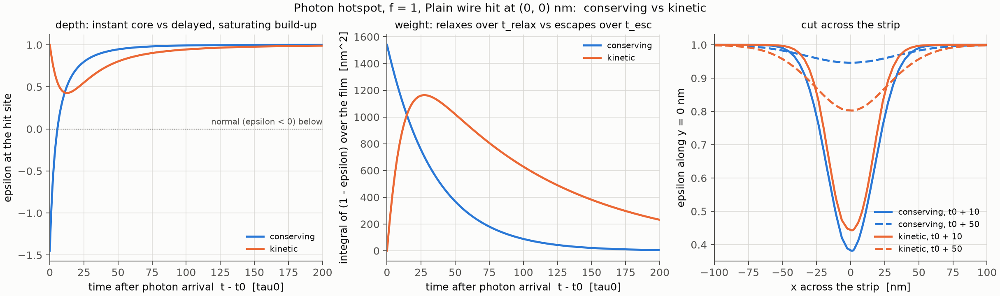

**Conserving vs kinetic photon.** By the time the kinetic suppression has built up, the energy has already spread to about a third of its peak density, so no normal core forms. What remains is a shallow, broad suppression: its weight on the strip is 1.3× the conserving one at t₀ + 20 τ₀, 2.8× at t₀ + 50 τ₀ and 7× at t₀ + 100 τ₀. An edge hit goes deeper (ε = 0.21), because the wall reflects the energy. The integrator reproduces ε_∞(1 − e^{−t/τ_th}) and two other exact solutions to 3·10⁻⁸.

## 4 · Measuring detection

### 4.1 Thresholds and efficiency

- **Dark switching current.** I_sw is found by bisection without a photon, in [0.70, 1.20] × I_dep.
- **Photon threshold.** I_det(x, y) is found by bisection at each absorption site in [0.30, 1] × I_sw.
- **Sites.** The plain wire has 8 sites across half the width. The zipper has 42 sites over half a unit cell, filled out by its mirror and glide symmetry.
- **Hard-step efficiency.** η(I) is the area fraction of the unit cell with I_det < I, interpolated between sites [[9](#r9)]. i_10, i_50 and i_95 are the biases at which η reaches 10, 50 and 95 %. i_max is the 100 % point.
- **Units.** Results are quoted in I_dep units: I_sw itself drifts with the window, which would mix a window effect into I_det/I_sw.
- **Selectivity.** The median over probe sites of i_det(f) − i_det(1), at f = 0.6 and 0.35. Weak photons need more bias.
- **Current crowding.** K_peak/K_uniform is the steady-state sheet current averaged over discs 1.5 ξ in radius, with centres at least 1.5 ξ from any wall. The single-node maximum used before is dominated by mesh noise (§8).

### 4.2 The detection criterion, three generations

**What counts as a detection**

| Version | A run counts as switched if… | Used | Why it was replaced |
| --- | --- | --- | --- |
| v1 | Any of: peak \|V\| after t0 + 4 τ0 > 0.45 V0; 25 τ0 trailing mean of \|V\| > 0.18 V0; the supercurrent through one monitored cross-section collapses. | 21–28 Oct, `results/v1_voltage_or_collapse/` | A photon inside the zipper's monitored channel, site (68, 61), triggered the collapse branch at 0.724 with no voltage, against 0.801 at its glide image. |
| v2 | Either voltage branch (the "voltage trigger") | 28–29 Oct, `results/v2_voltage_trigger/` | The trailing-mean branch also fires on flux a photon pushes from hole to hole. That costs 1–6 phase slips, then the device is quiet again with new trapped flux (§9). This counted 24 % of the zipper's area as detected at 0.78 I_dep. |
| v3 | All of: the voltage trigger fires; ≥ 1 phase slip between the probes (\|∫V dt\|/2π) in the last 50 τ0 of the window; ≥ 1 slip in the last 50 τ0 of a 150 τ0 continuation from the final state, without the photon. | from 29 Oct, `results/hitmap/` etc. | Current. The continuation was added after a first re-run without it. That re-run found six zipper sites "detecting" at 0.777 I_dep on a rearrangement delayed to 360–386 τ0, inside the window's last 50 τ0. With the continuation, that run has 0.23 slips at the end and is rejected. |

Separating "a vortex crossed" from "a resistive state formed" is an open issue in the TDGL literature on SNSPDs [[10](#r10), [22](#r22)]. One vortex crossing the full width slips the phase by 2π. A vortex that stops in a hole slips only the fraction of the width it crossed, about 0.4 here. The trailing-mean threshold (0.18 V0 over 25 τ0) corresponds to about 0.72 slips, so two vortices entering one hole nearly fire it.

### 4.3 Measuring trapped flux

With A = 0, the fluxoid of a hole is the winding number of arg ψ along a loop around it:
- The loop is pyTDGL's fluxoid polygon, pushed out to the middle of the 12 nm bridge.
- ψ is interpolated linearly from the mesh at 400 points along the loop.
- A frame counts only while min |ψ| on the loop ≥ 0.05, i.e. while no vortex core is crossing it.
- The result agrees with pyTDGL's `hole_fluxoid` and is fast enough to evaluate on every saved frame (at least every 8 τ0).

A trapped state can be used as the initial condition of a new run (`seed_solution`). That is how its own switching current and its response to a second photon were measured.

### 4.4 The two criteria are bounds

> Neither criterion is a real detector.
> - **Voltage trigger (v2): lower bound.** It counts every resistive episode, including flux moving between holes and episodes that heal by themselves.
> - **Sustained switching (v3): upper bound.** It asks the TDGL state to stay resistive with no help. There is no Joule heating in the model, so once the hotspot has relaxed (35 τ0), the strip has to stay resistive on the supercurrent alone. With the conserving hotspot that needs about 0.82 I_dep, whatever the photon was. The kinetic hotspot lasts longer and lowers this floor to 0.775–0.818 (§9c), so the floor is set by the hotspot's lifetime, not by the strip.
>
> In a real film, each phase slip dissipates I·Φ0. That heat keeps the strip normal at lower bias, down to the retrapping current of the electro-thermal model [[8](#r8), [10](#r10)]. The true threshold therefore lies between the bounds, and a heat-balance term would give it directly.
>
> **Update, 5 Nov (§9e).** With a heat term, the threshold falls at or below the trigger bound at 11 of 14 sites, by up to 0.031 I_dep. A few slips that heal without heat hold a normal domain once they heat the strip. So the trigger is a lower bound only for the model without heat. The two 30 nm sites and the zipper's centre stay above it.
>
> Test case: the 30 nm strip, photon at the centre, 400 τ0.
> - At 0.40 I_dep the trigger fires and the strip slips 2 phases, then heals.
> - At 0.60 it slips 15 phases, at 0.75 it slips 65 (about 10 eV at 11 µA, or 12 photons of 1550 nm). It is resistive until about 200 τ0, then heals.
> - In every case the last 50 τ0 show no slip.
>

## 5 · How the project got here

**Phases, what they showed, and their status**

| Dates | Work | Outcome | Status |
| --- | --- | --- | --- |
| 8–16 Oct | Static I_c sweeps, four-hole tests, crowding landscapes, first photon margins | Several flaws: Bias turn-on transients were read as switching. Some meshes were 100 nm, where the comments said 10 nm. A photon threshold came out above the dark I_sw. | unreliable |
| 18–20 Oct | 2×2, staggered 2-1-2 and the first columns, with a static hotspot fired at the bias step | The plain-vs-holes ranking flips with the hotspot size | unreliable |
| 21–22 Oct | Column cascades (2 and 3 channels, short and long zipper); first 2D hitmap; window check | A cascade happens, but at the plain wire's bias. Valid, but coarse (4 sites). | superseded |
| 23–27 Oct | Conserving hotspot; full-grid hitmap at 0.8 ξ; narrow strips and width scan; edge banks | Negative result for holes; 56 nm strip far better; no gain from banks | v1 |
| 28 Oct | Repository cleanup and library; λ = 600 nm; method checks; voltage-only criterion | Collapse-branch artefact found and removed; zipper thresholds window-dependent | v2 |
| 28–29 Oct | Re-run at 400 τ0 (plain, zipper, 30 / 56 / 100 nm); first fluxoid trace | Zipper onset 0.777 is set by flux trapped in a hole | v2 |
| 29 Oct | Flux-trapping study (1,764 runs + trapped states + second photon) | Detailed in §9 | current |
| 29 Oct | Sustained-switching criterion, full re-run | Plain wire and zipper plateau unchanged. Narrow strips all move to about 0.82: the two criteria are bounds. | current |
| 30 Oct | Fabrication-feasible slot column in 2 µm strips; graded mesh tested | Graded mesh not worth using; no slot length lowers the plateau; the tail sits in the bridges | current |
| 3 Nov | Validation suite (`validation/`, 70 checks) | Solver, ε mapping and photon thresholds pass; known limits of the fluxoid meter; the zipper meshes differently on another machine (§8.1) | current |
| 4 Nov | Kinetic hotspot after Simon et al.; full re-run under both bounds; sensitivity to the paper's open choices | Verdict unchanged; thresholds move 0.01–0.03 I_dep, about as much as the open choices do (§9c) | current |

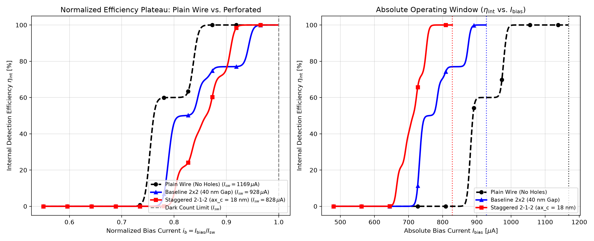

**18–20 Oct, large static hotspot (r = 18 nm, A = −3):** the plain wire saturates first.

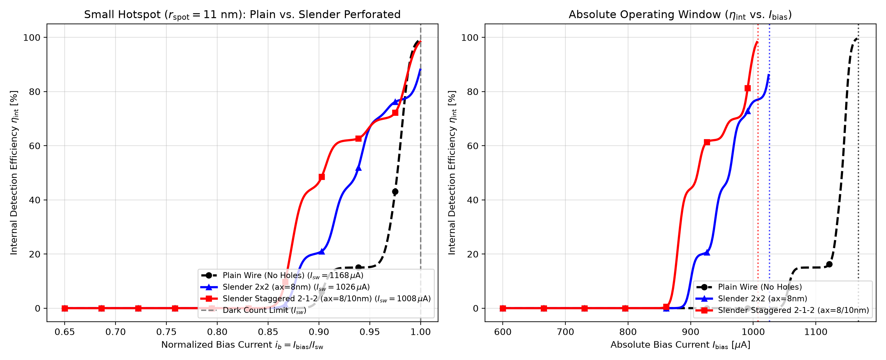

**Same comparison, small hotspot (r = 11 nm, A = −2):** now the holes look better. The ranking was set by the hotspot, not the geometry. That is why one hotspot has been used since 21 Oct.

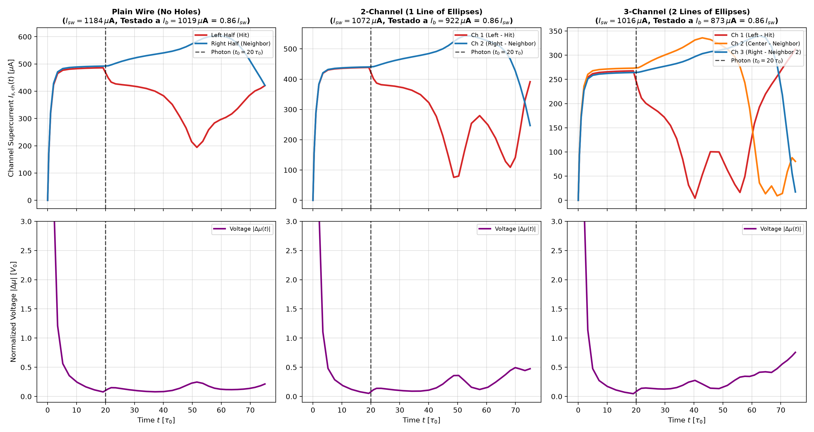

**Current redistribution in a column device (21 Oct, legacy hotspot).** The hit channel sheds current and its neighbours collapse in turn, 35–55 τ0 later. The cascade works, but only at the plain wire's normalised bias. This is the one result not yet repeated with the current code.

## 6 · Plain wire vs long zipper

**Main comparison across criteria (thresholds in units of I_dep of the narrowest cross-section, f = 1)**

|  | v1 · 0.8 ξ · 150 τ0 (units of I_sw) plain | v1 · 0.8 ξ · 150 τ0 (units of I_sw) zipper | v2 · 1.4 ξ · 400 τ0 (lower bound) plain | v2 · 1.4 ξ · 400 τ0 (lower bound) zipper | v3 · 1.4 ξ · 400 τ0 (upper bound) plain | v3 · 1.4 ξ · 400 τ0 (upper bound) zipper |
| --- | --- | --- | --- | --- | --- | --- |
| I_sw / I_dep | 1.002 | 0.992 | 0.970 | 0.968 | 0.970 | 0.968 |
| i_10 | 0.852 | 0.813 | 0.840 | 0.777 | 0.840 | 0.788 |
| i_50 | 0.857 | 0.831 | 0.845 | 0.795 | 0.845 | 0.805 |
| i_95 | 0.861 | 0.872 | 0.850 | 0.853 | 0.850 | 0.853 |
| i_max | 0.862 | 0.925 | 0.850 | 0.907 | 0.850 | 0.907 |
| Selectivity, f = 0.35 | 0.115 | 0.096 | 0.118 | 0.129 | 0.118 | 0.118 |
| Go / no-go (3 criteria) | 0 / 3 |  | 1 / 3 (C3 passes by 0.001) |  | 0 / 3 |  |

All columns use the conserving hotspot. With the kinetic hotspot (§9c), at the lower / upper bound: plain i_50 0.833 / 0.833 and i_95 0.848 / 0.848; zipper i_50 0.779 / 0.814, i_95 0.835 / 0.835 and i_max 0.891 / 0.891; go / no-go 1 / 3 under both bounds.

The v1 column is normalised to each device's own I_sw. At 150 τ0, I_sw/I_dep ≈ 1.00, so it is nearly the same scale. Other numbers:
- K_peak/K_uniform is 1.08 (plain) and 1.25 (zipper).
- K_peak at each device's own i_95 is 461 vs 468 µA/µm, which fails C2.
- Latency at threshold (v3): the plain wire has median 92 τ0 and max 129 τ0. The zipper has median 118 τ0 and max 342 τ0, with 15 of 42 sites above 200 τ0. With v2 the zipper's median was 174 τ0.

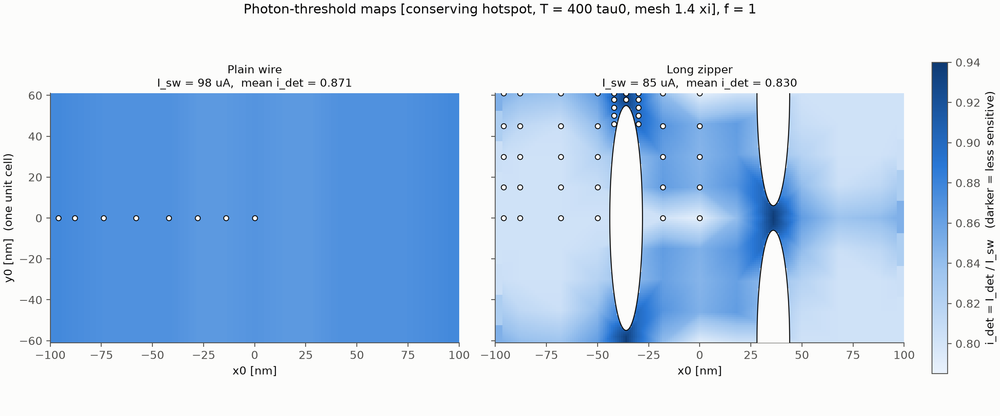

**Threshold maps, v3, 400 τ0, 1.4 ξ** (normalised to I_sw; darker = less sensitive). The zipper's channels and edges are more sensitive than the plain wire. Its bridges and hole tips are much less sensitive.

**Efficiency, v3.** The zipper's curve starts earlier and rises slowly. It crosses the plain wire at about 93 % and reaches 100 % only at 0.937 I_sw, because of the bridge and hole-tip tail.

> **Reading.** The zipper's map has three kinds of region:
> - channel and edge sites a little more sensitive than the plain wire;
> - bridge sites much less sensitive;
> - hole tips that are the least sensitive of all.
>
> Area-weighted, that makes an earlier but slower curve whose 95 % point is no better than the plain wire's. §9 shows that the sensitive left-channel sites at 0.78–0.81 I_dep switch only through trapped flux.

## 7 · Narrow strips and the width scan

The zipper's channels are 56 nm wide, and narrow strips are known to saturate at lower normalised bias [[16](#r16), [17](#r17)]. `narrow_baseline.py` changes only the strip width and keeps every other ingredient. A hole geometry is interesting only if it beats a plain strip as narrow as its channels.

*(The chart of threshold vs width in the published page is the table below.)*

**Width scan, v2 = voltage trigger, lower bound (400 τ0, 1.4 ξ, conserving hotspot, f = 1)**

|  | 30 nm | 56 nm | 100 nm | 200 nm | zipper |
| --- | --- | --- | --- | --- | --- |
| I_sw [µA]; I_sw/I_dep | 14.7; 0.971 | 27.4; 0.970 | 48.8; 0.968 | 97.7; 0.970 | 84.5; 0.968 |
| i_50 [I_dep] | 0.327 | 0.603 | 0.766 | 0.845 | 0.795 |
| i_95 [I_dep] | 0.334 | 0.614 | 0.775 | 0.850 | 0.853 |
| Window 1 − i_95 [I_sw] | 0.656 | 0.366 | 0.199 | 0.123 | 0.119 |
| (1 − i_50) × w [nm] | 19.9 | 21.1 | 20.9 | 25.7 | 30.9 |
| Selectivity f = 0.35 / 0.6 | 0.451 / 0.246 | 0.282 / 0.172 | 0.170 / 0.104 | 0.118 / 0.066 | 0.129 / 0.063 |
| v1 i_50 (0.8 ξ, 150 τ0, I_sw) | 0.329 | 0.607 | 0.775 | 0.857 | 0.831 |
| v3 selectivity f = 0.35 / 0.6 | 0.008 / 0.008 | 0.060 / 0.000 | 0.109 / 0.027 | 0.118 / 0.066 | 0.118 / 0.055 |
| **v3 (upper bound)** i_50 / i_95 [I_dep] | 0.815 / 0.815 | 0.823 / 0.823 | 0.825 / 0.825 | 0.845 / 0.850 | 0.805 / 0.853 |

With the kinetic hotspot the v3 row becomes 0.775 / 0.778, 0.801 / 0.804 and 0.818 / 0.819 for 30 / 56 / 100 nm, and the v2 i_50 row 0.382 / 0.617 / 0.737 (§9c).

> **Under v3 the narrow strips lose their advantage.** 30, 56 and 100 nm all switch at 0.82 ± 0.01 I_dep. That is below the zipper's plateau (0.853) but above its onset (0.805). The 30 nm strip's selectivity is 0.008, so its threshold no longer depends on the photon. The v3 numbers for narrow strips measure the lowest current at which the model can stay resistive without heat, not photon detection (§4.4). The width law below holds for v2, the lower bound. In experiments narrow strips do saturate at lower bias [[16](#r16), [17](#r17)], which points to v2 as the closer bound for them.

- **Width law (v2).** (1 − i_50) × w is 20–21 nm for 30–100 nm and 26 nm at 200 nm, close to the 28 nm hotspot diameter. So i_det ≈ 1 − d_hs/w summarises the plain strips: the normal-core picture [[6](#r6)], and the measured width dependence of the cut-off [[16](#r16), [17](#r17)].
- **The zipper is not three narrow wires.** Its channel-centre sites need 0.80–0.82 I_dep, against 0.59–0.62 for an isolated 56 nm strip. Its onset matches a plain strip about 155 nm wide (v1). Two explanations fit, and the current runs cannot tell them apart:
  - each channel is only 110 nm long, about twice its width, so displaced current bypasses it;
  - detection requires the whole width to switch, as in a SNAP [[18](#r18), [19](#r19)].

- **Weak photons.** The narrow-strip advantage shrinks with photon energy: probe-site medians for plain, zipper and 56 nm are 0.855, 0.824 and 0.617 at f = 1, but 0.972, 0.944 and 0.892 at f = 0.35 (v1). For weak photons the edge is the most sensitive line [[14](#r14), [15](#r15), [20](#r20)], a useful sanity check of the model.

## 8 · Checks of the method

**What was checked, and what it showed**

| Check | Result | Verdict |
| --- | --- | --- |
| Mesh, 1.4 ξ vs 0.8 ξ | \|Δi_det\| ≤ 0.007 at 28 shared site/energy pairs; I_sw +1.6–1.9 % on the finer mesh. 30 nm strip at 400 τ0: ≤ 0.006. | pass |
| Mesh, trapped flux | [0 −2] state switching: 0.786 (1.4 ξ) vs 0.845 I_dep (0.8 ξ) with v3; 0.775 vs 0.795 with v2. The 30 nm strip agrees between meshes under both (sustained i_95 0.839 I_sw at both). | 0.06 shift |
| Unsimulated edge band (outer 4 nm) | x = −98 nm agrees with x = −96 nm within 0.003 | pass |
| Symmetry (mirror, y-mirror, glide) | All image sites agree within tolerance, except the zipper's monitored channel: (68, 61) at 0.724 vs 0.801 | pass → v2 |
| Window 150 → 250 → 400 τ0 | Plain thresholds window-independent (delays ≤ 95 τ0). Zipper channel and edge sites keep falling: (−96, 0) 0.803 → 0.787 → 0.777. Plain I_sw drifts 0.986 → 0.970 I_dep. | zipper window-dependent |
| Current-crowding metric | The old single-node K_peak/K_uniform (1.21 plain, 1.45 zipper) was mesh noise: a straight strip must give 1.00. The disc average gives 1.04–1.08 (plain) and 1.24 (zipper). At I_sw both reach 1.04–1.06 j_dep locally. | fixed |
| λ change, refactor | Rescaled vs fresh: plain I_sw 99.50 vs 99.41 µA, centre i_det 0.852 vs 0.852. Library vs old scripts: identical summaries. | pass |
| Criterion v1 → v2 | 12 critical-grid sites at 1.4 ξ, 150 τ0: within 0.003; I_sw within 0.15 % | pass |
| Criterion v2 → v3 | Plain wire identical. Zipper i_50 0.795 → 0.805, i_95 unchanged. Narrow strips 0.33–0.77 → 0.82: the criteria are bounds, not alternatives (§4.4). Flux scan and hitmap agree at 42 / 42 zipper and 8 / 8 plain sites. | bounds |
| Flux scan vs hitmap (v2) | All 42 zipper sites and all 8 plain sites first fire at the grid bias just above the bisected threshold | pass |
| Fluxoid meter | Matches pyTDGL's `hole_fluxoid`; trapped states regenerate identically from different photons | pass |
| Depairing check | All current geometries: I_sw/I_dep = 0.968–0.971 (400 τ0). The archived first-photon studies failed it (0.89, 1.22), which is one reason they are marked unreliable. | pass |
| Mesh pinning (4 Nov) | The stored production meshes are reloaded with `SNSPD_MESH_DIR`. Two stored kinetic thresholds (zipper (−68, 0), Slot 400 (−58, 0)) recompute bit for bit. | pass |

### 8.1 Validation suite (3 Nov)

`python -m validation run all` tests the pieces of the method against cases with known answers; `results/validation/summary.txt` lists every check. It keeps the conserving hotspot, because it checks the stored conserving results. 55 checks pass, 10 fail, 5 are informational.

**What passes**
- **Hotspot diffusion (1a):** energy is conserved to 7·10⁻⁹ on every production mesh. Profiles match the exact free-space, wall and strip-mode solutions within 0.5 %. The time and space orders are 2.00 and 1.7–2.1.
- **ε mapping (1b):** pyTDGL uses ε < −1 as given, with no clipping. The production hotspot reaches −1.4 to −3.25 at t0, and the guard at −6 never acts.
- **Frozen normal disc vs a real hole (1c), one hole in a strip (2c):** pass.
- **Photon thresholds (1d):** pass against known behaviour, except one linearity test.
- **Ring (2b):** the ring current and the Eckhaus stability limit pass.

**What fails, and what it means**

| Check | Finding | Consequence |
| --- | --- | --- |
| 1d.2 | At the edge site (−96, 0), i_det(f) is flat for f ≥ 0.6 and then rises, so it is not linear in f (residual 0.029) | The expectation was wrong; selectivity is not a linear function of photon energy |
| 2a.5, 2a.8, 2a.9 | The fluxoid meter's \|ψ\| gate misses some vortex cores within 0.4 nm of the loop. It raises an error if ψ is exactly 0 on the loop. A vortex in the middle of a 12 nm zipper bridge counts in both neighbouring loops for one frame. | One-frame miscounts in trapped-flux traces. Production runs never have ψ exactly 0. |
| 2b.5, 2b.6 | A ring started above its stability limit overshoots to winding 2–4, not "8 or just below". In fast bursts several slips occur between frames. | TDGL switching/retrapping hysteresis; only net changes are defined in a burst |
| 2d.2, 2d.4 | 11 % of the fluxoid steps in resistive scan runs are 2–3 quanta at once | Same: the frame rate does not resolve bursts. Outcome classes are not affected. |
| 2d.8, 2d.9 | The zipper meshes differently on another machine: 10,543 nodes against the production 10,710. The plain strips and slot columns match exactly. On the other mesh, the flux-mediated thresholds at (−96, 0) and (−68, 0) move from 0.788 to 0.825–0.830 I_dep. | Triangulation noise alone is about 0.04 I_dep for flux-mediated zipper quantities. Fixed for new runs by pinning the meshes; the uncertainty stays. |

Not built: re-running a published pyTDGL hotspot simulation (Simon et al. [[27](#r27)]). The paper does not state ξ, λ, the ε amplitude and profile, the strip length or the voltage threshold.

## 9 · Flux trapping

The 400 τ0 re-run showed eleven left-channel sites sharing one threshold, 0.777 I_dep, all switching 320–370 τ0 after the photon. A fluxoid trace explained it: the photon pushes two flux quanta into the neighbouring hole, and the device then waits. `fluxtrap.py` maps this systematically:
- all 42 zipper sites at 42 biases from 0.40 to 0.96 I_dep, plus a plain-wire control;
- for every run, the fluxoid of every hole at every frame and the phase slipped since the photon.

The results below are from the v3 re-run, with the 150 τ0 continuation, and use the conserving hotspot. §9d repeats the study with the kinetic hotspot: less flux is trapped, and most delayed detections through trapped flux become pulses that heal.

**One photon at (−68, 0) nm, four biases (conserving).** Left: flux quanta held by the holes. Right: phase slips since the photon. The version with the probe voltage and each hole's fluxoid is `trace_Long_Zipper_-68_0_detailed_conserving_T400_m1.4.png`.
- At 0.70 one quantum enters the left-centre hole, for 0.38 slips, and stays.
- At 0.77, two quanta enter and stay.
- At 0.80 the trapped flux starts hopping between holes after about 100 τ0, and the phase-slip rate builds until the device is resistive.
- At 0.85 the device switches directly, in about 70 τ0.

### 9.1 Which sites leave flux, and how much

- Flux is left from 0.64 I_dep, about 0.14 below detection, near the left edge and in the left channel. Silently trapped area: 59 % of the unit cell at 0.70 I_dep, 85 % at 0.75.
- The flux arrives 18–102 τ0 after the photon (median 34). Each quantum entering a hole costs about 0.4 phase slips, below the voltage trigger.
- Never more than two quanta (180 runs with one, 139 with two). This is consistent with the small saturation number of holes only a few ξ across [[32](#r32), [33](#r33)].

**Trapped states left by sub-threshold photons (fluxoid of holes 0–6; signs follow the current direction)**

| State | Runs | Where the photon lands | Interpretation |
| --- | --- | --- | --- |
| [0 −1 0 0 0 0 0] | 180 | near the left edge | One vortex enters from the left edge and stops in the left-centre hole |
| [0 +1 0 0 0 −1 0] | 103 | centre channel | A vortex–antivortex pair, pulled apart by the current, ends in the two hole columns |
| [0 −1 −1 0 0 0 0] | 23 | top bridge | One vortex in each of two left holes |
| [0 −2 0 0 0 0 0] | 10 | left channel, just below threshold | Two vortices in the left-centre hole |

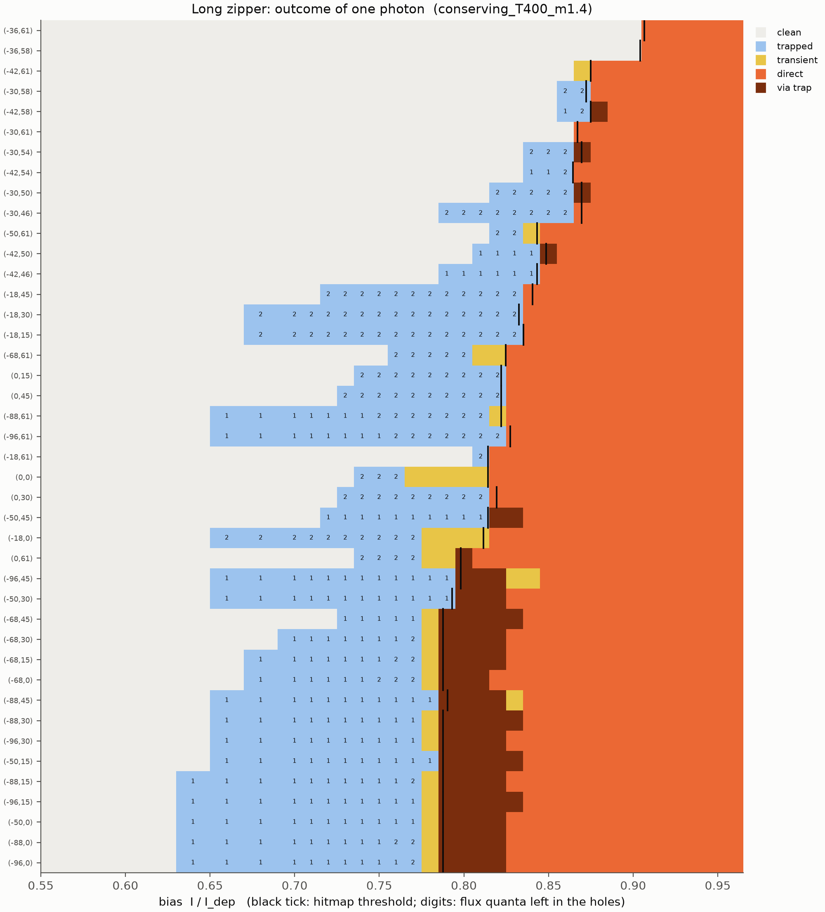

**Outcome of one photon at every site and bias** (v3 scan). Light blue: flux left in a hole, with the number of quanta. Yellow: the voltage trigger fired but the device did not stay resistive. Dark brown: switched after sitting with trapped flux. Orange: switched directly. Black tick: the v3 hitmap threshold.

### 9.2 Prompt, delayed and transient switching

**Area fraction of the zipper's unit cell by outcome (v3 scan)**

| bias [I_dep] | voltage trigger | sustained | direct | prompt (≤ 130 τ0) | silent trap |
| --- | --- | --- | --- | --- | --- |
| 0.70 | 0 % | 0 % | 0 % | 0 % | 59 % |
| 0.75 | 0 % | 0 % | 0 % | 0 % | 85 % |
| 0.78 | 24 % | 0 % | 0 % | 0 % | 68 % |
| 0.80 | 52 % | 45 % | 0 % | 0 % | 43 % |
| 0.82 | 66 % | 57 % | 1 % | 44 % | 30 % |
| 0.85 | 94 % | 94 % | 92 % | 93 % | 4 % |
| 0.88 | 99 % | 99 % | 98 % | 98 % | 1 % |

**Efficiency-curve points for each definition of a detection (units of I_dep; scan grid 0.01, so up to 0.01 above bisected values)**

| Counting as a detection | i_10 | i_50 | i_95 | i_max |
| --- | --- | --- | --- | --- |
| zipper, any voltage trigger (v2, lower bound) | 0.780 | 0.800 | 0.855 | 0.910 |
| zipper, sustained (v3, upper bound) | 0.790 | 0.810 | 0.856 | 0.910 |
| zipper, prompt (resistive by 130 τ0 after the photon) | 0.811 | 0.823 | 0.858 | 0.910 |
| zipper, direct (no zero-voltage dwell with trapped flux) | 0.827 | 0.834 | 0.859 | 0.910 |
| plain wire, every definition | 0.840 | 0.850 | 0.850 | 0.850 |

- **At 0.78 I_dep**, photons in the left channel and on the centre line make the trapped flux hop: two quanta leave the left hole, cross into the right column and exit at the right edge. Two antivortices then enter a right-column hole from the right edge. That is 2–3 phase slips, after which the device is quiet with new trapped flux. v2 counted this as a detection; v3 does not (0 % sustained at 0.78).
- **From 0.79** the same sequence ends in a resistive state 80–250 τ0 after the photon (180–210 τ0 at 0.79). At 0.80, all of the 45 % sustained area goes through trapped flux, and none of it is prompt.
- **The plain wire** has nothing to trap flux in, and every detection is prompt and sustained.

### 9.3 The trapped state as a device

**Trapped states used as initial conditions, without a photon (v3 bisection; dark I_sw of the empty device 0.968 I_dep)**

| State | Own I_sw [I_dep] | What happens at it | Held 400 τ0 at 0 and just below I_sw |
| --- | --- | --- | --- |
| [0 −1 0 0 0 0 0] | 0.909 | Sustained switch; the same value from photons at 0.64 and at 0.86 | flux kept |
| [0 −1 −1 0 0 0 0] | 0.871 | Sustained switch after a dwell | flux kept |
| [0 +1 0 0 0 −1 0] | 0.874 | Sustained switch after a dwell | flux kept |
| [0 +1 0 0 −1 0 0] | 0.874 | Sustained switch after a dwell (1 scan run) | flux kept |
| [0 −2 0 0 0 0 0] | 0.786* | *At 0.782 the flux tours the right column for about 250 τ0 and comes back as [0 −2], with no lasting voltage. At 0.786 the same tour ends resistive. With v2 it "switched" at 0.775. At 0.8 ξ: 0.845. | flux kept |

**Second photon: threshold with a trapped state minus the empty device (v3, I_dep; bisected, so the empty-device values differ from the 0.01-grid scan)**

| Photon site | empty device | [0 −2] | [0 −1] | [0 −1 −1] | [0 +1 0 0 0 −1 0] |
| --- | --- | --- | --- | --- | --- |
| (−68, 0) left channel | 0.788 | −0.001† | +0.037 | +0.057 | +0.008 |
| (−18, 0) centre channel | 0.812 | −0.025† | +0.006 | −0.002 | +0.001 |
| (0, 0) centre line | 0.814 | −0.028† | +0.003 | −0.005 | +0.039 |
| (68, 61) right channel | 0.801 | −0.015† | +0.012 | +0.016 | +0.016 |

† Capped at the state's own switching current (0.786): from [0 −2], every site switches there, so the photon no longer matters. [0 −1] is from the photon at (−96, 0); the one from (−42, 58) agrees within 0.003. With v2 the [0 −2] column read −0.09 to −0.15: those were rearrangements of the trapped flux, not switches. Negative values are more sensitive than the empty device. The circulating current of the trapped flux adds to the bias on one side of a hole and subtracts on the other, so the sign depends on where the second photon lands.

- **Is this seen in real devices?** The physics is established, but no experiment on a perforated SNSPD was found, so this is a prediction of the model.
  - Closest experiment: bright (about MeV) infrared pulses on parallel strips, modelled with vortices trapped in the loops between slots, in agreement with photon-assisted vortex-antivortex unbinding [[35](#r35)]. Not single photons; persistence and reset are not in the abstract.
  - Closest device: a shunted constriction in a loop, where each single-photon detection adds one flux quantum as persistent current, and the circulating current lowers the effective bias and so the detection efficiency [[36](#r36)]. That memory is designed in, and the write is a full switch rather than a silent sub-threshold event.
  - Also relevant: single vortices trapped in a film by laser switching [[37](#r37)] (title only seen), and fluxoid changes in thin-film rings by thermal activation of a Pearl vortex in the ring wall [[38](#r38)].
  - A test: measure the I_sw distribution after cooling in the dark, again after sub-threshold illumination, and again after warming above T_c, with a plain wire as control.
- **Persistence.** Deterministic TDGL has no thermal escape. A rough barrier for a vortex leaving a hole is of order ε0d = Φ0²/(2πμ0Λ) ≈ 0.04 eV ≈ 500 K × k_B [[4](#r4), [5](#r5)]. At 1–2 K the flux would also stay in a real device at zero bias. Near the depinning current the barrier vanishes.
- **Consequence.** After a sub-threshold photon, the zipper becomes a different detector:
  - its switching current is lower;
  - its sensitivity map is rearranged;
  - at a bias above the trapped state's I_sw, it would eventually switch with no new photon, which is a dark count in effect.

## 9b · The slot column: a fabrication-feasible layout 

The zipper's 16 nm holes and 12 nm bridges cannot be fabricated, and its bridges are not mesh-converged. The new layouts keep to 30 nm hole width, 40 nm bridges and at least 40 nm from hole to film edge. Results are in `results/slots/`.

| Device | I_sw [µA], lower / upper | i_50 lower / upper | i_95 lower / upper | i_max lower / upper | Go / no-go, lower / upper |
|---|---|---|---|---|---|
| Plain wire, 2 µm | 95.8 / 98.7 | 0.849 / 0.848 | 0.851 / 0.851 | 0.851 / 0.851 | reference |
| Slot 110 nm | 83.5 / 83.5 | 0.826 / 0.837 | 0.914 / 0.914 | 0.973 / 0.973 | 0/3 / 0/3 |
| Slot 200 nm | 83.5 / 83.5 | 0.812 / 0.837 | 0.872 / 0.875 | 0.963 / 0.971 | 0/3 / 0/3 |
| Slot 400 nm | 82.5 / 83.5 | 0.787 / 0.835 | 0.849 / 0.860 | 0.954 / 0.973 | 1/3 / 0/3 |

Thresholds are in units of I_dep (100.8 µA for the wire, 85.7 µA for the slots). The lower bound is the voltage trigger, the upper bound sustained switching. Conserving hotspot; the kinetic values are in §9c.

- **The plateau is not lowered.** Even the best case, Slot 400 at the lower bound, is 0.002 I_dep below the wire, within the bisection tolerance. The zipper's i_95 is 0.853.
- **The tail sits in the bridges.** The highest thresholds, 0.98–1.0 I_sw, are at photon sites in the 40 nm bridges between slots, under both criteria. Shorter slots have more bridge area, which fits i_95 improving with length. Why bridges are insensitive (probably little current flows through them) was not checked directly.
- **Onset depends on the bound.** The i_50 gain over the wire is 0.011–0.013 I_dep at the upper bound and 0.023 / 0.037 / 0.062 at the lower bound for 110 / 200 / 400 nm. The gap between the bounds grows with length, the opposite of what was expected. A reduced flux scan explains the extra lower-bound events (below).
- **Peak current is higher than the wire's.** At i_95 it is 475–501 µA/µm against 452, so C2 fails everywhere. Slot 400 at the lower bound passes C3 only (selectivity +0.022).
- **Caveats.** The go / no-go tests use thresholds in units of I_sw. The wire's I_sw falls to 95.8 µA under the trigger, which inflates the lower-bound gains in those units: Slot 400's i_95 gain is +0.013 in I_sw but +0.002 in I_dep. The slots have no 0.8 ξ mesh check yet.

**Flux scan of Slot 400 (`results/fluxtrap/`, 12 sites × 0.76–0.86 I_dep, 72 runs; a subset, so its area fractions are indicative).** The onset gain at the lower bound is flux entering the slots, not a resistive switch.

| Bias [I_dep] | What most sites do | Phase slips | Ends |
|---|---|---|---|
| 0.76–0.80 | Flux enters a slot silently, then the second or third quantum fires the trigger | 0.6–2.5 | Quiet, 1–4 quanta left in the slots |
| 0.80–0.84 | Burst: the slot fills to 4–5 quanta, empties and refills with the opposite sign | 5–14 | Quiet, 2–3 quanta left |
| 0.84–0.86 | Sustained switching, with no zero-voltage dwell first | 80–1100 | Resistive |

All 24 transient runs end with flux in a slot and no voltage. All 19 sustained runs are direct, with none via a trapped state, unlike the zipper. Sustained onset agrees with the hitmap at 12 of 12 sites. At the 0.84–0.86 onset, 4 runs near the slot ends sit in a slower resistive state (13–26 slips per 50 τ0, against about 190), whose stability was not studied. A [0 −1 0] state placed directly (`fluxtrap.py trapped --place`, phase wound around the slot and relaxed 50 τ0) matches the one a photon at (−96, 0) leaves at 0.76: same fluxoid, kept for 400 τ0 at zero bias, and the same switching current, 0.962 I_dep against 0.973 for the empty device. So the upper bound, i_50 = 0.835 and a gain of 0.013, is the better reading unless heat makes the bursts latch. A burst dissipates about 5–13 eV, 6–16 times a 1550 nm photon, so a heat model is what decides this.

**Why one column and these lengths.** Two columns at this size fit only with 40 / 60 / 40 nm channels and a 156 nm free width, and at 110 nm length their holes overlap over only 47 % of the length. One column keeps 170 nm of free width and has the fewest edges. The main variable is length, because the zipper's channels capture only about 15 % of an isolated 56 nm strip's gain, probably because each is only about twice as long as wide and current goes around it. The slots test channels 1.3, 2.4 and 4.7 times as long as wide.

**Why slots rather than ellipses.** An ellipse's tip radius is (half-width)² / (half-length): about 1 nm for 30 × 400 nm, which cannot be made. The slots have 15 nm end radii.

**What was expected before the runs (judgement).** A 110 nm slot should gain little: an extrapolation gives about 0.015 I_dep at onset. Longer slots should behave more like separate narrow channels. Flux hopping should be harder across 40 nm bridges, which may shrink the onset gain and bring the two bounds together.

**Success test.** i_95 below the 2 µm plain wire's by more than the mesh and criterion shifts.

**Mesh coarser towards the terminals: tested, not used** (plain 2 µm wire, edge growing from 1.4 ξ at |y| = 700 nm)

| Edge at the terminals | Nodes | I_sw [µA] | i_det at x = −96 / 0 nm [I_dep] | Time per threshold |
| --- | --- | --- | --- | --- |
| 1.4 ξ (uniform) | 27,757 | 98.7 | 0.853 / 0.843 | about 580 s |
| 2 ξ | 25,277 | 97.9 (−0.8 %) | 0.855 / 0.841 | about 550 s |
| 3 ξ | 23,302 | 96.2 (−2.6 %) | 0.857 / 0.844 | about 530 s |

Photon thresholds stay within about the bisection tolerance, but I_sw falls, probably because a coarse lattice carries less current so the leads become the weak point (the location was not checked). The saving is small, so the uniform mesh is used. The 2 µm thresholds agree with the 0.8 µm strip's (0.850 / 0.842), so length does not change the plain-wire reference.

## 9c · The kinetic hotspot (Simon et al.)

Every main comparison was re-run with the kinetic hotspot (§3.3), under both bounds, at 400 τ0 and 1.4 ξ on the pinned production meshes. Dark I_sw and the crowding maps involve no photon, so they were reused from the conserving runs (`results/kinetic_reused_dark_results.sh`). Summaries: `results/{hitmap,slots}/summary_kinetic_T400_m1.4{,_trigger}.txt` and `results/narrow_baseline/width_scan_summary_kinetic_T400_m1.4{,_trigger}.txt`. Site-by-site comparison: `python compare_hotspots.py`.

### 9c.1 Thresholds

**Conserving → kinetic, in units of I_dep (narrowest cross-section), f = 1. Each cell: lower bound (voltage trigger) / upper bound (sustained).** The slot columns use the critical grid.

| | i_50 | i_95 | i_max |
| --- | --- | --- | --- |
| plain wire, 200 nm | 0.845 → 0.833 / 0.845 → 0.833 | 0.850 → 0.848 / 0.850 → 0.848 | 0.850 → 0.848 / same |
| long zipper | 0.795 → 0.779 / 0.805 → 0.814 | 0.853 → 0.835 / 0.853 → 0.835 | 0.907 → 0.891 / same |
| 100 nm strip | 0.766 → 0.737 / 0.825 → 0.818 | 0.775 → 0.772 / 0.825 → 0.819 | — |
| 56 nm strip | 0.603 → 0.617 / 0.823 → 0.801 | 0.614 → 0.622 / 0.823 → 0.804 | — |
| 30 nm strip | 0.327 → 0.382 / 0.815 → 0.775 | 0.334 → 0.390 / 0.815 → 0.778 | — |
| plain wire, 2 µm | 0.849 → 0.833 / 0.848 → 0.832 | 0.851 → 0.847 / 0.851 → 0.846 | 0.851 → 0.849 / 0.851 → 0.848 |
| slot column, 110 nm | 0.826 → 0.820 / 0.837 → 0.833 | 0.914 → 0.893 / 0.914 → 0.896 | 0.973 → 0.952 / 0.973 → 0.952 |
| slot column, 200 nm | 0.812 → 0.811 / 0.837 → 0.835 | 0.872 → 0.872 / 0.875 → 0.879 | 0.963 → 0.952 / 0.971 → 0.952 |
| slot column, 400 nm | 0.787 → 0.790 / 0.835 → 0.821 | 0.849 → 0.835 / 0.860 → 0.846 | 0.954 → 0.951 / 0.973 → 0.952 |

**Go / no-go (kinetic):** zipper 1/3 under both bounds (C2 stress passes by 2 µA/µm). Slot 110 0/3 under both; Slot 200 1/3 (trigger) and 0/3 (sustained); Slot 400 1/3 (trigger) and 0/3 (sustained). No geometry passes C1, the plateau test.

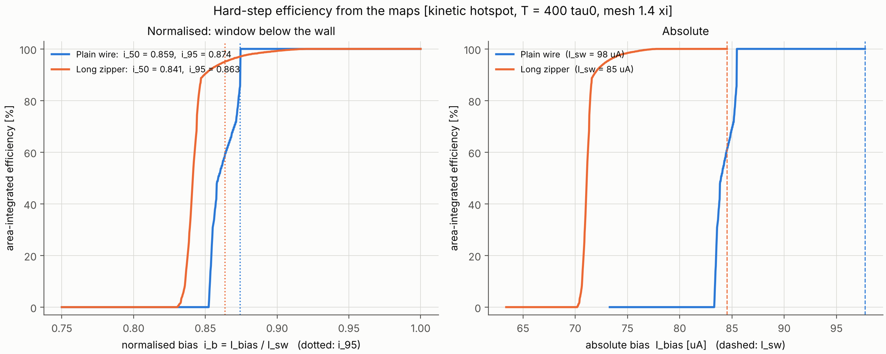

**Efficiency, v3, kinetic hotspot.** Compare the conserving curves in §6: the zipper's slow tail is shorter and its start later.

### 9c.2 What changes, device by device

- **Plain wire: barely moves.** i_50 drops by 0.012 and i_95 by 0.002, the same under both bounds. Hits near the edges get 0.016–0.019 easier and centre hits 0.005–0.008 harder. Latency at threshold grows from a median of 92 to 134 τ0, because the suppression peaks about 12 τ0 after arrival.
- **Long zipper: shorter tail, smaller onset gain.**
  - i_95 is 0.835 against the plain wire's 0.848 under both bounds (before: 0.853 vs 0.850), and i_max falls from 0.907 to 0.891.
  - The sustained onset gain over the plain wire shrinks from 0.040 to 0.019; the lower-bound gain stays (0.054).
  - Fifteen sites left of the centre detected at 0.788–0.798 with the conserving hotspot. Thirteen of them went through trapped flux and triggered 195–220 τ0 after the photon (§9.2). With the kinetic hotspot these sites detect at 0.806–0.819, 38–54 τ0 after the photon. Sites triggering more than 200 τ0 after the photon drop from 15 of 42 to 1.
  - Selectivity at f = 0.35 falls below the plain wire's under v3 (−0.038; was +0.000).
- **Narrow strips: the sustained floor moves.** Under v3 the floor falls from about 0.82 to 0.775 / 0.801 / 0.818 for 30 / 56 / 100 nm. The 56 nm strip now beats the zipper on onset and plateau under both bounds (0.801 / 0.804 against 0.814 / 0.835 at the upper bound). Under the trigger, the 30 nm strip needs more current (0.327 → 0.382), because the shallow hotspot no longer makes a 30 nm strip slip at very low bias. The 100 nm strip needs less (0.766 → 0.737).
- **Slot columns: shift with the wire.** Every slot site gets 0.003–0.029 easier under both bounds (medians −0.016 to −0.027), about as much as the 2 µm wire off its centre (−0.019). Their standing against it barely moves:
  - the lower-bound onset gain shrinks (Slot 400: 0.062 → 0.043 at i_50 in I_dep);
  - Slot 400's plateau edge grows (i_95 0.835 vs 0.847 at the lower bound; 0.846 vs 0.846 at the upper bound);
  - every column's tail shortens (i_max 0.97 → 0.95).

### 9c.3 Sensitivity to what the paper leaves open

The paper fixes the shape of the build-up and the two times in picoseconds. It does not fix τ0 (that needs the film's ρ_n), the amplitude, the profile or any floor on ε. Eleven sites were re-run with three alternatives (`results/kinetic_sensitivity.txt`):

| Variant | t_rise | t_esc | Floor on ε |
| --- | --- | --- | --- |
| kinetic (stored results) | 10 τ0 | 100 τ0 | −0.25 |
| τ0 anchored on D = 0.5 cm²/s (0.200 ps) | 7 τ0 | 75 τ0 | −0.25 |
| same anchor, τ_esc = 10 ps (the paper's other value) | 7 τ0 | 50 τ0 | −0.25 |
| no floor | 10 τ0 | 100 τ0 | none |

**Thresholds at f = 1 [I_dep]**

| Site | Criterion | conserving | kinetic | 7 / 75 | 7 / 50 | no floor |
| --- | --- | --- | --- | --- | --- | --- |
| plain 200 nm (0, 0) | v3 | 0.842 | 0.848 | 0.848 | 0.863 | 0.829 |
| plain 200 nm (−96, 0) | v3 | 0.850 | 0.832 | 0.837 | 0.845 | 0.826 |
| zipper (0, 0) | v3 | 0.814 | 0.804 | 0.811 | 0.814 | 0.806 |
| zipper (−68, 0) | v3 | 0.788 | 0.817 | 0.817 | 0.788 | 0.817 |
| zipper (−96, 0) | v3 | 0.788 | 0.817 | 0.785 | 0.788 | 0.817 |
| zipper (−36, 61), tail | v3 | 0.907 | 0.891 | 0.896 | 0.915 | 0.880 |
| zipper (−42, 58), tail | v3 | 0.875 | 0.856 | 0.864 | 0.880 | 0.851 |
| 30 nm strip (0, 0) | v3 | 0.815 | 0.775 | 0.794 | 0.804 | 0.775 |
| 30 nm strip (0, 0) | v2 | 0.318 | 0.376 | 0.374 | 0.416 | 0.299 |
| 56 nm strip (0, 0) | v3 | 0.823 | 0.801 | 0.812 | 0.817 | 0.801 |
| 56 nm strip (0, 0) | v2 | 0.617 | 0.620 | 0.620 | 0.654 | 0.593 |

- **Robust in sign.** No normal core forms for a centre hit in any variant. Narrow-strip v3 thresholds fall (30 nm by 0.011–0.040, 56 nm by 0.005–0.021). Edge hits of the plain wire get easier (0.005–0.024).
- **Not robust.**
  - The change at the plain-wire centre ranges from −0.013 to +0.021.
  - The zipper's plateau-tail sites range from −0.026 to +0.008, so its 0.013 plateau edge over the plain wire is inside the spread.
  - Narrow-strip trigger thresholds range from −0.02 to +0.10.
  - The zipper's flux-mediated sites flip between 0.788 and 0.817. A 7 τ0 rise brings back the delayed channel at (−96, 0), 206 τ0 after the photon. This is the same channel that moves by 0.04 with the mesh (§8.1).
- **Reading.** Differences of up to about 0.03 I_dep between geometries depend on hotspot details the paper leaves open, and the go margin is 0.03. This applies to the onset gains, the zipper's plateau edge, and the 56 nm strip vs zipper order at the upper bound. Settling them needs the film's τ_th and ρ_n (or T_c), not more geometry runs. Larger gaps survive every variant, for example the narrow strips under the trigger.

### 9c.4 The hotspot with the measured NbTiN times (5 Nov)

The same 11 cases were re-run with the times measured on 9 nm NbTiN (§3.2): t_esc = 530 τ0 and D = 7.1 nm²/τ0. t_rise stays at 10 τ0, and there is no heat (variant `NbTiN` of `hotspot_sensitivity.py`).

| Site | Criterion | kinetic (stored) | NbTiN times | Change |
| --- | --- | --- | --- | --- |
| plain 200 nm (0, 0) | v3 | 0.848 | 0.813 | −0.035 |
| plain 200 nm (−96, 0) | v3 | 0.832 | 0.810 | −0.022 |
| zipper (0, 0) | v3 | 0.804 | 0.790 | −0.014 |
| zipper (−68, 0) | v3 | 0.817 | 0.804 | −0.013 |
| zipper (−96, 0) | v3 | 0.817 | 0.804 | −0.013 |
| zipper (−36, 61), tail | v3 | 0.891 | 0.835 | −0.056 |
| zipper (−42, 58), tail | v3 | 0.856 | 0.809 | −0.047 |
| 30 nm strip (0, 0) | v3 / v2 | 0.775 / 0.376 | 0.677 / 0.294 | −0.098 / −0.082 |
| 56 nm strip (0, 0) | v3 / v2 | 0.801 / 0.620 | 0.738 / 0.524 | −0.063 / −0.096 |

- **Every threshold drops**, by 0.013–0.10 I_dep. That is more than any choice of §9c.3 moved them, so the escape time is the hotspot parameter that matters most.
- **The order of the geometries stays.**
  - The zipper's tail still needs more than the plain wire (0.835 vs 0.810–0.813).
  - Its onset sites lead the plain wire by 0.006–0.023.
  - The narrow strips gain most, and widen their lead.
- **No delayed channel returns.** The zipper's (−96, 0) site detects 44 τ0 after the photon, not 200.
- **This variant overstates the effect.** It keeps the whole photon energy in the electrons for 530 τ0. In the film, c_e/c_ph ≈ 0.16, so most of that energy passes to the phonons within τ_EP ≈ 20–27 τ0, at a lower electron temperature. A two-temperature photon hotspot would treat this properly. The heat model of §9e already splits the Joule heat this way, but not the photon.

## 9d · Flux trapping with the kinetic hotspot (5 Nov)

The flux scans of §9 and §9b were repeated with the kinetic hotspot (`run_flux_kinetic.sh`; 1,736 runs, about 2.5 h on 9 workers):

| Device | Sites | Biases [I_dep] |
| --- | --- | --- |
| zipper | all 42 | the same 34 as the conserving scan, 0.56–0.96 |
| Slot 400 | the 12 of the conserving scan | 17, from 0.70 to 0.88, mostly 0.01 apart (the conserving scan was 0.02 apart) |
| plain wire | all 8 | 13, from 0.78 to 0.90 |

The side-by-side comparisons are `results/fluxtrap/compare_<device>_T400_m1.4.txt` (`fluxtrap.py compare`). Each run is classified as in §9:
- **nothing:** no flux left, no trigger;
- **flux left, no signal:** flux stays in a hole and the trigger does not fire;
- **pulse, then heals:** the trigger fires, but the strip is quiet by the end of the continuation;
- **detected via trapped flux:** sustained, after at least 20 τ0 with flux trapped at zero voltage;
- **detected directly:** sustained, without that dwell.

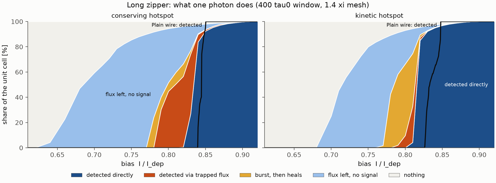

**What one photon does in the zipper.** Left: conserving hotspot. Right: kinetic. The black line is the plain 200 nm wire's detected share with the same hotspot.

**Share of the zipper's unit cell, conserving / kinetic [%]**

| Bias [I_dep] | flux left, no signal | pulse, then heals | detected via trapped flux | detected directly |
| --- | --- | --- | --- | --- |
| 0.70 | 59 / 25 | 0 / 0 | 0 / 0 | 0 / 0 |
| 0.74 | 82 / 73 | 0 / 0 | 0 / 0 | 0 / 0 |
| 0.78 | 68 / 47 | 24 / 43 | 0 / 0 | 0 / 0 |
| 0.80 | 43 / 26 | 7 / 57 | 45 / 10 | 0 / 0 |
| 0.81 | 36 / 19 | 9 / 43 | 51 / 29 | 0 / 3 |
| 0.82 | 30 / 6 | 10 / 1 | 56 / 1 | 1 / 87 |
| 0.84 | 7 / 2 | 1 / 0 | 6 / 0 | 84 / 95 |

**Efficiency points of the zipper from the scan (0.01 grid) [I_dep], conserving → kinetic**

| Counting as a detection | i_10 | i_50 | i_95 |
| --- | --- | --- | --- |
| any voltage trigger (lower bound) | 0.780 → 0.779 | 0.800 → 0.784 | 0.855 → 0.839 |
| sustained (upper bound) | 0.790 → 0.800 | 0.810 → 0.815 | 0.856 → 0.840 |
| direct only | 0.827 → 0.812 | 0.834 → 0.820 | 0.859 → 0.840 |
| plain wire, every definition | 0.840 → 0.830 | 0.850 → 0.835 | 0.850 → 0.850 |

**What changes in the zipper**

- **Less flux, entering later.**
  - Flux first stays in a hole at 0.68 I_dep instead of 0.64, at the left edge.
  - The silent-flux share falls at every bias, most where it mattered: 6 % instead of 30 % at 0.82.
  - Flux reaches a hole 54 τ0 after the photon (median) instead of 34.
  - Runs that end with trapped flux and no signal: 211 instead of 319.
  - The kinetic photon never makes a normal core (§3.3). A vortex has to be pulled in through a shallow, slowly growing suppression, which needs more current.
- **The same trapped states, with more double quanta.**

  | State | Conserving runs | Kinetic runs |
  | --- | --- | --- |
  | [0 −1 0 0 0 0 0] | 180 | 90 |
  | [0 +1 0 0 0 −1 0] | 103 | 64 |
  | [0 −2 0 0 0 0 0] | 10 | 29 |
  | [0 −1 −1 0 0 0 0] | 23 | 17 |
  | [0 −1 0 0 0 −1 0] | 0 | 9 |

- **Switching after the flux hops almost disappears.** With the conserving hotspot, 68 runs switched after a trapped dwell (§9.2). With the kinetic one, 11 do. They sit at 0.79–0.81 only, and never cover more than 29 % of the cell.
- **Pulses that heal take their place.**
  - There are 76 such runs instead of 30, and they are larger: 15 phase slips at the median (conserving: 3), up to 88.
  - At 0.79–0.80 they cover 57 % of the cell.
  - At 0.80 I_dep (70 µA) each slip dissipates I·Φ0 ≈ 0.9 eV, so a pulse dissipates 1–80 eV within about 50 ps. That is 1–100 photons of 1550 nm.
  - Without heat, the strip carries this and recovers. With heat, it latches (§9e).
- **Detection becomes direct, and the sustained curve steeper.** The detected share goes 10 → 32 → 88 % at 0.80 → 0.81 → 0.82 (conserving: 45 → 51 → 57 %). At the sustained bound the zipper turns on later (i_50 0.815 vs 0.810) but saturates earlier (i_95 0.840 vs 0.856).
- **The direct-only onset gain is the same in both models**: 0.015 (kinetic) and 0.016 I_dep (conserving). What the hotspot changes is what happens to the extra events below it: delayed switching (conserving), or pulses that heal (kinetic).
- **The sustained outcome is not monotone in bias at six sites.** At (−96, 0), (−88, 0), (−50, 0), (−96, 45), (−88, 45) and (−50, 45) the strip is still resistive at 0.79, heals at 0.80–0.81 and is resistive again from 0.82.
  - At 0.79 the flux tours the right column and the strip stays resistive.
  - At 0.80–0.81 a larger pulse (50–88 slips) drives the flux out, and the strip recovers during the continuation.
  - The hitmap's bisection assumes a monotone outcome, so it found the upper crossing (0.817). These six sites are six of the eight "differ" lines of `summary_Long_Zipper_kinetic_T400_m1.4.txt`. The other two, (−96, 15) and (−68, 30), flip the same way within one grid step.
  - Without heat, the line between staying resistive and healing is not monotone in bias. That is where the sustained bound is least reliable. With heat these sites detect at 0.764–0.765, below all of this (§9e).

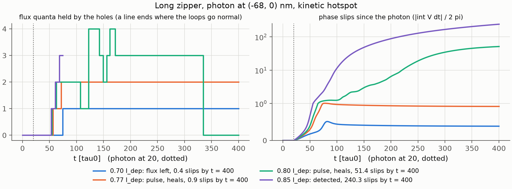

**One photon at (−68, 0) nm, kinetic hotspot.** Compare the conserving trace in §9.

| Bias [I_dep] | Conserving | Kinetic |
| --- | --- | --- |
| 0.70 | One quantum enters and stays (0.4 slips) | Same, about 20 τ0 later |
| 0.77 | Two quanta enter and stay, no signal | Two quanta enter. The second fires the trigger, 53 τ0 after the photon (0.9 slips). |
| 0.80 | Flux starts to hop after about 100 τ0, and the strip switches (via trapped flux) | Flux tours the right column with up to 4 quanta while the strip slips 51 phases. The flux leaves at 335 τ0, and the strip heals in the continuation. |
| 0.85 | Direct switch | Direct switch |

**Trapped states as devices, kinetic** (`fluxtrap.py trapped --hotspot kinetic`, `summary_Long_Zipper_kinetic_T400_m1.4.txt`). Each state was regenerated from a kinetic photon, held with no photon, then hit by a second photon at four sites.

| State (runs in the kinetic scan) | Own i_sw, kinetic (conserving) | Held at 0 | Second photon vs pristine, kinetic (conserving) |
| --- | --- | --- | --- |
| [0 −1 0 0 0 0 0] (90) | 0.909 (0.909) | kept | −0.004 to +0.014 (+0.003 to +0.037) |
| [0 +1 0 0 0 −1 0] (64) | 0.874 (0.874) | kept | −0.004 to +0.044 (+0.001 to +0.039) |
| [0 −2 0 0 0 0 0] (29) | 0.786 (0.786) | kept | −0.017 to −0.030, capped at 0.786 (−0.001 to −0.028) |
| [0 −1 −1 0 0 0 0] (17) | 0.874 (0.871) | kept | +0.005 to +0.031 (−0.005 to +0.057) |
| [0 −1 0 0 0 −1 0] (9, new) | 0.824 (–) | kept | −0.006 to +0.012 |

- **A trapped state's own switching current does not depend on the hotspot.** It is a property of the state, and the two models give the same values within 0.003. The states are therefore not an artefact of the conserving photon. The kinetic photon reaches them less often (§9d, first bullet).
- **Every state survives at zero bias for 400 τ0**, so the memory effect of §9.3 stands.
- **A second photon shifts thresholds by −0.03 to +0.04**, as in the conserving study: up near some holes and down near others, since the circulating current adds to the bias on one side.
- **The [0 −2] state still caps everything at 0.786.** That is 0.02–0.03 below the pristine kinetic thresholds of these sites, and is the 1.4 ξ value that the 0.8 ξ mesh puts at 0.845 (§4.4).
- **Near-threshold holds behave as before.** At 0.782 the [0 −2] flux tours the right column for about 300 τ0 and ends as [0 −1] with no lasting voltage; at 0.786 it ends resistive.

**Slot 400 and the plain wire**

- **Slot 400 keeps its pattern** (`compare_Slot_400_T400_m1.4.txt`).
  - As with the conserving hotspot, there is no detection via trapped flux. Below the sustained onset almost every event is a pulse that heals (86–92 % of the sampled cell at 0.78–0.82) or silent flux in a slot (most of the rest).
  - The sustained onset moves down by about 0.02. On the kinetic scan's 0.01 grid it is 0.81–0.84, with i_50 0.820. The 2 µm plain wire's kinetic i_50 is 0.832.
  - The same non-monotone pattern appears at three sites: (−96, 0), (−74, 0) and (−42, 0). These are resistive at 0.81, heal at 0.82 after 73–86 slips, and are resistive from 0.83.
  - Two resistive states appear again, with about 175 and about 40 slips per 50 τ0.
  - States left: [0 −2 0] 17 runs, [0 −1 0] 11, [0 0 −1] 3, [0 −2 −1] 1. The sites are a subset, so the shares are indicative only.
- **The plain wire stays binary.** In both models there is no flux, no pulse that heals, and every detection is direct and sustained. The kinetic threshold is 0.83–0.85 I_dep, against 0.84–0.85 conserving.

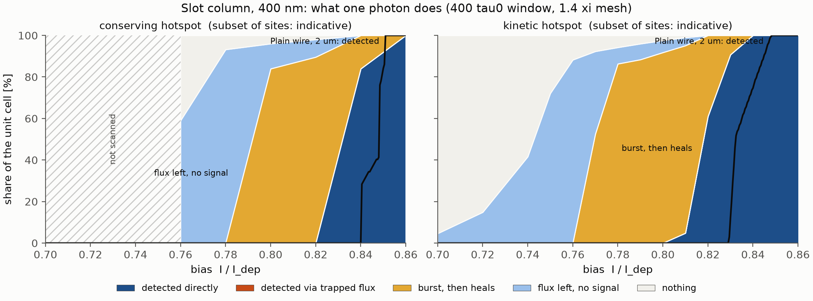

> **Reading.** With the kinetic hotspot the zipper still has a sub-threshold memory: silent flux over 19–84 % of the cell between 0.70 and 0.81 I_dep. But there is less of it, and almost none at the sustained onset. The delayed detections that made the conserving onset gain mostly become pulses that heal. Whether such a pulse counts is exactly what the two bounds disagree on. The heat check says it does (§9e), so the zipper's onset gain is real in the model: about 0.05 I_dep at the sites checked. It comes with flux left behind at lower bias, and it does not widen the plateau.

## 9e · Electro-thermal check (5 Nov)

`snspd/thermal.py` couples the TDGL to a local temperature, in the form of Zotova and Vodolazov [[8](#r8)] (their Eq. 2, arXiv v1 read 5 Nov):

∂θ/∂t = D∇²θ + η|∇μ|² − θ/t_esc,  ε = max(ε_photon − θ, −1),  θ = (T − T0)/(T_c − T0),  η = 4E_cond/(C_v(T_c − T0))

- **What each term is.**
  - θ = 0 is the bath and θ = 1 is T_c.
  - |∇μ|² is the normal-current Joule heat in pyTDGL units.
  - E_cond = Φ0²/(16π²μ0λ²ξ²) = 2.4 kJ/m³ is the condensation energy, and ρ_n cancels.
  - ε_photon is the kinetic hotspot, unchanged. The photon's energy is not fed into θ, so it is not counted twice.
- **Parameters.**
  - **1T (one temperature, nominal):** η = 0.59, from C_v = 2.4 mJ cm⁻³ K⁻¹ (the paper's NbN value), T_c = 9 K and T0 = 0.25 T_c. D = 10 nm²/τ0 and t_esc = 100 τ0, as the hotspot.
  - **η ×0.5 and ×2:** η = 0.30 and 1.20, at 6 of the sites.
  - **NbTiN 2T:** electrons and phonons separately, with the measured values of §3.2. η = 1.22 (electrons only), D = 7.1 nm²/τ0, τ_EP = 27 τ0, c_e/c_ph = 0.16, and phonon escape over 530 τ0.
- **Our choices, not the paper's.**
  - θ = 0 within 25 nm of the contacts. pyTDGL feeds the current in through ψ = 0 terminals, which would otherwise heat steadily.
  - ε is floored at −1, to keep pyTDGL's ψ update from underflowing in a normal domain. The floors −5 and −1 give the same outcome at threshold.
  - The parameters do not depend on θ.
  - Diffusion is operator-split, every 0.25 τ0.
- **Detection is one criterion:** the run is still resistive at 400 τ0, by bisection to 0.004 I_dep. A second reading, a normal domain (θ ≥ 1) at the end, agrees within 0.002–0.013.
- **How it was run:** `thermal_check.py`, 14 sites chosen to span the bounds, 400 τ0, 1.4 ξ, pinned meshes.

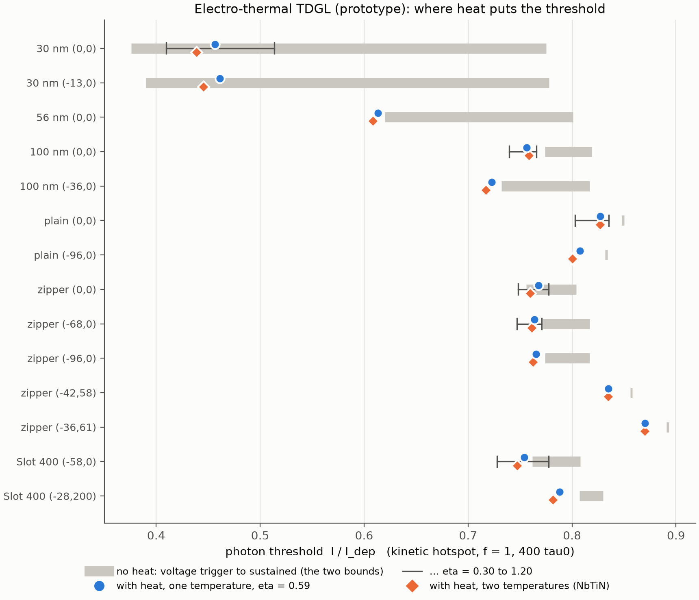

**Threshold with heat vs the two bounds without it.** Gray bar: from the trigger (lower) to the sustained (upper) bound. Circle: one-temperature model. Diamond: NbTiN two-temperature model. Whisker: η ×0.5 to ×2.

**Thresholds [I_dep], kinetic hotspot, f = 1**

| Site | lower (trigger) | upper (sustained) | with heat, 1T | with heat, NbTiN 2T | η ×0.5 to ×2 |
| --- | --- | --- | --- | --- | --- |
| 30 nm strip (0, 0) | 0.376 | 0.775 | 0.457 | 0.439 | 0.410–0.513 |
| 30 nm strip (−13, 0) | 0.390 | 0.778 | 0.461 | 0.446 | |
| 56 nm strip (0, 0) | 0.620 | 0.801 | 0.613 | 0.609 | |
| 100 nm strip (0, 0) | 0.774 | 0.819 | 0.756 | 0.759 | 0.739–0.766 |
| 100 nm strip (−36, 0) | 0.732 | 0.817 | 0.723 | 0.717 | |
| plain 200 nm (0, 0) | 0.848 | 0.848 | 0.827 | 0.827 | 0.803–0.836 |
| plain 200 nm (−96, 0) | 0.832 | 0.832 | 0.808 | 0.801 | |
| zipper (0, 0) | 0.756 | 0.804 | 0.768 | 0.760 | 0.748–0.777 |
| zipper (−68, 0) | 0.772 | 0.817 | 0.764 | 0.762 | 0.747–0.771 |
| zipper (−96, 0) | 0.774 | 0.817 | 0.765 | 0.762 | |
| zipper (−42, 58), tail | 0.856 | 0.856 | 0.835 | 0.835 | |
| zipper (−36, 61), tail | 0.891 | 0.891 | 0.870 | 0.870 | |
| Slot 400 (−58, 0) | 0.762 | 0.808 | 0.754 | 0.747 | 0.728–0.778 |
| Slot 400 (−28, 200), bridge | 0.807 | 0.830 | 0.788 | 0.782 | |

- **Heat merges the bounds, at or below the lower one.**
  - The 30 nm strip and the zipper's centre are the only sites above the trigger bound: 0.06–0.08 above for the strip, 0.004–0.012 for the zipper's centre. Both are far below the sustained bound.
  - At every other site the threshold is 0.007–0.025 below the trigger bound. A few slips that heal without heat now heat the strip enough to hold a normal domain.
  - Where the two bounds coincide (plain wire, zipper tail), heat lowers the threshold by 0.02–0.03.
- **The narrow-strip question is settled, in the model.** The 56 nm strip (0.61) and even the 100 nm strip (0.72–0.76) detect below every zipper site (0.76 and up). So v2 was the closer bound for narrow strips, as experiments suggested [[16](#r16), [17](#r17)].
- **The zipper's onset gain survives.** Its onset sites need 0.760–0.768 against 0.801–0.827 for the plain wire. The gain is about 0.05 (0.04–0.07, depending on which sites are paired), the size of the lower-bound gain.
- **The plateau result stands at these sites.** The tail site (−36, 61) needs 0.870, against 0.827 for the plain wire's hardest site. i_95 needs full maps with heat.
- **The details of the heat matter little.**
  - Halving or doubling η moves thresholds by up to 0.06 at 30 nm and by up to 0.03 elsewhere.
  - The NbTiN two-temperature model lands within 0.008 of the one-temperature model, and within 0.018 at 30 nm.
- **Late onsets.** Close to threshold some runs latch late. The plain wire at (−96, 0) in the 2T model triggers 345 τ0 after the photon. In the same model, the zipper at (−96, 0) is in a slow resistive state at 400 τ0 without having fired the trigger. A longer window could lower some thresholds slightly.

**Limits of the check.**
- 14 sites, not maps.
- The heat parameters are estimated, not fitted. The measured retrapping current of these strips [[40](#r40)] would fix η.
- The photon is still the kinetic hotspot, not a hot spot in the same heat equation.
- A current source keeps the bias, so "latched" here means a normal domain that holds. In a real circuit that domain sends the current into the 50 Ω load, which is the detection pulse. Whether a short pulse resets or latches in a real device depends on L_k and the load, which are not modelled.

## 10 · Edge banks (parked, 27 Oct, v1)

Demonstrated detector improvements protect the weakest sites and leave the absorber sensitive: bank structures [[24](#r24)], local ion irradiation [[25](#r25)] and current-biased rails [[26](#r26)]. In TDGL, ε cannot exceed 1, so "strong edges" were built as ε = 1 bands around a weakened centre, 16 configurations in all. Findings:

- No configuration improved the plateau beyond the bisection tolerance.
- With w ≪ Λ the current follows |ψ|², so the nominal banks carry most of the current and become the sensitive sites. The design intent inverts.
- The weakened centre sits closest to dark failure.

These runs used λ = 175 nm and the v1 criterion. Their normalised values are unaffected by the λ change. The study is parked until the hole study is written up, and its natural next step is a defect-limited baseline (§12).

## 11 · Critical analysis

### 11.1 What is robust

- **The zipper's plateau is never better than the plain wire's by more than the model's uncertainty.** With the conserving and legacy hotspots its i_95 is ≥ the plain wire's in every generation (+0.011, +0.003, +0.006 to +0.009 by definition), on both meshes. With the kinetic hotspot it is 0.013 lower (0.835 vs 0.848), inside the 0.01–0.03 spread of the hotspot's open parameters and below the 0.03 go margin. Its i_max is 0.04–0.06 higher throughout, set by the bridges and hole tips.
- **The zipper's plateau is no better than a 56 nm strip's under either bound or hotspot.** Its i_95 is 0.853 (conserving) and 0.835 (kinetic), against 0.614 / 0.622 (v2) and 0.823 / 0.804 (v3) for the 56 nm strip.
- **No hole layout passes the plateau test (C1)** under any criterion or hotspot: zipper, and slot columns of 110, 200 and 400 nm.
- **Heat does not remove the zipper's tail.** In the electro-thermal check the tail sites (−36, 61) and (−42, 58) need 0.870 and 0.835 I_dep, against 0.808–0.827 for the plain wire (§9e). That is 14 sites, not maps.
- **The plain wire is a stable reference.** Its thresholds are window- and criterion-independent, and every one of its detections is prompt and sustained. Its i_50 moves from 0.857 (I_sw, 150 τ0) to 0.845 (I_dep, 400 τ0) only through the I_sw/I_dep normalisation.
- **Switching at depairing** follows from the model: an ideal strip with w ≪ Λ and no defects. It is checked for every current geometry.

### 11.2 What is fragile

- **The narrow-strip advantage was a lower-bound result; heat now supports it.** With the trigger, the 56 nm strip beats the zipper by about 0.2 I_dep under both hotspots. With the sustained criterion and the conserving hotspot all narrow strips sit at 0.82, and the zipper's onset (0.805) is lower than all of them. With the kinetic hotspot the strips fall to 0.775–0.818 and the 56 nm strip beats the zipper (0.801 against 0.814). The sensitivity runs move both by about 0.01–0.02 (§9c.3). Experiments favour narrow strips [[16](#r16), [17](#r17)], so v2 is probably closer for them.

  The electro-thermal check now shows this (§9e). With heat, the 30 / 56 / 100 nm strips detect at 0.44–0.46 / 0.61 / 0.72–0.76 I_dep, below every zipper site. That rests on 14 sites and estimated heat parameters. It holds for η ×0.5 to ×2 and in the two-temperature model.
- **The zipper's onset gain depends on what counts as a detection, and on the hotspot.** With the conserving hotspot the i_50 gain over the plain wire is 0.050 (any trigger), 0.040 (sustained), 0.027 (prompt) or 0.016 (direct). With the kinetic hotspot it is 0.054 (trigger) and 0.019 (sustained). It also depends on the window (left-channel sites move by 0.026 from 150 to 400 τ0), on the mesh (0.04 at the flux-mediated sites, §8.1), and on the hotspot's time constants (0.03 at the same sites, §9c.3). Its sign is positive in every case, but its size is not a well-defined property of the geometry. It should not be quoted as an advantage without saying which definition is meant. The kinetic flux scan gives a direct-only gain of 0.015, against 0.016 conserving (§9d). With heat, the onset sites gain about 0.05 (§9e).
- **The bridges are under-resolved.** A 12 nm bridge is 2.4 ξ wide: about 3 mean mesh edges at 1.4 ξ (mean edge 4.1 nm) and 5 at 0.8 ξ (2.3 nm). Photon thresholds in plain strips converge (≤ 0.007 between meshes). Anything that needs flux to cross a bridge does not: the [0 −2] switching current is 0.786 at 1.4 ξ and 0.845 at 0.8 ξ, a 0.06 shift. That is larger than the zipper's whole onset gain. Careful GL work meshes rims at ≤ ξ/2 [[28](#r28)]. A 0.5 ξ check at the bridges is now the first thing to do (§12).
  - This is not a bug in the mesh. The 1.4 ξ mesh resolves the bulk: the 30 nm strip and the plain-wire crowding agree between meshes.
  - The problem is that a vortex in a 12 nm bridge sits in a channel only three to five triangles wide. Its core (about 2ξ across) is barely resolved there, so the barrier it must cross to leave a hole is not resolved either.
  - The zipper's via-trap onset (0.79–0.81) depends on exactly that barrier, so it may move up on a finer mesh.

- **The hotspot sets thresholds at the 0.01–0.03 level.** r0 = 2.8 ξ sits at the radius where detection switches on sharply for a static normal disc in a 20ξ-wide strip near j_c (between 2.8 ξ and 2.9 ξ; 4.6 ξ in a 40ξ-wide strip [[28](#r28)]), and the earlier static-hotspot work showed rankings can flip with the hotspot (§5). The kinetic hotspot adds the delayed build-up and the substrate loss of Simon et al. [[27](#r27)]. As expected, the loss removes most of the zipper's late, flux-mediated triggers. But most changes are no larger than the spread over the choices the paper leaves open (§9c.3), and the paper gives no wall treatment or amplitude. So the hotspot is now the largest single uncertainty on differences between geometries, together with the missing heat. The escape time measured on 9 nm NbTiN (530 τ0 rather than 100) moves thresholds by up to 0.10. That is more than any choice the paper leaves open (§9c.4).
- **Sampling.** The plain wire has 8 sites across a uniform width. The zipper has 42 sites with interpolation and symmetry, checked to within tolerance. The hard-step efficiency ignores the stochastic smoothing of real detectors [[9](#r9)]. The quantiles are reliable to about one grid step (0.01) in the flux scan, and to the bisection tolerance in the hitmap.

### 11.3 What the model leaves out, and why it matters here

- **No thermal noise.** GTDGL in pyTDGL is deterministic [[1](#r1)]:
  - I_sw is an instability current, not a dark-count rate, so the study cannot show dark-count suppression.
  - Trapped flux never escapes by activation, and near-threshold delays diverge instead of being cut short by fluctuations.
  - Thermally activated switching is far more geometry-sensitive and needs saddle-point barriers [[21](#r21)].

- **No heat, no circuit.** "Sustained" means the TDGL state keeps slipping phase. It is not a latched normal domain read out through a 50 Ω load. This matters most for the transients:
  - Each phase slip at bias I dissipates I·Φ0. At 0.78 I_dep (68 µA) that is about 0.9 eV, comparable to a 1550 nm photon (0.8 eV).
  - A flux rearrangement with 2–6 slips therefore deposits several photons' worth of energy in the bridges.
  - In a real film this could heat the bridges into a genuine detection, or remain an invisible sub-millivolt blip lasting about 10 ps.

  The v2 criterion (counts them) and v3 (does not) bracket the truth. Only an electro-thermal model can decide [[8](#r8), [10](#r10)]. The narrow strips show how wide the bracket can be: 0.33 vs 0.82 I_dep at 30 nm.

  The prototype of §9e decides it at 14 sites. With heat these episodes hold a normal domain, and every threshold falls to or below the lower bound. It has no circuit yet, so it cannot tell a latch from a pulse that resets through the load.
- **Ideal strips.** Real strips switch below I_dep, at their weakest point:
  - the seven NbN and WSi devices of [[23](#r23)] at 0.43–0.74 I_dep;
  - 9 nm NbTiN strips from the same KTH process as the film modelled here at 0.63 I_dep (3 K) [[40](#r40)].

  Constrictions dominate dark counts [[31](#r31)]. In a real device the bias unit that matters is this defect-limited I_sw. Every hole adds rims where fabrication defects and constrictions can occur, so a 0.03 gain in I_dep units could easily vanish or reverse.

  The absolute numbers are a sharper problem. Every f = 1 threshold of the 200 nm devices lies above 0.63 I_dep, even with heat: at least 0.75 (§9e). Read literally, a 200 nm strip of this film would switch dark before most of its area could detect. So either the model's f = 1 photon is weaker than a real 1550 nm photon, or such wide strips would not saturate. The absolute photon scale is not calibrated, and comparisons between geometries are safer than absolute thresholds.
- **Near-T_c, dirty-limit GTDGL at T ≪ T_c.** Temperature is not an input. It enters only through ξ(T) = 5 nm and λ(T) = 600 nm, which are set to the measured values of 9 nm NbTiN at its operating temperature (about 0.2–0.3 T_c). GL is an expansion in 1 − T/T_c, so its use here is formally outside its range [[1](#r1), [3](#r3)].
  - What survives: geometry, current distribution, the vortex picture and thresholds in units of I_dep, which are ratios of the same model's own scales.
  - What does not: absolute currents and times. The GL depairing current differs from the low-temperature value of the kinetic (Usadel) theory, and the order-parameter relaxation is not the GL one at low T.
  - The standard way to model real SNSPDs at low T is a kinetic-equation approach or a TDGL coupled to an electron-temperature equation [[8](#r8), [10](#r10)]. The second would also fix the missing heat (§4.4).
  - The τ0 scale is backed by the measured T_c and R_sq of the same film class (§3.2), with the same order-of-magnitude caveat.

- **A short strip.** 0.8 µm with seven holes. The flux in the rearrangements exits at the right edge and re-enters as antivortices, and a longer array might hold it instead. ψ = 0 terminals nucleate dark switching 20–50 nm from the contacts (≲ 1 % on I_sw).

### 11.4 Where the conclusions stand

> The plateau result stands under both bounds and both hotspot models. In the 14-site heat check, heat lowers the zipper's and the plain wire's sites alike and leaves the zipper's tail 0.04 above the plain wire. Within ideal, deterministic GTDGL, internal holes do not widen the detection window of a 200 nm strip by the 0.03 I_dep margin. They add an insensitive tail at bridges and hole tips. The earlier turn-on they give comes with flux trapped in the holes below threshold, which makes the device history-dependent. With heat that earlier turn-on is about 0.05 I_dep at the sites checked. Heat also settles the narrow-strip comparison in favour of the narrow strips. Three things are open:
> - full maps with heat, to turn the 14-site check into i_50 and i_95;
> - the absolute photon scale: the measured escape time moves thresholds by up to 0.10, and real strips of this film switch at 0.63 I_dep, below every f = 1 threshold of the wide devices;
> - mesh convergence at the bridges, for anything that involves trapped flux.

## 12 · Next steps

**Status of the steps planned on 4 Nov**

| Step | Status, 5 Nov |
| --- | --- |
| Electro-thermal TDGL, to merge the two bounds [[8](#r8), [10](#r10)] | Prototype built and run at 14 sites (§9e). The bounds merge at or below the lower one. |
| Measure ρ_n / T_c and τ_th, to fix the hotspot | Literature values for the same film class found (§3.2). They confirm τ0, but give a 5× longer escape time, which lowers thresholds by 0.01–0.10 (§9c.4). τ_th is not measured for NbTiN. |
| Repeat the flux study with the kinetic hotspot | Done (§9d). Less flux is trapped, and the delayed detections become pulses that heal. |
| Defect-limited baseline [[23](#r23)] and barrier-based dark counts [[21](#r21)] | Assessed, not run (items 7 and 8 below) |

1. **Full maps with heat.** Run the plain wire, zipper, 56 nm strip and Slot 400 maps with `snspd/thermal.py`: the NbTiN two-temperature model as default, the one-temperature model as a check. This gives i_50 and i_95 under a single criterion. Each site then needs one bisection instead of one per bound.
2. **Calibrate the heat.** Fit η (through C_v) to the measured retrapping current of 9 nm NbTiN strips [[40](#r40)]: hold a normal domain in a 200 nm strip and lower the bias until it collapses.
3. **A two-temperature photon.** Put the photon's energy into the same electron and phonon equations, as [[8](#r8)] does with a hot disc, using τ_EP and c_e/c_ph from §3.2. This replaces the kinetic hotspot's single escape time and removes the overstatement of §9c.4.
4. **Our own film.** An R(T) of a bar from the same chip gives T_c and R_sq, and with them τ0. τ_th needs a time-resolved measurement, for example detection latency against photon energy. Until then, keep 10 τ0 and quote the spread of §9c.3.
5. **A circuit.** Add the kinetic inductance and a 50 Ω load, as a bias that drops with the voltage. This tells a latch from a pulse that resets, and puts the pulses of §9d on a readout scale.
6. **Mesh at the old bridges.** A 0.5 ξ check of the [0 −2] switching current. Only needed if the zipper's flux numbers will be quoted as more than qualitative.
7. **Defect-limited baseline (assessed, not run).**
   - The plan: an edge defect tuned so that I_sw matches a measured value, then all thresholds quoted in units of that I_sw. [[23](#r23)] gives 0.43–0.74 I_dep for seven NbN and WSi devices; 9 nm NbTiN strips of this process switch at 0.63 [[40](#r40)].
   - As the model stands, every f = 1 threshold of the 200 nm devices is at least 0.75 I_dep, even with heat. Above 0.63, such a device would be blind to photons away from the defect, so the baseline would say nothing about the geometries.
   - It becomes meaningful once items 1–4 fix the absolute photon scale, or for narrower strips: the 56 nm strip detects at 0.61 with heat.
   - Building it is simple: a local ε < 1 patch or a notch in `geometry.py`, with I_sw bisected as now.
8. **Barrier-based dark counts (assessed, not run).**
   - [[21](#r21)] computes Ginzburg–Landau saddle-point energies for vortex entry, phase slips and a vortex-free nucleus. It relaxes the GL equations with a pinned phase difference, or with |ψ| fixed along a short line at the edge. It gives barriers, not rates.
   - Its energy unit in SI is F0 = Φ0²d/(4πμ0λ²) ≈ 42 meV ≈ 490 K for this film.
   - Straight film: ΔF ≈ 1.88 F0 (1 − I/1.034 I_dep) at 30 ξ width, for 0.6 ≤ I/I_dep ≤ 0.97.
   - A bend with an edge slit brings the current at which ΔF = 0.1 F0 down to 0.72 I_dep.
   - At 2.5 K, k_BT ≈ 0.005 F0. A dark rate of about 1 Hz needs ΔF ≈ 25 k_BT ≈ 0.13 F0, which a straight film reaches only at about 0.96 I_dep. In an ideal film, barrier dark counts therefore sit above every photon threshold.
   - The question for the holes is the barrier at hole rims and bridges compared with the outer edge. pyTDGL has no constraint hook, so this needs a pinned-phase relaxation added to the solver, or a zero-ε line as in [[21](#r21)]. It matters only once a geometry wins on the plateau.
9. **Photon sequences** at sub-threshold bias:
   - Does accumulated flux reach a state that switches?
   - Does a switching event clear the trapped flux? This is a direct test of the memory effect.
10. **Write up the hole study.** Present the plateau result as robust, and the onset and narrow-strip comparisons with the heat check beside the two bounds.

Done since 30 Oct: the slot runs and the Slot 400 flux scan (§9b), the kinetic hotspot (§9c), the kinetic flux study (§9d), the electro-thermal prototype (§9e).

## 13 · References

[V] details checked against the publisher, arXiv or an institutional record on 28 October 2026. [K] standard reference, cited from knowledge. [R] taken from the literature review in `docs/` and not re-checked; verify before citing in the thesis. References 1–31 are those of the 28 Oct report; 32–40 were added later. Reference 27 was checked on 4 Nov. References 8, 10, 21 and 23 were re-checked on the arXiv pages on 4–5 Nov, and 10, 21 and 23 were corrected.

1. L. Bishop-Van Horn, pyTDGL: Time-dependent Ginzburg–Landau in Python, *Comput. Phys. Commun.* **291**, 108799 (2023). [arXiv:2302.03812](https://arxiv.org/abs/2302.03812); docs [py-tdgl.readthedocs.io](https://py-tdgl.readthedocs.io/). [V]
2. L. Kramer and R. J. Watts-Tobin, Theory of dissipative current-carrying states in superconducting filaments, *Phys. Rev. Lett.* **40**, 1041 (1978). [V]
3. R. J. Watts-Tobin, Y. Krähenbühl and L. Kramer, Nonequilibrium theory of dirty, current-carrying superconductors: phase-slip oscillators in narrow filaments near T_c, *J. Low Temp. Phys.* **42**, 459 (1981). [K]
4. M. Tinkham, *Introduction to Superconductivity*, 2nd ed. (McGraw-Hill, 1996), ch. 4 (GL depairing current). [K]
5. J. Pearl, Current distribution in superconducting films carrying quantized fluxoids, *Appl. Phys. Lett.* **5**, 65 (1964). [K]
6. A. D. Semenov, G. N. Gol'tsman and A. A. Korneev, Quantum detection by current carrying superconducting film, *Physica C* **351**, 349 (2001). [V]
7. G. N. Gol'tsman *et al.*, Picosecond superconducting single-photon optical detector, *Appl. Phys. Lett.* **79**, 705 (2001). [K]
8. A. N. Zotova and D. Y. Vodolazov, Photon detection by current-carrying superconducting film: a time-dependent Ginzburg–Landau approach, *Phys. Rev. B* **85**, 024509 (2012). [arXiv:1112.3790](https://arxiv.org/abs/1112.3790). [V arXiv; K journal]
9. A. N. Zotova and D. Y. Vodolazov, Intrinsic detection efficiency of superconducting nanowire single photon detector in the modified hot spot model, *Supercond. Sci. Technol.* **27**, 125001 (2014). [arXiv:1407.3710](https://arxiv.org/abs/1407.3710). [K]
10. D. Yu. Vodolazov, Theory of single-photon detection by a 'dirty' current-carrying superconducting strip based on the kinetic-equation approach, *Phys. Rev. Applied* **7**, 034014 (2017). [arXiv:1611.06060](https://arxiv.org/abs/1611.06060). [V arXiv page, 4 Nov; the title of earlier versions of this list was wrong]
11. J. R. Clem and K. K. Berggren, Geometry-dependent critical currents in superconducting nanocircuits, *Phys. Rev. B* **84**, 174510 (2011). [arXiv:1109.4881](https://arxiv.org/abs/1109.4881). [V]
12. H. L. Hortensius *et al.*, Critical-current reduction in thin superconducting wires due to current crowding, *Appl. Phys. Lett.* **100**, 182602 (2012). [K]
13. M. Jönsson *et al.*, Current crowding in nanoscale superconductors within the Ginzburg–Landau model, *Phys. Rev. Applied* **17**, 064046 (2022). [arXiv:2112.05443](https://arxiv.org/abs/2112.05443). [V]
14. A. Engel, J. J. Renema, K. Il'in and A. Semenov, Detection mechanism of superconducting nanowire single-photon detectors, *Supercond. Sci. Technol.* **28**, 114003 (2015). [V]
15. J. J. Renema *et al.*, Position-dependent local detection efficiency in a nanowire superconducting single-photon detector, *Nano Lett.* **15**, 4541 (2015). [arXiv:1504.05003](https://arxiv.org/abs/1504.05003). [R]
16. F. Marsili *et al.*, Single-photon detectors based on ultranarrow superconducting nanowires, *Nano Lett.* **11**, 2048 (2011). [V]
17. R. Lusche *et al.*, Effect of the wire width on the intrinsic detection efficiency of superconducting-nanowire single-photon detectors, *J. Appl. Phys.* **116**, 043906 (2014). [arXiv:1303.4546](https://arxiv.org/abs/1303.4546). [V]
18. M. Ejrnaes *et al.*, A cascade switching superconducting single photon detector, *Appl. Phys. Lett.* **91**, 262509 (2007). [V]
19. F. Marsili *et al.*, superconducting nanowire avalanche photodetectors (SNAPs): avalanche current ratios I_AV/I_SW ≈ 0.68–0.84 for 2–4 branches (2011). [MIT QNN PDF](https://qnn-rle.mit.edu/documents/Marsili-1-2011-83.pdf). [R]
20. L. N. Bulaevskii, M. J. Graf and V. G. Kogan, Vortex-assisted photon counts and their magnetic field dependence in single-photon superconducting detectors, *Phys. Rev. B* **85**, 014505 (2012). [K]
21. D. Y. Vodolazov, Saddle point states in 2D superconducting film biased near the depairing current, *Phys. Rev. B* **85**, 174507 (2012). [arXiv:1204.0365](https://arxiv.org/abs/1204.0365). [V arXiv HTML, 4 Nov] GL saddle-point barriers for a straight film and for a film with a bend; it gives barriers, not dark-count rates.
22. G. R. Berdiyorov, M. V. Milošević and F. M. Peeters, spatially dependent sensitivity of superconducting meanders as single-photon detectors (2012). [arXiv:1206.4298](https://arxiv.org/abs/1206.4298). [R]
23. S. Frasca, B. Korzh, M. Colangelo, D. Zhu, A. E. Lita, J. P. Allmaras, E. E. Wollman, V. B. Verma, A. E. Dane, E. Ramirez, A. D. Beyer, S. W. Nam, A. G. Kozorezov, M. D. Shaw and K. K. Berggren, Determining the depairing current in superconducting nanowire single-photon detectors, *Phys. Rev. B* **100**, 054520 (2019). [arXiv:1904.08596](https://arxiv.org/abs/1904.08596). [V arXiv HTML, 4 Nov] I_sw/I_dep = 0.43–0.74 is the range over its seven NbN and WSi devices at 1.05 K, not a general figure.
24. S. Yabuno *et al.*, high-critical-current bank structures for wide-strip SNSPDs (2023). [arXiv:2305.06583](https://arxiv.org/abs/2305.06583). [R]
25. S. Strohauer *et al.*, local He-ion irradiation of straight segments in NbTiN SNSPDs (2025). [PMC11952108](https://pmc.ncbi.nlm.nih.gov/articles/PMC11952108). [R]
26. Parzuchowski *et al.*, current-biased superconducting rails beside SNSPD strips (2026, preprint). [arXiv:2601.15971](https://arxiv.org/abs/2601.15971). [R]
27. Simon *et al.*, ab initio photon-to-hotspot model coupled to pyTDGL, *Phys. Rev. B* **112**, 174512 (2025). [arXiv:2501.13791](https://arxiv.org/abs/2501.13791). HTML v3 read 4 Nov 2026 (Eq. 3, Eq. 10, Sec. III, Table 1, appendix VII.1–2); the PDF was not read.
28. Y. Masaki and H. Matsueda, Theoretical analysis of photon detection mechanism in superconducting single-photon detectors, arXiv:2511.02466 (2025; v2 20 Dec 2025, no journal listed). [arXiv:2511.02466](https://arxiv.org/abs/2511.02466). Read 5 Nov 2026: static normal disc (T = T_c step), 40ξ × 20ξ strip at j = 0.28 j0 (just below j_c), threshold radius between 2.8ξ (no detection up to 1600 t0) and 2.9ξ; 4.6ξ in a 40ξ-wide strip; bias dependence not studied. [V arXiv]
29. A. Gurevich, bulk vortex–antivortex unbinding limit and rail-type current shaping (2026, preprint). [arXiv:2602.02984](https://arxiv.org/abs/2602.02984). [R]
30. Sarkar *et al.*, locally irradiated NbTiN SNSPDs and dark-count onset (2026, preprint; some numbers inconsistent). [arXiv:2601.23277](https://arxiv.org/abs/2601.23277). [R]
31. Zhang *et al.*, constriction-limited dark counts in NbN nanowires (2014). [arXiv:1406.2043](https://arxiv.org/abs/1406.2043). [R]
32. G. S. Mkrtchyan and V. V. Shmidt, Interaction between a cavity and a vortex in a superconductor of the second kind, *Sov. Phys. JETP* **34**, 195 (1972). Saturation number of a cavity. [K]
33. A. I. Buzdin, Multiple-quanta vortices at columnar defects, *Phys. Rev. B* **47**, 11416 (1993). [K]
34. M. Baert, V. V. Metlushko, R. Jonckheere, V. V. Moshchalkov and Y. Bruynseraede, Composite flux-line lattices stabilized in superconducting films by a regular array of artificial defects, *Phys. Rev. Lett.* **74**, 3269 (1995). [K]
35. A. Casaburi, R. M. Heath, M. Ejrnaes, C. Nappi, R. Cristiano and R. H. Hadfield, Experimental evidence of photoinduced vortex crossing in current carrying superconducting strips, *Phys. Rev. B* **92**, 214512 (2015). [Record](https://eprints.gla.ac.uk/114665). Abstract read 30 Oct 2026.
36. M. Onen, M. Turchetti, B. A. Butters, M. R. Bionta, P. D. Keathley and K. K. Berggren, Single-photon single-flux coupled detectors (2019). [arXiv:1910.11435](https://arxiv.org/abs/1910.11435). First pages read 30 Oct 2026.
37. M. Huber, G. S. Park, C. E. Cunningham and B. Cabrera, Single trapped vortices induced in a superconducting film by laser switching, *J. Appl. Phys.* **73** (1993). [Record](https://www.nist.gov/publications/single-trapped-vortices-induced-superconducting-film-laser-switching). Citation only; not read.
38. J. R. Kirtley et al., Direct measurement of single fluxoid dynamics in superconducting rings (2001). [arXiv:cond-mat/0103474](https://arxiv.org/abs/cond-mat/0103474). Abstract read 30 Oct 2026.
39. M. Sidorova, A. Semenov, H.-W. Hübers, S. Gyger, S. Steinhauer, X. Zhang and A. Schilling, Magnetoconductance and photoresponse properties of disordered NbTiN films, *Phys. Rev. B* **104**, 184514 (2021). [arXiv:2108.04717](https://arxiv.org/abs/2108.04717). HTML read 4–5 Nov 2026 (Tables 1–2); journal reference from the DOI on the arXiv page.
40. M. Sidorova, A. D. Semenov, H.-W. Hübers, S. Gyger and S. Steinhauer, Phonon heat capacity and self-heating normal domains in NbTiN nanostrips, *Supercond. Sci. Technol.* (2022), DOI 10.1088/1361-6668/ac8454. [arXiv:2204.01423](https://arxiv.org/abs/2204.01423). HTML read 4–5 Nov 2026 (Table 1, Eqs. 1–4, I_C/I_dep); journal from the ISSN in the DOI, volume not checked.

## A · Open items and housekeeping

- **Uncommitted (4–5 Nov):**
  - 4 Nov: kinetic as the default hotspot (`SimConfig.hotspot`, `fluxtrap.py`), the validation config pinned to `conserving`, the rest of the kinetic slot re-run (both bounds), `results/kinetic_sensitivity.txt`, the hotspot comparison figure.
  - 5 Nov: the kinetic flux scans and comparisons (`results/fluxtrap/`, `run_flux_kinetic.sh`); simplified flux figures in `fluxtrap.py`; `snspd/thermal.py`, `thermal_check.py` and `results/thermal/`; `hotspot_sensitivity.py` with the NbTiN variant; the presentation figures.
  - The README and this report. `docs/kinetic-hotspot.bundle` is merged and can be deleted.
- **Default hotspot changed:** commands without `--hotspot` now use the kinetic model. Add `--hotspot conserving` to reproduce or extend any result from before 4 Nov.
- **Meshes:** run with `SNSPD_MESH_DIR=meshes` (after `python -m snspd.sim pin-meshes meshes`) to stay on the production meshes. This matters only for the zipper (§8.1).
- **Never run at 400 τ0:**
  - a 0.8 ξ full-grid zipper hitmap. The 0.8 ξ reference is still the v1 run at 150 τ0.
  - the column geometries (2-channel, aligned 3-channel, short zipper). They exist only in the archived cascade scripts.

- **Parked work on old settings:** the edge banks use λ = 175 nm-era data and the v1 criterion (normalised values unaffected).
- **Disk:** about 1.3 GB of solver `.h5` files in `archive/` are ignored by git and can be deleted.
- **`tests/`** is not maintained, and nothing in the current code imports it.
