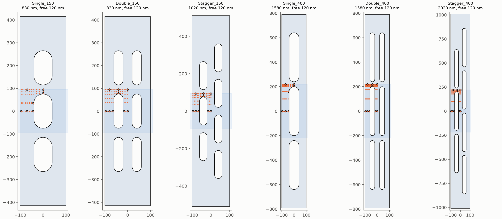
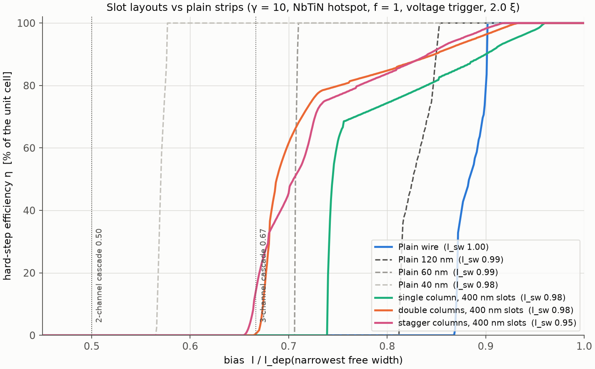
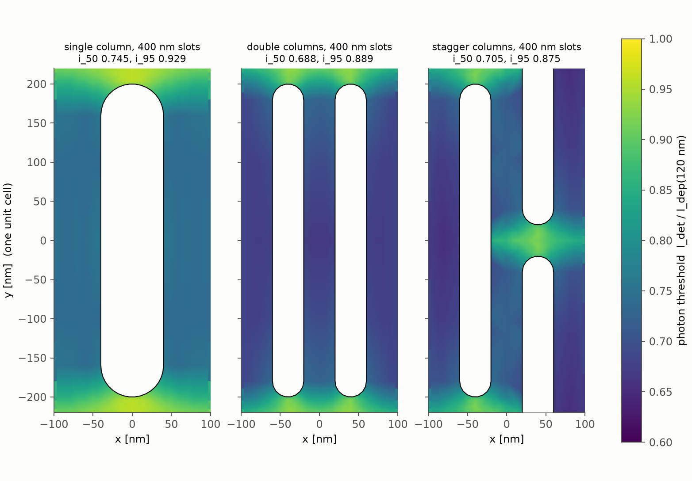
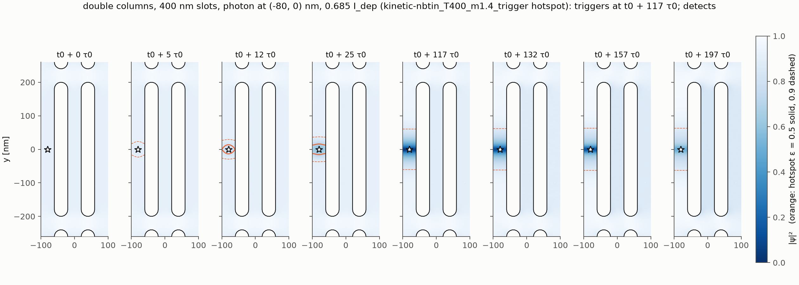
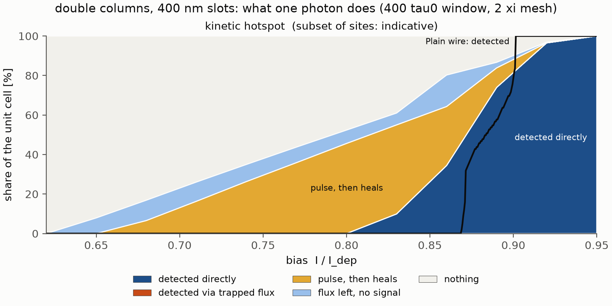
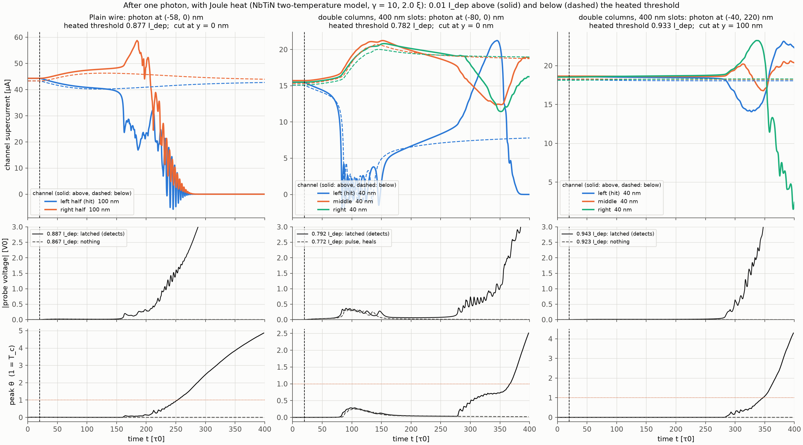
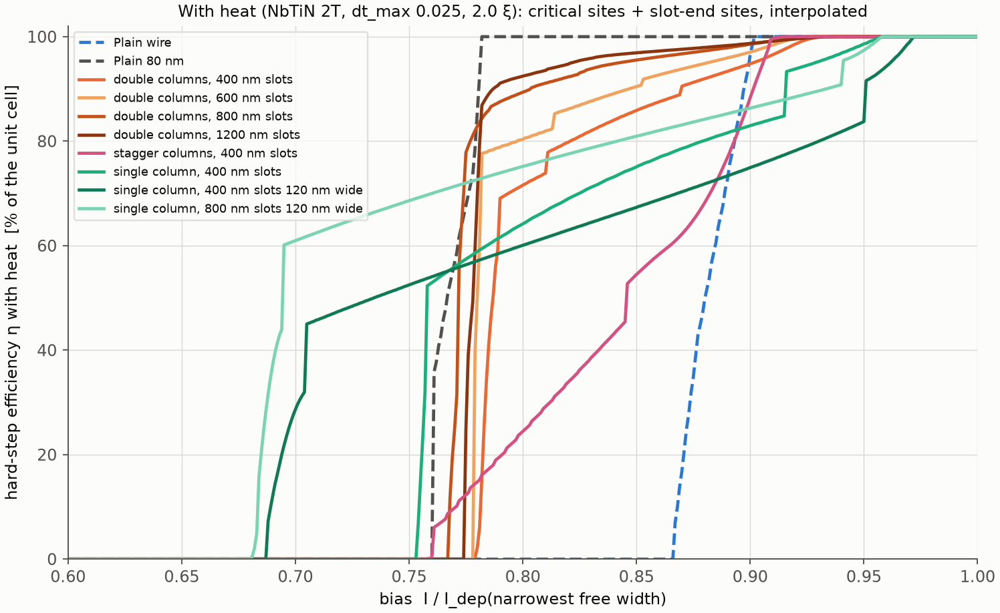
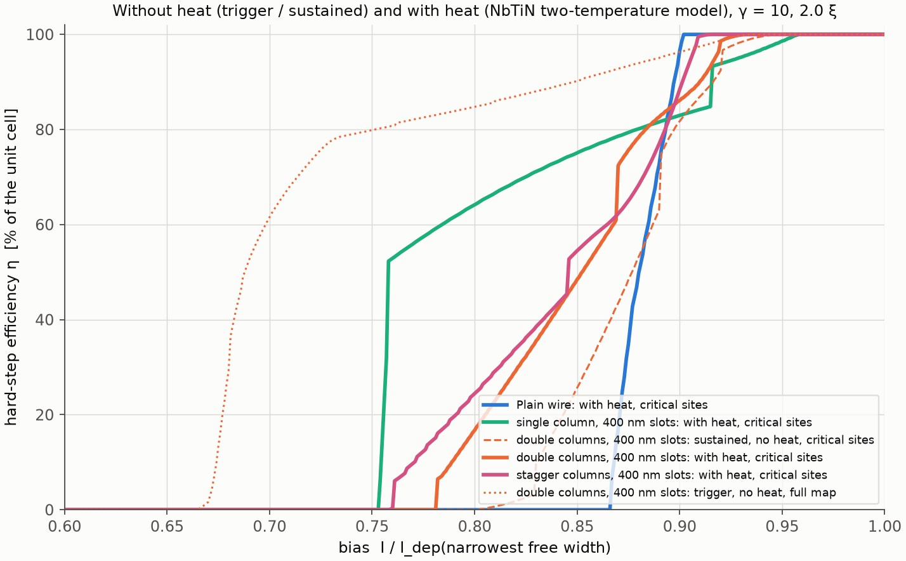

# Slot layouts: first results (7 Nov 2026)

Three fabrication-friendly slot layouts in a 200 nm, 9 nm NbTiN strip, against plain strips. Model and method:
[methods.md](methods.md). Everything here uses preset `nbtin` (γ = 10, measured NbTiN hotspot times, settled start),
the kinetic hotspot at f = 1 and a 400 τ0 window. Biases are in units of I_dep of the narrowest free cross-section:
120 nm (60.6 µA) for every slot layout, and the strip width for the plain strips. Dark I_sw is taken from the
sustained criterion.

Scripts: `run_slots.sh` (the pipeline), `slot_analysis.py` (tables and figures, `results/slot_analysis.txt`),
`mesh_check.py` (length and mesh), `snapshots.py`, `fluxtrap.py`, `heat_check.py`.

## Summary

> **Correction, 7 Nov 15:00.** The first heated results (computed in the night of 6–7 Nov) used the solver's old
> time step, dt_max 0.2. That step leaves a local instability at single small mesh cells, which the heat model turned
> into a permanent hot spot that seeded latching away from the photon (methods.md §5). Everything with heat below is
> recomputed with dt_max 0.025 (`run_heat2.sh`, `results/heat/check_dt0.025.csv`). The superseded numbers are kept
> in §8b. Results without heat are not affected (≤ 0.003, `dt_check.py`).

1. **400 nm slots, not 150.** With 150 nm slots the channels never reach the cascade. With 400 nm the double and
   staggered columns' channels detect 0.10–0.15 lower (§2).
2. **The channels work as a SNAP-like cascade.** A channel photon makes the hit channel dump its current into the
   others. Without heat, the voltage trigger fires at about max(1 − w_channel/w_free, threshold of a plain strip of
   the channel width): 0.67 for three 40 nm channels, 0.75 for two 60 nm channels. The 200 nm wire needs 0.87–0.90
   (§3).
3. **Without heat, that cascade usually heals.** In the double and staggered columns the device returns to zero
   voltage with 2–5 flux quanta trapped in the slots. Only from 0.80–0.83 does it stay resistive, so the two criteria
   are 0.15 apart (§6, §7).
4. **With Joule heat (measured NbTiN two-temperature parameters), a second switching event latches.** The double
   column's channels detect at 0.78, between the two bounds and 0.10 below the plain wire (0.87–0.90). The bridge
   rows stay where they were without heat (0.87–0.93), above the plain wire's worst site (0.90). With 400 nm slots
   the bridge rows and slot ends are too much of the cell, and the plateau is a no-go (§8).
5. **Optimisation within the fabrication limits (every feature ≥ 40 nm): longer slots.** Heat does not change the
   channel or bridge thresholds with slot length. Longer slots only shrink the share of bridge rows, and that is
   enough. With heat, critical sites plus slot-end sites, against the plain wire's i_95 of 0.899:
   - 600 nm slots: i_95 0.881 (+0.018);
   - 800 nm slots: 0.862 (+0.037); its full heated map (65 sites) gives **0.842 (+0.057)**, i_50 0.771, and 89 % of
     the cell detecting at 0.80, where the plain wire detects nowhere;
   - **1200 nm slots: 0.842 (+0.057), with i_50 0.778 against 0.880 (+0.10).** Its full heated map gives
     **i_95 0.821 (+0.078)** and 92 % of the cell detecting at 0.80.
   The bridge rows themselves stay at about 0.93: a few per cent of the cell still needs more bias than the plain
   wire (i_max). Two 40 nm channels (a 120 nm slot) detect lowest (0.68–0.69), but their bridge rows are blind (0.95–
   0.97). Edge notches at the bridge rows: §10.
6. **Caveats:**
   - The heat parameters are estimated; there is no noise or circuit, and the window is 400 τ0.
   - All of this is at 2.0 ξ. At 1.4 ξ the bridges came out 0.01–0.03 higher (first heated run, §8b).
   - Below threshold, trapped flux makes the layouts history-dependent.
   - The slot-length result comes from critical and slot-end sites, not full maps.

## 1 · The layouts

| Layout | Cross-section at a slot | Channels | Cascade limit 1 − w_ch/w_free |
| --- | --- | --- | --- |
| single column | 60 \| slot 80 \| 60 nm | 2 × 60 nm | 0.50 |
| double column | 40 \| 40 \| 40 \| 40 \| 40 nm | 3 × 40 nm | 0.67 |
| staggered double | as double; the right column is shifted by half a period | 3 × 40 nm | 0.67 |

All have semicircular slot ends, 40 nm bridges between consecutive slots, and a free width of 120 nm. The slots are
150 or 400 nm long (ends included).

**Shortened strips.** A device holds the central slot with one neighbour on each side (two for the shifted column),
plus 150 nm of plain lead to each terminal: 1.58 µm for 400 nm slots (2.02 µm staggered), 0.83 µm for 150 nm. On
the double column, `mesh_check.py` found these reproduce the 2 µm strip within 0.011 I_dep at 1.4 ξ. A 2.0 ξ mesh
stays within 0.019 (channel sites within 0.005) and runs 6–8× faster. Grading the mesh in the leads gains only
1.2–1.7×, no more than shortening, because the finest cells set the time step. The maps below are at 2.0 ξ; §5
checks them at 1.4 ξ.

## 2 · Slot length: 400 nm, clearly

Critical sites at 2.0 ξ, 150 vs 400 nm slots (`results/maps150/`):

| Layout | channel sites | bridge sites | dark I_sw |
| --- | --- | --- | --- |
| single | 0.765–0.808 → 0.745–0.756 | 0.94–0.98 → 0.92–0.96 | 0.993 → 0.981 |
| double | 0.780–0.818 → 0.665–0.681 | 0.90–0.94 → 0.87–0.93 | 0.985 → 0.981 |
| staggered | 0.765–0.770 → 0.654–0.664 | 0.88–0.91 → 0.86–0.91 | 0.946 → 0.950 |

With 150 nm slots the channels never reach the cascade limit. A channel segment of 150 nm between two bridges is too
short: the current pushed out of a blocked spot gets back into the same channel at the next bridge, so the other
channels never carry the full diverted current. With 400 nm the channel thresholds of the double and staggered
columns fall by 0.10–0.15, onto the cascade limit. Longer slots also make the bridges a smaller fraction of the
area: 9 % of the cell length at 400 nm, 21 % at 150 nm.

## 3 · Efficiency and maps (400 nm slots)

| Device | dark I_sw | i_10 | i_50 | i_95 | i_max | η(0.70) | η(0.80) | η(0.90) |
| --- | --- | --- | --- | --- | --- | --- | --- | --- |
| plain 200 nm | 0.997 | 0.870 | 0.884 | 0.901 | 0.901 | 0 % | 0 % | 79 % |
| plain 120 nm | 0.985 | 0.813 | 0.826 | 0.852 | 0.853 | 0 % | 0 % | 100 % |
| plain 60 nm | 0.987 | 0.706 | 0.707 | 0.709 | 0.709 | 0 % | 100 % | 100 % |
| plain 40 nm | 0.977 | 0.567 | 0.570 | 0.576 | 0.576 | 100 % | 100 % | 100 % |
| single column | 0.981 | 0.740 | 0.745 | 0.929 | 0.960 | 0 % | 74 % | 90 % |
| double column | 0.981 | 0.674 | 0.688 | 0.889 | 0.933 | 62 % | 85 % | 96 % |
| staggered | 0.950 | 0.664 | 0.705 | 0.875 | 0.919 | 45 % | 84 % | 98 % |

**The channels work as a cascade.**
- The channel sites of the double and staggered columns sit at 0.654–0.702, on the three-channel limit
  1 − 40/120 = 0.667.
- A 40 nm strip alone detects at 0.57, so in a 40 nm channel the photon is never what limits detection. The
  limit is whether the other two channels can take the diverted current.
- The single column's channels sit at 0.740–0.756: above both its cascade limit (0.50) and a plain 60 nm strip
  (0.71). There, the 60 nm channel's own detection is the limit, raised a little because the hotspot can also leak
  sideways into the bridge rows.
- Rule of thumb: **channel threshold ≈ max(cascade limit, threshold of a plain strip of the channel width)**.

**The onset gain is large.**
- Against the plain 200 nm wire (same footprint): i_50 is lower by 0.20 (double), 0.18 (staggered) and 0.14
  (single).
- Against the plain 120 nm strip (same I_c): lower by 0.14, 0.12 and 0.08.
- That is 3–5× the best onset gain of the first phase (+0.04–0.05 for the zipper and the 30 nm slot column at γ = 10).

**The bridge rows set the plateau.**
- Where consecutive slots meet, the full 200 nm cross-section carries the current at 120/200 of the channel
  density. Photons there need 0.87–0.93 (double) and 0.92–0.96 (single).
- The bridges are 9 % of the cell length, but with the slot ends they make up the slow tail of η. Against the
  200 nm wire, i_95 is +0.012 (double) and +0.027 (staggered), both below the 0.03 go margin.
- Against the 120 nm strip, the plateau is worse (−0.02 to −0.08).
- Staggering spreads the bridge row over two half-rows and leaves less area above 0.90: 2 % (staggered), against
  4 % (double) and 10 % (single).

**The staggered column switches earlier in the dark** (0.950 vs 0.981). Its current crowding at the slot ends is
the highest of the three (peak sheet current 1.79 × the uniform value, against 1.73–1.74). Every device switches
at the same local sheet current, about 515–535 µA/µm. So staggering trades about 0.03 of dark I_sw for a smaller
insensitive tail.

**The single column's bridge rows sit at the dark-switching edge.** Three bridge sites read exactly 0.960 with
t = 55 τ0: the settled start failed there. At 0.965 I_dep this device creeps for hundreds of τ0 and switches at
about 800 τ0 with γ = 10 dynamics (it switches by 200 τ0 with γ = 1). So its long-time dark I_sw is about 0.96, and
those sites do not detect below dark switching.

**Weak photons and latency.**
- Selectivity, i_det(f) − i_det(1) at f = 0.35: +0.16 to +0.22 for the slot layouts, against +0.08 (200 nm wire)
  and +0.11 (120 nm). Weaker photons need clearly more bias, as in narrow strips.
- Detection in the channels is faster: a median of 160 τ0 after the photon (double, staggered), against 290 τ0 for
  the 200 nm wire.

## 4 · What this means (without heat; see §8 for heat)

- **The layouts behave like a superconducting nanowire avalanche photodetector (SNAP) folded into one strip.** The
  40 nm channels give narrow-wire sensitivity, and the cascade sets the bias at 1 − 1/n for n channels. A real SNAP
  needs a series inductor to keep the avalanche from latching; in this model the current source plays that role.
  For real devices this is the next thing to check (§7).
- **Design levers suggested by the cascade picture:**
  - More channels raise the cascade limit (1 − 1/n). Fewer, narrower channels lower it, but the channels must stay
    narrow enough to detect alone: about 0.57 at 40 nm and 0.71 at 60 nm.
  - Expected, not simulated: two 40 nm channels (a single column in a 120 nm strip) have a 0.50 cascade limit and
    a 0.57 local threshold, so they should detect at about 0.57.
  - The bridge rows and slot ends are the remaining insensitive area. Longer slots (fewer bridge rows per length)
    and shorter bridges shrink it. Staggering spreads it out.
- **Caveats** ([methods.md](methods.md) §6):
  - No noise, so the dark I_sw is an instability current, not a dark-count rate. Every slot end crowds the current
    to about 1.75× the uniform value, and real dark counts come from such places. The slot layouts switch at the
    same local sheet current as plain strips here, but their real dark-count onset will depend on rim quality.
  - The absolute photon scale is uncalibrated.
  - These are 2.0 ξ maps.

## 5 · Mesh check: 1.4 ξ at the critical sites

| Device | dark I_sw 1.4 ξ (2.0 ξ) | critical sites: 1.4 − 2.0 ξ, mean (range) | channel sites at 1.4 ξ |
| --- | --- | --- | --- |
| plain 200 nm | 1.007 (0.997) | +0.008 (+0.006 … +0.009) | 0.877–0.910 |
| single column | 1.001 (0.981) | +0.006 (−0.007 … +0.019) | 0.744–0.754 |
| double column | 0.997 (0.981) | +0.011 (+0.003 … +0.016) | 0.675–0.686 |
| staggered | 0.962 (0.950) | +0.005 (−0.005 … +0.017) | 0.657–0.667 |

The 2.0 ξ maps are about 0.01 low overall, slightly more at the bridges, which sit next to dark switching. The
channel sites stay on the cascade limit at 1.4 ξ, and the order of the devices and their gains over the plain wire do
not change. Single-column bridge sites at 1.4 ξ: 0.973 and 0.979, again at the dark-switching edge.

## 6 · Snapshots: what a detection looks like

Other devices: `docs/fig/snapshots_kinetic-nbtin_T400_m1.4_trigger_<device>.png`.

- **Plain 200 nm wire (0.896 I_dep):** after about 150 τ0 the hit half loses its current, and from about 200 τ0 the
  whole strip is resistive. The voltage oscillates around 1 V0 until the window ends: a sustained switch.
- **Slot layouts:** the hit channel's current collapses at 110–170 τ0 after the photon, and the other channels take
  it over, as the cascade picture says. Then 4–5 phase slips cross the hit channel (voltage peaks of 0.2–0.5 V0), and
  the device goes **back to zero voltage**. The current stays redistributed: in the double column the hit channel
  carries 6.3 µA instead of 13.5 µA, and the other two carry 16.6 and 17.3 µA. The difference circulates around the
  slots as **trapped flux**. Below threshold (dashed) the same redistribution happens with fewer slips and no trigger.
- **So in these layouts the voltage-trigger "detection" is a short burst of phase slips that ends in a trapped-flux
  state, not a resistive state.** This is the behaviour of a SNAP-type cascade with an ideal current source: once the
  hit channel has dumped its current, the other channels carry the full bias below their own switching current, so
  they stay superconducting.
- **Whether a real device registers this depends on what the model leaves out:**
  - Each slip dissipates I·Φ0, about 0.5 eV at 40 µA, so a 4–5 slip burst is 2–3 eV, two to three 1550 nm photons.
    The electro-thermal check of the first phase found that such bursts heated strips into a normal domain at most
    sites.
  - In a real readout the series kinetic inductance and the 50 Ω load also matter.
  - The sustained criterion would reject these events. The flux scans (§7) measure how far apart the two criteria
    are for the slot layouts.

## 7 · Flux trapping and the second criterion

`fluxtrap.py scan` runs every critical site at fixed biases, 0.50–0.95 I_dep in steps of 0.03, without heat. It
classifies each run (2.0 ξ, `results/flux/`):
- **clean**: nothing happens;
- **trapped**: flux is left in the slots with no voltage signal;
- **transient**: the voltage trigger fires, then the device heals;
- **direct / via_trap**: the device switches and stays resistive (the sustained criterion).

| Site | trigger (hitmap) | first trigger in the scan | sustained switch | state just below |
| --- | --- | --- | --- | --- |
| double, edge channel (−96…−64, 0) | 0.670–0.681 | 0.68 | **0.83** | healed, −3 quanta in the right centre slot |
| double, centre channel (0, 0), (−16, 0) | 0.665–0.670 | 0.68 | **0.80–0.83** | healed, ±2…5 quanta in both centre slots |
| double, bridge row (−40…0, 204–220) | 0.90–0.93 | 0.92–0.95 | 0.92–0.95 | clean |
| staggered, edge channel (−96…−64, 0) | 0.654–0.664 | 0.68 | **0.83** | healed, −4 quanta in each of two right-column slots |
| staggered, centre (0, 0), (−16, 0), beside a right-column bridge | 0.856–0.862 | 0.86 | 0.89 | healed, +3…5 / −2…−3 quanta |
| staggered, left bridge row | 0.86–0.91 | 0.86–0.92 | 0.89–0.92 | clean or trapped ±2 |
| single, channel (−96…−44, 0…160) | 0.745–0.756 | 0.74–0.77 | **0.80** | healed, −4…−5 quanta in the centre slot |
| single, bridge row | 0.92–0.96 | 0.92 to > 0.95 | 0.92 to > 0.95 | clean |

- **Without heat the two criteria are far apart in the channels:** 0.15 I_dep (double, staggered) and 0.05 (single). This is
  unlike the plain wire (no gap) and the first phase's devices at γ = 10.
- **In between, a photon in a channel leaves 2–5 flux quanta in the slots beside it.** The slots are 400 nm long and
  can hold several. In the double column the flux sits in both centre slots with opposite signs (e.g. [+5, −5]):
  the current circulates around the slot pair and keeps the hit channel's current low.
- Sustained efficiency without heat (critical sites, 0.03 bias steps): double column i_10 / i_50 / i_95 =
  0.830 / 0.877 / 0.920, staggered 0.837 / 0.890 / 0.918, single column 0.800 / 0.800 / 0.943. The plain 200 nm wire is 0.870 / 0.884 / 0.901. So **without heat, the onset gain shrinks to
  0.04–0.08 and the plateau is no better**.
- **Memory.** Below the sustained threshold every channel photon changes the device: the hit channel carries less
  current and the others more. A later photon finds a different device, more sensitive in the loaded channels and
  less in the unloaded one, as long as the flux stays. In this deterministic model it stays until the next switching
  event. In a real film, thermal activation over the slot-to-edge barrier would let it out.

## 8 · With heat

`heat_check.py` bisects the threshold with the electro-thermal TDGL (`snspd/thermal.py`) at every critical site.
Detection is a single criterion there: still resistive at the end of the 400 τ0 window. Heat model "NbTiN 2T":
electrons and phonons separately, with the values measured on 9 nm NbTiN (η = 1.22, τ_EP = 27 τ0,
c_e/c_ph = 0.16, escape 530 τ0). dt_max 0.025, 2.0 ξ, `results/heat/check_dt0.025.csv`.

**What a heated detection looks like (double column, channel photon).**
1. The cascade burst comes first (80–150 τ0 after the photon): the hit channel dumps its current with a few slips,
   the peak temperature reaches θ ≈ 0.3, and the device heals.
2. The hit channel then slowly takes current back.
3. From about 280 τ0 a second switching event starts. Above 0.78 I_dep the heat holds it as a growing normal domain
   (θ > 1). At 0.772 only the first burst happens.
4. The plain wire and the bridge sites switch and latch in one event.

| Layout, with heat | channel sites | slot-end zone | bridge rows |
| --- | --- | --- | --- |
| plain 200 nm wire | 0.866–0.902 (all sites) | | |
| double, 400 nm slots | 0.782–0.785 | 0.779–0.828 | 0.870–0.933 |
| double, 600 nm | 0.779–0.782 | 0.779–0.831 | 0.852–0.926 |
| double, 800 nm | 0.768–0.772 | 0.771–0.824 | 0.842–0.923 |
| double, 1200 nm | 0.775–0.782 | 0.778–0.824 | 0.842–0.930 |
| staggered, 400 nm | 0.757–0.761 | | 0.845–0.916 (centre beside the other column's bridge: 0.86–0.87) |
| single, 80 nm slot | 0.754–0.757 | | 0.916–0.958 |
| single, 120 nm slot, 400 / 800 nm | 0.687–0.705 / 0.680–0.694 | | 0.951–0.972 / 0.940–0.958 |
| plain 80 nm (reference for the 120 nm slots) | 0.761–0.782 (all sites) | | |

| With heat (critical + slot-end sites, interpolated) | i_10 | i_50 | i_95 | i_max | plateau gain vs plain wire |
| --- | --- | --- | --- | --- | --- |
| plain 200 nm wire | 0.868 | 0.880 | 0.899 | 0.902 | |
| double, 400 nm | 0.782 | 0.787 | 0.901 | 0.933 | −0.002 |
| double, 600 nm | 0.778 | 0.780 | 0.881 | 0.926 | +0.018 |
| double, 800 nm | 0.769 | 0.772 | 0.862 | 0.923 | +0.037 |
| **double, 800 nm, full map (65 sites)** | **0.768** | **0.771** | **0.842** | 0.926 | **+0.057** |
| **double, 1200 nm, full map (65 sites)** | **0.775** | **0.778** | **0.821** | 0.937 | **+0.078** |
| **double, 1200 nm** | 0.775 | **0.778** | **0.842** | 0.930 | **+0.057** |
| staggered, 400 nm (critical sites) | 0.771 | 0.845 | 0.906 | 0.916 | −0.007 |
| single, 80 nm slot (critical) | 0.754 | 0.757 | 0.928 | 0.958 | −0.029 |
| single, 120 nm slot, 800 nm (critical) | 0.684 | 0.694 | 0.940 | 0.958 | −0.041 |

- **Heat moves the channels, not the bridges.** With heat the channels of every double and staggered layout detect
  at 0.76–0.78, between the trigger (0.60–0.68) and the sustained bound (0.80–0.83), about 0.10 below the plain wire.
  The bridge rows keep their unheated values (0.84–0.93): a bridge photon switches in one event, so heat adds
  nothing there.
- **Slot length changes only the area.** Channel, slot-end and bridge thresholds are nearly the same for 400–1200 nm
  slots. What changes is the share of the cell taken by bridge rows: 9 % at 400 nm, 4.8 % at 800 nm and 3.2 % at
  1200 nm. Once it drops well below 5 %, i_95 falls into the slot-end zone (0.80–0.83) and the plateau test passes.
- **What does not pass: i_max.** The bridge-row centres (0.92–0.93) still need more bias than any point of the plain
  wire (0.902): a few per cent of the cell, which the 95 % criterion tolerates and a 100 % criterion would not.
- **The two-channel layouts** (a 120 nm slot, 40 | 120 | 40) have the most sensitive channels of all (0.68–0.69). But
  their bridge rows carry only 40 % of the channel current density and are blind up to dark switching, so they fail
  the plateau.

## 8b · Superseded: the first heated results (dt_max 0.2)

`heat_check.py` bisects the threshold with the electro-thermal TDGL (`snspd/thermal.py`) at every critical site.
Detection is a single criterion there: still resistive at the end of the window. Heat model "NbTiN 2T": electrons
and phonons separately, with the values measured on 9 nm NbTiN (η = 1.22, τ_EP = 27 τ0, c_e/c_ph = 0.16, escape
530 τ0). As a check, the one-temperature model (η = 0.59) at two sites gives 0.698 vs 0.712 (double, (−80,0)) and
0.877 vs 0.877 (plain wire).

| Site | with heat | trigger (no heat) | sustained (no heat) |
| --- | --- | --- | --- |
| plain wire (−96,0) / (−58,0) / (0,0) | 0.866 / 0.877 / 0.902 | 0.871 / 0.877 / 0.901 | same |
| double, edge channel (−96…−64, 0) | 0.712–0.740 | 0.670–0.681 | 0.83 |
| double, centre channel (−16,0), (0,0) | 0.778–0.782 | 0.665–0.670 | 0.80–0.83 |
| double, bridge row (4 sites) | **0.842–0.877** | 0.869–0.933 | 0.89–0.95 |
| staggered, edge channel | 0.722–0.750 | 0.654–0.664 | 0.83 |
| staggered, centre / bridge rows | 0.838–0.912 | 0.856–0.914 | 0.89–0.92 |
| single, channel (4 sites) | 0.754–0.757 | 0.745–0.756 | 0.80 |
| single, bridge row | 0.916–0.958 | 0.917–0.960 | 0.92 to > 0.95 |

| Critical sites, interpolated | i_10 | i_50 | i_95 | i_max |
| --- | --- | --- | --- | --- |
| plain wire, with heat | 0.868 | 0.880 | 0.899 | 0.902 |
| double column, with heat | 0.740 | 0.810 | **0.853** | **0.877** |
| **full maps:** plain wire, with heat (8 sites) | 0.863 | 0.884 | 0.902 | 0.902 |
| **full maps:** double column, with heat (63 sites) | 0.688 | **0.740** | **0.851** | **0.877** |
| full maps: double column, trigger, no heat | 0.674 | 0.688 | 0.889 | 0.933 |
| staggered, with heat | 0.751 | 0.838 | 0.908 | 0.912 |
| single column, with heat | 0.754 | 0.757 | 0.928 | 0.958 |

- **Heat puts the slot layouts between the two bounds, close to the trigger.** In the channels the threshold is
  0.00–0.11 above the trigger and 0.02–0.12 below the sustained threshold (single column: at the trigger). The four or five phase slips of the
  cascade burst heat the hit channel enough to hold a normal domain at a lower bias than the bare TDGL needs.
- **In the double column heat also lowers the bridge rows, by 0.02–0.07.** A bridge photon starts slips that heat
  the bridge and the channel ends next to it. So the double column's worst site (0.877) is below the plain wire's
  (0.902). The staggered column's bridges move by at most 0.02 and the single column's not at all.
- **Double column: go on the plateau.**
  - Full heated map (63 sites, `results/heat/check.csv`): i_10 / i_50 / i_95 / i_max = 0.688 / 0.740 / 0.851 /
    0.877, against 0.863 / 0.884 / 0.902 / 0.902 for the heated plain wire.
  - Gains: +0.175 / +0.144 / +0.051 / +0.025.
  - The channel values scatter by about ±0.04 between neighbouring sites: whether a few slips heat into a latched
    domain is sensitive to details.
  - **At 1.4 ξ the plateau gain shrinks to the margin.** On the critical sites with heat at 1.4 ξ, the plain wire's
    thresholds barely move (0.866 / 0.877 / 0.909 at (−96,0) / (−58,0) / (0,0)). The double column's channel sites
    stay low or fall (0.705–0.733), but its four bridge sites rise by 0.01–0.03 (0.873–0.891).
  - Critical-site estimate at 1.4 ξ: i_95 0.876 against 0.906 (+0.030, exactly the margin), i_max 0.891 against
    0.909 (+0.018). At 2.0 ξ on the same sites it was +0.046.
  - So the go is real at 2.0 ξ and **borderline at 1.4 ξ**. The bridge rows decide it, which makes them the target
    of any optimisation (§10).
- **Limits:** the heat parameters are linearised at T_c and estimated (a factor of ~2 on η moved thresholds by
  ≤ 0.03 in the first phase). There is no circuit: a latched domain here would, in a real device, push the current
  into the load, which is the detection pulse.

## 9 · Optimisation within the fabrication limits

The constraint: every feature at least 40 nm (slot widths, channels, bridges, hole-to-edge distance). Within it, the
heated results point to one lever and rule out three others.

| Variant | Idea | Result with heat (2.0 ξ) |
| --- | --- | --- |
| **longer slots (600 / 800 / 1200 nm), double column** | fewer bridge rows per length | channels, slot ends and bridges keep their thresholds; the bridge share falls from 9 % to 3 %; i_95 0.881 / 0.862 / **0.842** against 0.899 for the plain wire: **passes from 800 nm** |
| two 40 nm channels (40 \| 120 \| 40) | lower cascade limit (0.50) | most sensitive channels (0.68–0.69), but bridge rows at 40 % of the channel current density are blind (0.94–0.97): fails |
| staggered columns | spread the bridge rows | channels 0.76, bridges 0.85–0.92; dark I_sw 0.95 (crowding at slot ends); i_95 0.906: fails at 400 nm |
| edge notches at the bridge rows (radius 20 nm) | narrow the bridge rows towards the free width | **dark I_sw falls to 0.865** (current crowding around the notches): the device switches in the dark before its bridge rows detect; fails |

**Recommendation: the double column with long slots, 40 nm everywhere, 800–1200 nm slots.**
- Fabrication: it is the original double column with longer slots, no new feature sizes. Long, narrow slots are easy
  to write, and the 40 nm channels are 800–1200 nm long.
- With heat it turns on 0.10 I_dep below the plain 200 nm wire (i_50 0.77–0.78 against 0.88) and reaches 95 % of the
  cell 0.04–0.06 lower.
- The price: the bridge-row centres, 3–5 % of the area, still need 0.92–0.93. That is above any point of the plain
  wire, but below dark switching (0.97–0.98).
- Full heated maps (65 sites each) confirm it: i_95 0.842 (800 nm) and 0.821 (1200 nm) against 0.899, and 89 / 92 %
  of the cell detecting at 0.80 I_dep, where the plain wire detects nowhere. The 1.4 ξ check of the bridges
  (0.01–0.03 higher at 1.4 ξ in the first heated run) is still to do; it moves i_max more than i_95.
- Measured devices would need the long channels to be uniform: a constriction in one 40 nm channel sets the dark
  count of the whole device.

## 10 · Relative to dark switching

**Why the tables use I_dep, and why that is not the whole story.**
- I_dep (j_dep × narrowest free width) is fixed by the film parameters, so it is the same for every run of a device.
  The simulated dark I_sw is not: it moved with γ (plain wire 0.970 → 1.007), the window (single column 0.98 in
  400 τ0, switching at 0.965 after ~800 τ0) and the mesh (0.997 → 1.007). Ratios I_det / I_sw would mix those
  numerical shifts into the comparison, so the tables use I_dep.
- But a detector's figure of merit is how far the efficiency curve sits below where it counts in the dark, and that
  depends on the geometry through current crowding, not only the narrowest width. Every device here switches in the
  dark when the local sheet current reaches about 515–535 µA/µm. Peak over uniform sheet current: 1.04 (plain wire),
  about 1.73 (double), 1.79 (staggered); the notches dropped dark I_sw to 0.865.

| With heat | dark I_sw (no heat) | i_50 | i_95 | margin I_sw − i_95 | i_50 / I_sw | i_95 / I_sw |
| --- | --- | --- | --- | --- | --- | --- |
| plain 200 nm wire | 0.997 | 0.880 | 0.899 | 0.098 | 0.883 | 0.902 |
| double, 800 nm | 0.970 | 0.771 | 0.842 | **0.128** | 0.795 | 0.868 |
| double, 1200 nm | 0.977 | 0.778 | 0.821 | **0.156** | 0.796 | 0.840 |
| staggered, 400 nm | 0.950 | 0.845 | 0.906 | 0.044 | 0.889 | 0.954 |

The long-slot double columns lose 0.02–0.03 of dark I_sw to crowding and gain 0.06–0.08 at the plateau, so they stay
ahead on this measure too.

**Limits of this comparison:**
1. **The model's I_sw is an instability current, not a dark-count rate.** Real dark counts are thermally activated
   vortex entry; the rate goes as (number of weak spots) × exp(−barrier / k_BT). Every slot end is a crowding spot,
   and a long device has hundreds of them where a plain wire has two straight edges. The dark-count onset can
   therefore fall further than the deterministic I_sw shows.
2. **Rims add defects.** Real 9 nm NbTiN strips switch at about 0.63 I_dep, limited by edges and constrictions, and
   slots add rim length.
3. **The dark I_sw above is without heat.** Heated dark runs at 0.60–0.75 I_dep did not latch, but the heated dark
   I_sw was not bisected.

## 11 · Next steps and open items (as of 9 Nov 2026)

**To confirm the result (long-slot double column):**
1. Heated dark I_sw for the plain wire and the 800 / 1200 nm double columns (3 bisections, ~1 h). Then redo the
   margin table of §10 against it.
2. Critical sites with heat at 1.4 ξ for Double_800 / Double_1200 and the plain wire. At 1.4 ξ the bridges came out
   0.01–0.03 higher in the first heated run; check how much of the plateau gain survives.
3. The heat-parameter spread: η × 0.5 and × 2, and the one-temperature model, at the double column's critical sites.
4. The plain 120 nm strip with heat: the same-I_c reference. Without heat its i_95 is 0.852, close to the 1200 nm
   double column's heated 0.821.
5. Add I_sw-relative columns and efficiency-vs-I/I_sw plots to `slot_analysis.py`, next to the I_dep ones.

**Physics still missing:**
6. **Dark-count rates:** a vortex-entry barrier estimate (GL saddle point, Vodolazov PRB 85, 174507) at a slot end
   against a straight edge, then rate ∝ number of weak spots × exp(−ΔF / k_BT). It needs a constrained relaxation
   that pyTDGL does not provide (methods.md, first-phase note).
7. **A series inductance and 50 Ω load**, as real SNAPs need to avoid latching, before comparing with measurements.
8. **Memory:** below threshold the slots keep 2–5 flux quanta. Second-photon runs from trapped states
   (`fluxtrap.py trapped`), and a flux scan of the long layouts.

**Design ideas not yet tried:**
9. Even longer slots (2–3 µm, in a longer strip). Gains are slowing (i_95 0.842 → 0.821 from 800 to 1200 nm) and
   should level off near the channel value, about 0.78–0.80, once slot ends and bridges drop below 5 % of the cell
   (slots of about 2.5 µm).
10. The notched layout (Double_400_n20) was stopped after its dark I_sw (0.865) ruled it out. Its photon thresholds
    are incomplete (3 of 12 sites, results/opt). Resume only if notches become interesting again, e.g. with smaller
    or rounder ones.

**Housekeeping:**
11. Nothing since the cleanup commit (f32b577) is committed: the slot code, scripts, results and these docs are
    uncommitted on `slot-geometries`.
12. Superseded result files (dt_max 0.2 with heat): `results/heat/check.csv` and `check_m1.4.csv`. The current ones
    are `check_dt0.025.csv`.
13. The solver default is now dt_max 0.025 (`snspd/sim.py`). The trigger maps in `results/maps`, `maps150`, `opt` and
    `flux` were run at 0.2; `dt_check.py` shows that is within 0.003 for results without heat.
